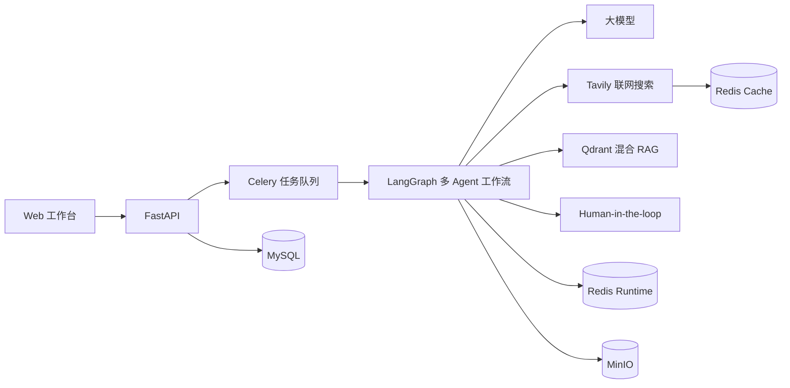
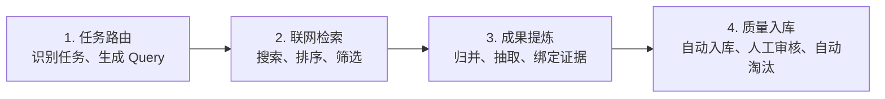
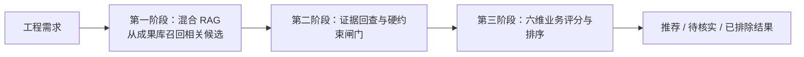
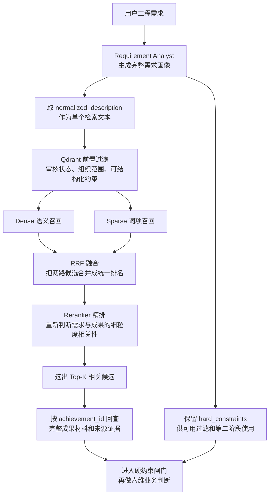
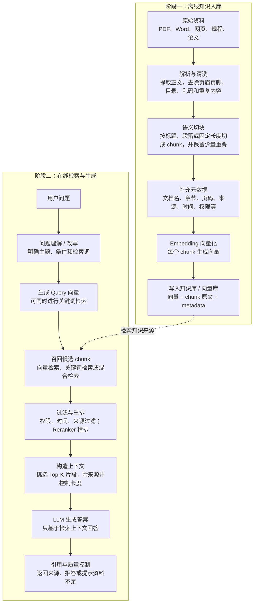
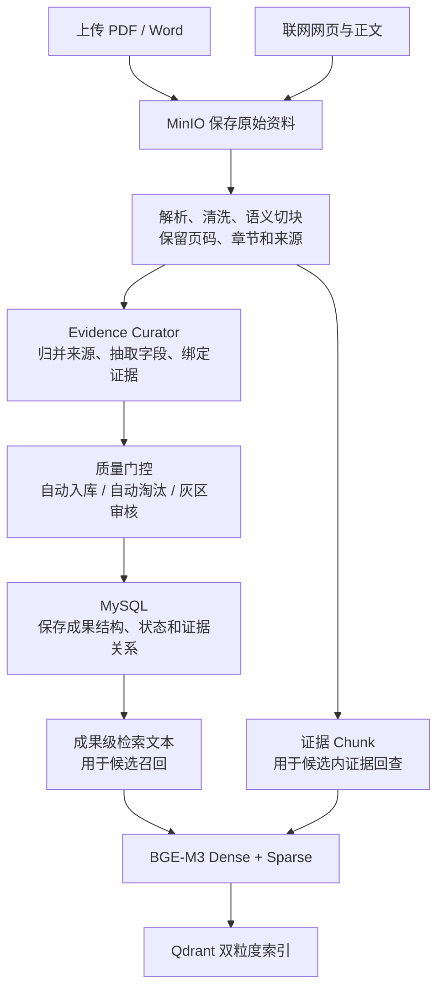
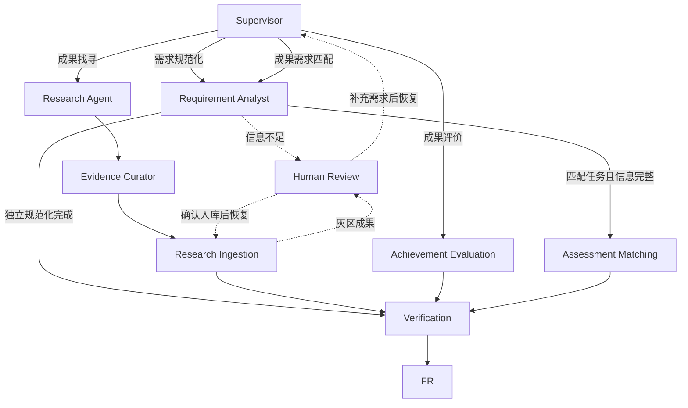

# HydroBridge 项目学习与面试手册（精简版）

> 本手册只把 **需求规范化、成果找寻、成果评价、成果需求匹配** 定义为业务功能。Supervisor、证据整理、运行级质量检查和报告生成属于多 Agent 工作流中的技术角色，不再作为业务功能单独介绍。

> 阅读约定：本文按照项目业务上准确、合理且自洽的设计讲解。判断一个流程是否正确，首先看它是否符合字段本身的语义和业务后果，例如“硬约束”一旦明确违反就必须退出推荐，而不能靠其他维度的高分抵消。

---

## 1. 项目介绍

### 1.1 项目是什么

HydroBridge 是一个面向水利科技成果转化的多 Agent 决策平台。它解决的不是普通聊天问题，而是把用户提出的水利工程问题转化为可执行、可观察、可暂停恢复并带有质量检查的工作流，最终完成需求规范化、成果找寻、成果评价和成果需求匹配。

项目的核心问题是：水利科技成果数量多、资料分散、描述不统一，而工程需求通常以自然语言表达，存在场景不清、约束缺失和评价标准不一致等问题。传统方式需要工作人员反复搜索资料、阅读成果、整理需求并凭经验判断适配关系，效率较低，过程也难以复盘。

项目希望建立一套相对标准的处理方式：

1. 先把模糊需求整理为结构化需求；
2. 从互联网或本地成果库找到相关成果；
3. 对单项成果进行独立评价；
4. 根据具体工程需求对候选成果进行匹配和排序；
5. 只在需求关键事实缺失和联网成果处于入库灰区时让人介入；Verification 发现问题时返回上游自动修订，而不是不断增加人工审批。

### 1.2 四大核心功能

| 功能 | 解决的问题 | 主要输出 |
| --- | --- | --- |
| 需求规范化 | 用户需求表达模糊，工程场景和约束不完整 | 结构化需求、缺失信息、检索词和澄清问题 |
| 成果找寻 | 成果资料分散在不同网站，搜索噪声大 | 带来源证据的候选成果、质量评分和入库分流结果 |
| 成果评价 | 单项成果缺少统一评价标准 | 六维得分、评价等级、优势、风险和改进建议 |
| 成果需求匹配 | 搜索相关不等于工程适用 | 候选排名、六维匹配分、推荐理由、差距和风险 |

### 1.3 总体架构



前端提供四大功能入口、人工审核、运行记录和系统状态。FastAPI 负责鉴权、业务接口和 SSE 事件；Celery 执行耗时任务；LangGraph 负责 Agent 编排；MySQL 保存业务事实；Redis 保存运行状态和缓存；Qdrant 提供成果级与证据 Chunk 级检索；MinIO 保存上传的 PDF/Word、网页快照、解析产物和最终报告。

### 1.4 技术栈

| 层次 | 技术 |
| --- | --- |
| 前端 | React、TypeScript、Vinext |
| API | Python、FastAPI、Pydantic、SQLAlchemy |
| Agent | LangGraph、LangChain、OpenAI-compatible Model Gateway |
| 检索 | Tavily、Qdrant、Dense/Sparse、RRF、Reranker |
| 数据 | MySQL、Redis Runtime、Redis Cache、MinIO |
| 异步 | Celery、Celery Beat |
| 测试 | Pytest、Ruff、ESLint、前端构建与渲染测试 |

项目中的模型可以替换。不同 Agent 的差异主要来自系统提示词、结构化 Schema、可用工具和图中的职责，而不是每个 Agent 必须使用不同的大模型。

---

## 2. 四大核心功能

### 2.1 需求规范化

需求规范化的目标，是把用户的一段自然语言描述整理成后续成果找寻和成果匹配可以直接使用的结构化需求。它不是编写一份“需求规范”文档，也不只是改写语句，而是识别业务目标、用户明确提出的可选硬约束、软偏好、检索词和关键缺失信息。

例如用户输入：

> 某北方农村供水工程冬季最低温度约为 -20℃，泵站主要依赖人工巡检，希望引入智能监测和故障预警技术；改造期间连续停水不得超过 2 小时，并优先考虑低成本、低维护方案。

系统会整理出类似以下信息：

```yaml
工程场景: 北方农村供水泵站
核心问题:
  - 人工巡检成本高
  - 低温环境下设备故障发现不及时
目标:
  - 实时监测泵组运行状态
  - 提前发现故障风险
已知条件:
  - 冬季最低温度约为 -20℃
硬约束:
  - 设备工作温度需覆盖 -20℃
  - 改造期间连续停水不得超过 2 小时
软偏好:
  - 成本较低
  - 维护简单
检索词:
  - 农村供水泵站智能监测
  - 泵组故障预警
  - 低温供水设备运维
```

实际执行时，Supervisor 先判断任务属于独立需求规范化，还是成果匹配前的需求侧处理，再调用同一个 Requirement Analyst。该 Agent 根据 Pydantic Schema 输出规范字段，包括标题、标准化描述、场景、问题、目标、已知条件、硬约束、软偏好、检索词、完整度和缺失字段。因此需求规范化既能作为单独功能使用，也会作为成果需求匹配的前置能力复用，代码中不是两套重复实现。

如果缺少会实质改变结果的工程对象或核心问题，或者用户已明确暗示存在“必须/不能”条件却表达不清，Requirement Analyst 会生成前端可直接渲染的澄清载荷。**没有硬约束本身是合法状态，不能为了填满 Schema 而强迫用户编一条。**澄清载荷包含已识别内容、需求完整度、每个待补字段、缺失原因和三条水利业务参考表达，并把 `next_step` 设置为 `human_review`。条件边将图路由到 Human Review 后，`interrupt()` 才真正保存检查点并暂停。用户提交补充内容后，系统使用原来的 `thread_id` 和 `Command(resume=...)` 恢复，更新 `user_message`，再由 Supervisor 和 Requirement Analyst 重新规范化。非关键偏好缺失不一定阻断，可进入探索性执行。

需求字段必须按语义分类：地点、工程对象和使用环境属于场景；已经客观存在的条件属于已知条件；用户明确表示“必须、不得、至少、不超过”的可判定条件才属于硬约束；成本低、维护方便等可权衡条件属于软偏好。模型负责理解和抽取，Schema 负责约束结构；关键表达含糊时必须让用户确认，不能为了填满字段而猜测。

需求规范化的关键价值有三点：

- 避免后续检索建立在错误或不完整的需求上；
- 把自然语言中的条件保留为结构化字段，供可实现的前置过滤和后续业务判断使用；
- 让用户看到系统如何理解需求，发现偏差时可以及时纠正。

面试时可以这样介绍：

> 需求规范化并不是简单改写 Prompt，而是把自然语言需求拆成工程场景、核心问题、目标、可选硬约束、软偏好和检索词。它既可以独立生成结构化需求，也复用于成果匹配的前置环节；如果会实质改变检索或匹配结果的关键字段不足，LangGraph 会以字段化表单让用户补充，再从原检查点继续执行。

### 2.2 成果找寻

成果找寻用于从开放互联网发现新的水利科技成果。它面对的数据更新快，但也存在重复链接、过期内容、营销网页和来源不可靠等问题，因此不能把 Tavily 返回的网页直接当成正式成果。

整个功能只需要记住四个大步骤：

> **任务路由 → 联网检索 → 成果提炼 → 质量入库**



**第一步：任务路由。**

这一阶段解决“用户想找什么，以及应该搜索什么”的问题，包含两个子步骤：

1. Supervisor 判断用户任务是否属于 `research`。它是工作流的意图路由节点，同时负责生成执行计划和选择下一个 Agent；
2. Research Agent 根据用户主题生成多组中英文 Query，从科技成果、论文、工程案例和不同术语角度扩大召回。

例如查找“泵站预测性维护成果”时，可以生成：

```text
泵站预测性维护科技成果
泵组故障诊断示范工程
水利泵站智能运维研究
pumping station predictive maintenance
```

多 Query 不是机械改写同一句话，而是解决同一技术存在不同名称、不同资料类型和中英文表达的问题。Query 可以由模型生成；模型不可用时，项目使用确定性模板降级。

**第二步：联网检索。**

这一阶段的目标是：**从大量网页中优先选出更相关、更可核验、且彼此不过度重复的候选。** 搜索排序只能降低噪声，不能仅凭域名或分数证明网页内容真实。只需要抓住四个子步骤：

1. **多路搜索——提高覆盖率。** 用上一阶段生成的多组 Query 分别调用 Tavily，覆盖不同名称、资料类型和中英文表达，降低漏检风险，但不承诺“找全”；
2. **融合排序——提高排名稳定性。** 先合并重复 URL，再用 RRF 融合不同 Query 的搜索排名。某个网页如果被多组 Query 反复命中，会获得更高的融合优先级，但 RRF 不等于相关性准确率保证；
3. **质量筛选——优先可核验来源。** 综合判断主题相关性、来源类型、时效性和页面类型，优先保留政府、高校、科研机构、论文、专利及工程案例，降低营销页、招聘页和无关新闻的权重。权威域名不能代替主题相关性和原文证据；
4. **多样化与正文获取——减少重复并获取可判断内容。** MMR 在“与 Query 的相关性”和“与已选结果的相似度”之间权衡，逐个选择既相关又不重复的网页；来源域名多样性可作为附加信号。随后对保留网页调用 Tavily Extract，取得正文供下一阶段整理。

时效性优先读取页面结构化元数据、官方发布日期、论文或专利日期，并保存日期来源；正文中出现的年份只能作为弱线索，不能直接当作发布日期。无法确认时标记 `unknown` 并降权或送审，不能让系统猜一个确定日期。

这里真正需要掌握的只有两个算法：

- **RRF 是“融合排名”**：解决多个 Query 各有一份搜索结果，最后怎样合成一份总排名；
- **MMR 是“控制重复”**：解决排名靠前的结果过于相似，怎样在相关性和多样性之间取得平衡。

因此，这一步可以概括为：

> **多 Query 扩大召回，RRF 融合排名，质量规则过滤噪声，MMR 控制重复，最后提取优质网页正文。**

**第三步：成果提炼。**

这一阶段解决“网页只是原始资料，怎样把网页整理成结构化候选成果”的问题，由 Evidence Curator 完成，包含三个子步骤。它做的是信息抽取和证据关联，不负责证明成果内容绝对真实：

1. **成果归并**：识别多个网页是否描述同一成果，将高校介绍、政府推广目录、论文和工程案例合并为“一项成果、多个来源”；
2. **结构化提取**：从正文中提取成果名称、完成单位、摘要、技术原理、应用场景、成熟度、优势、限制和量化指标；
3. **证据绑定**：为关键字段保留原文片段、来源 URL、支持类型和置信度，并标记缺失或冲突信息。

因此 Evidence Curator 不只是对网页做摘要。更准确的说法是：

> Evidence Curator 负责成果归并、结构化字段提取和字段级原文证据绑定。

这一步可以使用大模型理解网页语义，但输出受到 Pydantic Schema 约束，整理出的成果还必须经过下一步确定性质量门控，不会由模型直接决定入库。

**第四步：质量入库。**

这一阶段解决“整理后的候选是否达到当前入库规则，能不能进入正式成果库”的问题。系统按照六个维度计算 100 分质量分。质量分是可解释的门控信号，不是对成果真实性或工程效果的最终认证：

| 维度 | 分值 | 判断内容 |
| --- | ---: | --- |
| 相关性 | 20 | 是否真正符合用户的找寻主题 |
| 来源权威性 | 20 | 来源是否可信 |
| 信息完整性 | 20 | 名称、单位、原理、场景等字段是否完整 |
| 证据可追溯性 | 15 | 关键字段是否有原文和 URL 支撑 |
| 时效性 | 10 | 是否符合用户提出的时间范围 |
| 多来源一致性 | 15 | 同一字段在多个独立来源中是否相互支持；冲突值是否已标记并进入审核 |

评分前还会执行硬拒绝规则。缺少成果名称、来源 URL 或字段级证据，明确超出时间范围，完全不覆盖核心主题，或者全部属于低证据营销内容的候选，不能进入自动入库流程。

最终采用三段式分流：

| 分流 | 条件 | 处理方式 |
| --- | --- | --- |
| 自动入库 | 总分不低于 80，且没有明显风险 | 自动写入正式成果库 |
| 人工审核 | 总分不低于 60 且低于 80，或存在冲突、单位缺失、日期不明等风险 | LangGraph 暂停一次，用户批量勾选入库项 |
| 自动淘汰 | 总分低于 60，或命中硬拒绝规则 | 不进入正式成果库 |

一次人工审核最多展示质量分较高的 5 项灰区成果；超出上限的灰区项标记为 `deferred`，作为待处理线索保留，并非被自动判为低质。高分成果由系统自动处理，低分成果自动淘汰，人只负责最不确定的中间区域，避免全量人工审核成为瓶颈。

四个步骤可以用下表记忆：

| 大步骤 | 需要记住的内容 |
| --- | --- |
| 任务路由 | Supervisor 识别 `research`，Research Agent 生成多 Query |
| 联网检索 | 多 Query 扩大召回、RRF 融合排名、质量筛选、MMR 控制重复、Extract 获取正文 |
| 成果提炼 | 同一成果归并、结构化字段提取、原文证据绑定 |
| 质量入库 | 六维质量评分、高分自动入库、灰区人工审核、低分自动淘汰 |

面试时先说四个大步骤，面试官追问哪一步，再展开对应算法。完整表述可以是：

> 成果找寻主要分为四步。第一步是任务路由，Supervisor 识别 research 意图后，由 Research Agent 生成多组中英文 Query；第二步是联网检索，通过多 Query 扩大召回、RRF 融合排名、质量规则过滤噪声，并用 MMR 控制结果重复；第三步由 Evidence Curator 合并同一成果的不同来源，提取结构化字段并绑定原文证据；第四步进行质量门控，高质量成果自动入库，低质量结果自动淘汰，质量灰区通过 LangGraph Human-in-the-loop 批量审核。

一句话记忆：

> **路由决定找什么，检索筛出较优网页，提炼形成结构化候选，门控决定是否达到当前入库规则。**

### 2.3 成果评价

成果评价面向一项已经存在于成果库中的技术成果，回答“这项成果本身质量如何”。它不考虑某个具体工程需求，因此与成果需求匹配是两个不同功能。

用户在科技成果库打开成果详情，点击“智能评价”后，系统创建评价任务。Achievement Evaluation Agent 读取成果摘要、技术原理、成熟度、应用场景、量化指标、优势、限制和证据质量，形成六维评价。

| 评价维度 | 权重 | 主要依据 |
| --- | ---: | --- |
| 创新性 | 20% | 技术原理、技术优势和同类方案差异 |
| 有效性 | 20% | 量化指标和实际效果描述 |
| 成熟度 | 15% | TRL、示范应用和工程验证情况 |
| 证据质量 | 20% | 量化指标、检测报告、工程案例及其来源可追溯性 |
| 推广价值 | 15% | 适用场景、复制条件和推广范围 |
| 实施可行性 | 10% | 成本资料、限制条件和落地难度 |

项目定义的评价权重公式为：

```text
综合分 = 创新性 × 20%
       + 有效性 × 20%
       + 成熟度 × 15%
       + 证据质量 × 20%
       + 推广价值 × 15%
       + 实施可行性 × 10%
```

评价等级口径为：85 分及以上“优秀”，70 到 84.99 分“良好”，60 到 69.99 分“中等”，低于 60 分“待完善”。最终页面除了展示总分，还会展示维度得分、评分依据、优势、风险、缺失信息和改进建议。

评价链路按职责拆分：模型读取成果结构化材料和来源证据，根据统一 Rubric 输出六维分、逐维理由、引用证据和置信度；Pydantic 校验字段、类型和范围；后端根据固定权重重算总分，并由总分派生等级。证据不足时应明确列出缺失材料并降低置信度，不能用语言流畅度代替证据质量。

面试时可以这样介绍：

> 成果评价判断成果自身质量。模型按照统一 Rubric 给出创新性、有效性、成熟度、证据质量、推广价值和实施可行性六维判断，并为每一维绑定依据；后端统一重算总分和等级。结果不仅展示分数，还展示优势、风险、缺失材料和改进建议，使评价可以解释和复核。

### 2.4 成果需求匹配

成果需求匹配回答的是“某项成果是否适合当前工程需求”。一项成果自身评价很高，不代表它适用于所有项目。例如，某监测技术非常成熟，但如果必须长时间停水施工，就不适合要求不停水改造的农村供水项目。

匹配流程分为候选召回、硬约束闸门和六维业务排序三个阶段。



**第一阶段：混合 RAG 召回候选成果。**

第一阶段解决的不是“这项成果最终是否适用”，而是“成果库里有哪些成果值得进入下一轮判断”。这里不要把重点放在基础字段过滤上，它只是前置条件；真正有面试价值的是 Dense 召回、Sparse 召回、RRF 融合和 Reranker 精排。



这条链路可以按四个重点理解：

1. **需求结构化与检索输入**：Requirement Analyst 一次性生成完整需求画像，从中提取 `normalized_description` 作为检索文本；`hard_constraints` 是同一次规范化的结构化输出，不是让用户额外操作一次；
2. **Dense 语义召回**：使用 BGE-M3 等真实模型时，Dense 依赖向量相似度理解近义表达。例如需求写“减少人工巡检”，成果写“智能运维、异常预警、自动监测”，即使关键词不同也可能被召回；Hash 回退不具备同等级别的语义能力；
3. **Sparse 关键词召回**：Sparse 适合守住专业词、设备名、地区条件和硬性表达。例如“泵站、高寒地区、不停水施工、农村供水、堤防监测”这类词，可以补充 Dense 可能遗漏的精确词项；它仍只负责相关性召回，不负责证明约束满足；
4. **RRF 融合与 Reranker 精排**：Dense 和 Sparse 的原始分数不是同一种尺度，不能简单相加。RRF 不看原始分，而是看候选在不同召回结果里的排名，把两路结果融合成一份候选列表。真实 Reranker 再联合读取需求和成果文本，对候选做更细的相关性判断，提高更相关成果靠前的概率；Hash 回退只做词项覆盖启发式。

所以第一阶段最重要的一句话是：**Dense 负责找语义相近，Sparse 负责守住关键词，RRF 负责合并两路排名，Reranker 负责最后精排。**它输出的是“相关候选”，不是最终推荐结论。审核状态、组织范围和能直接结构化的约束应在检索前作为确定性 Filter 执行，不能依赖 Prompt 在召回之后补救。

### 补充：主流长文档 RAG 的完整流程

主流 RAG 可以分成两个彼此独立的阶段：**离线知识入库**和**在线检索生成**。离线阶段解决“如何把原始资料变成可检索知识”；在线阶段解决“用户提问时如何找对证据，并据此生成可信回答”。



可以把每一步理解为：

| 阶段 | 步骤 | 目的 |
| --- | --- | --- |
| 离线入库 | 解析与清洗 | 把 PDF、Word、网页等不同格式转成干净文本，减少目录、页眉、乱码等噪声进入检索库 |
| 离线入库 | 切块（chunking） | 让“一个检索单元”足够小且语义完整，避免一篇几十页文档只有一个平均语义向量 |
| 离线入库 | 向量化与 metadata | 为每个 chunk 建立语义索引，同时保留页码、章节、来源、权限等可过滤和可引用的信息 |
| 在线问答 | Query 理解与召回 | 将用户问题转换为更适合检索的表达，从大量 chunk 中先找回一批候选证据 |
| 在线问答 | 过滤、融合与重排 | 先排除无权限、过期或不相关资料；混合检索时融合多路结果，再用 Reranker 做细粒度排序 |
| 在线问答 | 上下文构造与生成 | 将少量高质量 chunk 连同来源交给大模型，使回答有依据、能引用，资料不足时避免编造 |

传统长文档 RAG 的核心链路可以压缩为：

```text
文档解析与清洗
→ 语义切块并补充元数据
→ 每个 chunk 向量化后写入向量库
→ 用户问题理解与向量化
→ 召回候选 chunk
→ 过滤、混合融合与 Reranker 精排
→ 将 Top-K 证据片段拼接为上下文
→ LLM 基于上下文生成带来源的答案
```

官方和主流文档里讲的 RAG，本质是“先检索，再生成”：先把资料写入向量库，用户提问时从知识库中检索相关内容，再把检索结果作为上下文交给大模型。OpenAI 的 [Retrieval](https://developers.openai.com/api/docs/guides/retrieval) 文档重点强调语义检索和向量库；Qdrant 的 [Hybrid Queries](https://qdrant.tech/documentation/search/hybrid-queries/) 与 [Hybrid Search with Reranking](https://qdrant.tech/documentation/tutorials-basics/reranking-hybrid-search/) 文档进一步强调 Dense、Sparse、RRF 和 Reranking 的组合。

这套流程与本项目的关系是：**基本思想相同，但检索和判断单元不同。** 传统问答 RAG 通常召回长文档中的 chunk；本项目先把资料整理成成果记录，以成果为召回单元，再回查该成果的完整字段与证据。召回解决“哪些成果相关”，硬约束闸门和六维评分解决“哪些成果真正适用”。

**成果入库、结构化与双粒度索引。**

成果资料有两种入口：用户上传 PDF/Word，或者成果找寻从网页获取正文。原始文件和网页快照先保存到 MinIO，再进行解析、清洗、版面与页码保留；Evidence Curator 归并同一成果的多个来源，抽取结构化字段并绑定原文证据。



MySQL 和 Qdrant 的职责不同，不能混为一谈：

| 组件 | 在项目中的职责 | 保存的主要内容 |
| --- | --- | --- |
| MySQL | 业务主库，保存可审核、可修改、可追溯的正式成果记录 | 成果完整 Schema、状态、来源证据、评价结果等 |
| Qdrant | 检索索引库，用于成果召回和候选内证据回查 | 成果级与 Chunk 级 Dense/Sparse 向量、`achievement_id`、`source_id`、页码、字段和权限元数据 |

其中 `achievement_id` 将成果级索引、Chunk 级证据索引与 MySQL 业务记录关联起来。Qdrant 负责快速找成果和证据片段；MySQL 保存成果结构、状态、来源与证据关系；MinIO 保存原始资料。候选召回后，系统通过 ID 回查完整业务字段，并在该候选范围内检索相关证据。

**一条成果如何变成两种向量。**

成果审核通过后，系统不会只拿标题生成向量，而是将标题、摘要、技术原理、应用场景、优势、局限、标签和机构等字段拼成“成果检索文本”，形成成果级 Dense/Sparse 索引；原始材料的语义 Chunk 分别生成证据级 Dense/Sparse 索引，并携带成果 ID、来源、页码和字段标签。

| 表示 | 如何生成 | 解决什么问题 | 示例 |
| --- | --- | --- | --- |
| Dense 向量 | BGE-M3 路径生成语义稠密向量；Hash 路径将词项哈希到固定维度 | 真实模型用于语义召回；Hash 只提供可运行基线 | BGE-M3 可能关联“减少人工巡检”与“智能运维、异常预警” |
| Sparse 向量 | BGE-M3 路径输出 `lexical_weights`；Hash 路径使用词频哈希权重；Qdrant 配置 IDF 修正 | 守住专业词、设备名和精确表达 | “泵站”“高寒地区”“不停水施工”“农村供水”等词可参与召回 |

因此，**Embedding Provider 负责生成 Dense 与 Sparse；Qdrant 不负责生成向量，而是负责存储和检索两类向量，并执行 RRF 融合。** 用户提出工程需求时，系统会把规范化描述交给同一个 Provider，保证成果侧和查询侧使用兼容表示，再进行两路召回、RRF 融合和 Reranker 精排。

Sparse 向量与 BM25 容易混淆。BM25 是传统关键词检索的统计排序公式，主要依据词频、逆文档频率和文档长度计算分数；Sparse 向量是“少量词项索引及权重”的表示。本项目没有直接以 BM25 作为主链路：BGE-M3 路径使用模型学习的稀疏词权重，Hash 路径使用词频哈希权重，Qdrant 侧再启用 IDF Modifier。它们都强调词项，但不是同一算法。

**为什么既需要成果级索引，也需要 Chunk 级索引。**

传统问答 RAG 面对的通常是几十页 PDF、规程、论文或长网页。一整篇长文只生成一个向量会让主题被平均化，也无法把真正相关的局部证据准确交给模型，因此需要“清洗—切分—每个 chunk 向量化—召回相关 chunk”。

项目的业务对象是一整项成果，所以第一阶段使用**成果级索引**召回候选，避免同一成果的多个片段挤占 Top-K。进入候选判断后，再用 `achievement_id` 限定范围，从**Chunk 级索引**检索与某条硬约束或评分维度最相关的证据。这样既不会只凭零散片段决定候选，也不会把几十页材料全部塞进模型上下文。

面试中可以这样解释：

> 本项目采用双粒度索引：成果级索引用于召回“哪些成果相关”，Chunk 级索引用于在候选成果内部查找“哪段材料支持或否定某条约束”。候选召回后按成果 ID 限定证据范围，再把相关证据交给硬约束校验和六维业务判断。

**第二、三阶段：先执行硬约束闸门，再进行六维业务匹配。**

硬约束不是普通评分项。它表达的是候选必须满足的业务底线，因此必须在正式排序前逐项判断，并绑定判断依据。处理分为三态：

| 硬约束结论 | 合理处理 |
| --- | --- |
| 明确通过 | 获得进入六维评分的资格；是否成为正式推荐还要看业务分是否达标 |
| 证据不足，无法判断 | 保留为“待核实候选”，显示缺口和风险，必要时人工确认 |
| 明确违反 | 不得留在推荐排名中；可放在“已排除候选”中展示原因和证据 |

候选没有硬约束，或已有硬约束全部通过时，才进入六维正式评分；待核实候选可以计算预评分用于确定核实优先级，但必须与正式结果分开。明确违反者直接退出推荐，不能被其他维度的高分抵消。通过闸门后的候选再按以下六维评分：

| 匹配维度 | 权重 | 含义 |
| --- | ---: | --- |
| 场景适配度 | 30% | 成果是否适用于当前工程对象和环境 |
| 预期效果 | 20% | 是否能解决用户提出的核心问题 |
| 成熟度 | 15% | 是否具备实际部署条件 |
| 证据质量 | 15% | 推荐结论是否有足够材料支撑 |
| 成本适配度 | 10% | 是否符合预算和维护要求 |
| 实施准备度 | 10% | 根据实施风险反向计算可落地程度 |

最终分计算方式为：

```text
最终分 = 场景适配度 × 30%
       + 预期效果 × 20%
       + 成熟度 × 15%
       + 证据质量 × 15%
       + 成本适配度 × 10%
       + (100 - 实施风险) × 10%
```

六维分既用于排序，也用于推荐准入。后端使用经验证集校准、可配置的 `recommendation_threshold`：达到阈值的候选进入正式推荐并按分数排序；未达到阈值的候选保留在“适配度不足”区域，展示短板，但不冒充推荐。Top-N 只控制页面展示数量，不能替代准入阈值。

完整判断顺序是：先按 `achievement_id` 回查候选的技术原理、适用条件、限制、指标和来源证据；再由规则代码处理可直接计算的数值与枚举约束，由大模型处理需要语义理解的约束，并要求模型返回“结论—依据—证据”；最后由后端执行确定性分流。模型可以帮助理解材料，但无权把明确违反者重新放回推荐列表。

只有证据明确且口径一致时才能判定通过或违反。来源冲突、单位无法换算、适用条件不一致或模型置信度过低时，应判为待核实，不能默认通过，也不能在证据不足时武断淘汰。

如果本地成果库没有候选，可以触发成果找寻扩展线索；外部成果必须先经过来源整理和质量门控，达到正式入库条件后才能进入正式匹配。未经审核的临时候选只能放在“外部线索”区域，不能和正式推荐混排。

面试时可以这样介绍：

> 成果需求匹配先用 Dense/Sparse 双路召回、RRF 融合和 Reranker 精排找到相关候选，再回查完整成果材料。系统先对硬约束做通过、待核实、违反三态判断，违反者退出推荐、待核实者单列；通过者再进入六维业务评分，达到推荐阈值后进入正式推荐并按分数排序，同时输出理由、证据、差距和风险。

---

## 3. LangGraph 多 Agent 设计

### 3.1 为什么使用 LangGraph

四大功能不是一次模型调用可以稳定完成的。例如成果找寻包含查询规划、工具调用、资料整理、质量门控、可能的人工审核和报告生成；成果匹配包含需求规范化、本地检索、评分、核验和结果回写。LangGraph 适合显式描述这些步骤、状态和分支。

项目属于 Supervisor/Router 风格的 Custom Workflow。它不是让多个 Agent 自由聊天，而是让每个专业 Agent 作为图节点，通过统一 AgentState 和条件边协作。

LangGraph 在项目中的主要作用包括：

- 保存任务状态和中间结果；
- 根据任务类型选择执行节点；
- 根据节点结果决定下一步；
- 在必要位置暂停并等待人工输入；
- 使用 Checkpoint 恢复任务；
- 使用 `iteration_count` 限制 Verification 的修订回路，降低该分支反复循环的风险。

### 3.2 Agent 分工与智能路由

| Agent 或节点 | 主要职责 | 是否属于业务功能 |
| --- | --- | --- |
| Supervisor | 判断任务类型、生成计划并选择入口 | 否，属于编排节点 |
| Requirement Analyst | 整理需求、识别约束和缺失信息 | 服务于需求规范化，并复用于成果需求匹配 |
| Research Agent | 生成 Query 并调用联网搜索工具 | 服务于成果找寻 |
| Evidence Curator | 合并来源并抽取结构化成果和原文依据 | 服务于成果找寻 |
| Research Ingestion | 计算质量分并进行入库分流 | 服务于成果找寻 |
| Achievement Evaluation | 对单项成果进行六维评价 | 服务于成果评价 |
| Assessment Matching | 召回候选、回查证据、执行硬约束闸门并完成六维匹配 | 服务于成果需求匹配 |
| Verification | 检查结构完整性、引用有效性、证据覆盖、评分一致性和约束结论 | 否，属于质量控制节点 |
| Final Report | 组织最终 Markdown 报告 | 否，属于输出节点 |
| Human Review | 暂停并接收人工决定 | 否，属于控制节点 |

Supervisor 只围绕四类业务任务路由：`research`、`requirement_analysis`、`evaluation` 和 `matching`。用户可以显式指定任务类型，也可以让 Supervisor 根据消息判断。确定任务后，图通过 `next_step` 和条件边进入对应节点，而不是让模型随意调用任何 Agent。

路由还要校验任务所需参数。例如成果评价必须携带 `achievement_id`；缺少时应返回明确的补充提示或参数错误，不能静默转入成果匹配或其他分支。这样才能保证“识别了什么任务”和“是否具备执行条件”是两层清晰判断。

四大功能的主要路由可以概括为：



### 3.3 AgentState、条件路由与恢复

Agent 之间不依靠自然语言对话传递关键结果，而是共享结构化 AgentState。State 中保存任务信息、需求画像、搜索 Query、搜索结果、成果证据、候选列表、评价结果、匹配结果、核验结论、人工决定和最终报告。

这种设计的好处是：

- 下游节点可以直接读取固定字段；
- 工作流状态可以持久化；
- 运行记录可以展示每一步产生了什么；
- 单个节点容易做单元测试；
- 模型更换后，节点之间的数据契约仍然稳定。

Human-in-the-loop 主要设置在两个位置：需求信息不足时进行澄清，以及联网成果处于入库灰区时进行批量确认。需求澄清的准确执行顺序是：Requirement Analyst 先写入 `review_payload` 并设置 `next_step = "human_review"`；条件边负责到达 Human Review；该节点调用 `interrupt()` 后才真正暂停图；Agent Runtime 收到 `__interrupt__` 后将 Run 更新为 `waiting_review` 并创建 ApprovalTask。

这里要严格区分三个概念：

| 概念 | 作用 |
| --- | --- |
| `next_step` | 决定条件边下一站进入哪个节点，本身不暂停 |
| `interrupt()` | 保存当前中断位置并把控制权交给外部系统 |
| Checkpoint + `thread_id` | 保存和定位同一工作流的 State，使进程退出后仍可恢复 |

旧版审核界面只能显示原始 JSON。当前后端会在 `review_payload` 中提供字段标签、缺失原因、三条可点击示例、已理解需求、原始消息和恢复目标，前端动态生成“补充需求”表单，并在对应需求抽屉中直接展示。示例只负责填入文本框，用户仍可修改或自行输入。用户提交的是 `decision = edit` 和增强后的 `edited_payload.message`。Agent Runtime 先持久化增强消息，再用相同 `thread_id` 调用 `Command(resume=...)`；该数据成为 `interrupt()` 的返回值，Human Review 更新 `user_message`，再返回 Supervisor 与 Requirement Analyst 自动重新规范化。如果本地重启导致需求澄清的旧 Checkpoint 缺失，运行时只针对 `clarification + edit` 以补充后的消息安全重进规范化流程；成果入库审核不使用这一降级路径。成果入库灰区则把人工选择的 candidate IDs 写回 State，再进入 Research Ingestion。

因此 Human Review 不是展示一个弹窗，而是由人工输入真实修改 AgentState、后续路由和最终业务结果。底层协议支持 approve、edit、reject；需求澄清界面只突出“补充完成并继续”和“取消本次任务”，避免用户直接批准一份不完整需求。

恢复时可能重新执行中断附近的节点，因此有副作用的操作必须幂等。项目通过成果标题归一化、来源 URL 哈希和 Outbox 版本唯一约束处理重复执行问题。

结构化输出由 Pydantic Schema 约束。Model Gateway 会按供应商能力使用结构化输出：火山方舟 Responses 接口直接按 Pydantic 类型解析；DeepSeek JSON mode 则把目标 JSON Schema 一并加入提示词，降低字段名和类型漂移。模型调用、搜索或 Embedding 失败时，系统可以进入确定性回退并记录降级状态。

Verification 是运行级质量控制节点，不是第五个业务功能。它检查输出结构是否完整、关键结论是否有引用、评价总分是否与维度一致、匹配中的硬约束结论是否有逐候选证据，以及是否存在冲突或无证据主张。核验失败时优先返回负责该问题的上游节点修订；达到修订上限仍不合格时输出明确失败与未解决问题，不能随意新增人工审批，也不能用一个运行级“通过”替代匹配阶段的逐候选硬约束闸门。

---

## 4. RAG 与检索技术

### 4.1 联网搜索与本地 RAG 的区别

| 对比项 | 联网成果找寻 | 本地成果 RAG |
| --- | --- | --- |
| 数据来源 | 互联网公开网页 | 优先使用平台内 `approved` 成果；本地无命中且 Tavily 可用时会转入联网扩展候选 |
| 主要工具 | Tavily Search/Extract | Qdrant |
| 优势 | 信息新、覆盖范围大 | 数据稳定、结构统一、便于控制 |
| 风险 | 噪声、重复、过期和营销内容 | 可能存在知识更新滞后 |
| 主要用途 | 发现新成果 | 用于成果需求匹配；也可扩展为知识库问答 |
| 质量控制 | 来源排序、证据提取、入库门控、审核状态和组织范围过滤 | 主检索与降级检索必须执行相同的安全和业务边界 |

不能把 Tavily 搜索直接等同于 RAG。联网成果找寻的核心是发现和治理开放资料；本地 RAG 的核心是从平台内 `approved` 状态成果中召回候选，供成果匹配使用。`approved` 是业务状态，不等于每项资料天然绝对可信，证据完整度仍需单独判断。

### 4.2 混合检索流程

本地 RAG 的标准过程为：

```text
结构化需求
  → 构造 Qdrant Filter：status=approved；可选最低成熟度
  → Dense / Sparse 两路召回
  → RRF 排名融合
  → Reranker 精排
  → Top-K 候选
  → 业务六维评分
```

Dense、Sparse、RRF 和 Reranker 各自解决不同问题：

- **Dense**：理解语义，适合同义表达和长文本；
- **Sparse**：保留精确词项，适合工程名词、地区、设备和硬条件；
- **RRF**：融合不同召回器的排名，不要求两路分数处于同一尺度；
- **Reranker**：同时阅读 Query 和候选文本，判断两者的细粒度相关性。

RRF 的常见形式为：

```text
RRF(d) = Σ 1 / (k + rank_i(d))
```

其中 `rank_i(d)` 是文档在第 i 路检索中的排名，k 用于减弱头部名次的过度差异。项目中的 RRF 负责融合，不负责直接判断工程适配。

必须区分三类分数：

1. 搜索排序分：用于开放互联网结果排序；
2. RAG 检索分：用于从本地成果库找到相关候选；
3. 业务匹配分：只对已经通过硬约束闸门的候选计算六维综合适配度；达到推荐阈值者进入正式推荐并据此排序，低于阈值者标记为适配度不足。违反者已被排除，信息不足者留在待核验区。

如果面试官问“为什么不直接按向量相似度推荐”，可以回答：

> 向量相似度只能说明文本语义接近，不能保证满足预算、环境、施工和成熟度要求。因此项目先用混合 RAG 找候选，再基于完整成果证据执行硬约束三态闸门；明确违反者被排除，证据不足者单列待核实，通过者进入六维业务评分，达到推荐阈值后才进入正式推荐排名。

### 4.3 知识库更新

成果正式通过后，MySQL 先保存成果状态和 OutboxEvent，Worker 再读取事件并写入 Qdrant。只有向量写入成功后，成果的 `qdrant_indexed` 才会更新。

这样设计是因为 MySQL 和 Qdrant 无法参与同一个本地数据库事务。如果在 API 中先改 MySQL、再直接写 Qdrant，第二步失败后可能出现“业务状态已经通过，但向量库没有数据”的不一致。Outbox 让失败事件可以重试，也保留了处理记录。

Embedding 支持配置真实向量模型；本地依赖不可用时可以使用确定性的 Hash Embedding 让接口和自动测试流程继续运行。面试时不能把 Hash 回退说成与 BGE-M3 效果等价，也不能用它证明真实检索质量。

---

## 5. 后端与工程架构

### 5.1 FastAPI 与 MySQL

FastAPI 提供登录鉴权、成果、需求、评价、匹配、Agent Run、审批、运行轨迹和系统状态等接口。接口层负责权限和参数校验，耗时的 Agent 任务交给 Celery，不占用普通 HTTP 请求线程。

MySQL 是业务事实来源，主要保存：

- 用户、组织、角色和登录信息；
- 科技成果及其来源；
- 工程需求和调研版本；
- 成果评价及评价版本；
- 匹配任务、候选排名和人工决定；
- AgentRun、AgentStep、ToolCall 和模型用量；
- ApprovalTask、Artifact 和 OutboxEvent。

这些数据需要关系、事务、唯一约束、版本和审计，因此不能只保存在向量数据库或 Redis 中。

### 5.2 两套 Redis

项目将 Redis Runtime 和 Redis Cache 分开使用。

| Redis | 保存内容 | 策略 |
| --- | --- | --- |
| Redis Runtime | Celery Broker、任务结果、LangGraph Checkpoint、SSE 事件流 | AOF、`noeviction`，尽量避免运行状态丢失 |
| Redis Cache | Tavily 搜索缓存 | 允许淘汰，缓存失效后可以重新搜索 |

不能把 Checkpoint 放在会随时淘汰 Key 的缓存 Redis 中，否则一个长时间等待人工审核的任务可能无法恢复。把运行状态和可重建缓存分开，是 Redis 在该项目中的主要设计点。

### 5.3 Celery、SSE、Qdrant 与 MinIO

Celery 用于在后台执行 Agent Run 和索引更新。联网调研、评价、匹配和索引按耗时与资源特征进入不同队列；网络超时和限流采用有上限的退避重试，参数错误与业务拒绝不盲目重试。Celery Beat 定期扫描 Outbox，完成 Qdrant 索引同步。

前端通过 SSE 查看 Agent 开始、工具调用、完成、等待审核和最终完成等事件。断线重连时可以使用事件游标继续读取，而不是只能重新刷新整条任务。

Qdrant 保存成果向量和检索 Payload，Payload 中包含成果 ID、状态、组织、版本和业务字段。主检索与数据库降级检索都必须使用相同的审核状态、组织范围和可结构化约束 Filter，不能依靠 Prompt 隐藏已经越权召回的数据。

MinIO 保存原始 PDF/Word、网页快照、解析产物和 Agent 最终报告；MySQL 中的 Artifact 记录对象 Key、哈希、MIME、版本、用户和成果关联。数据库保存元数据和关系，对象存储保存大文件本体。

系统状态页中的 Qdrant 或 MinIO 显示“未连接”，表示后端 Readiness 无法访问该依赖，可能是服务未启动、地址解析、端口或配置问题，不等于大模型推理本身出错。Qdrant 异常时可以进入执行相同权限与约束过滤的数据库降级检索；MinIO 原始资料写入失败时必须阻止入库，最终报告写入失败则可以保留主业务结果并补偿重试。项目页面中没有名为 QPS、WER 的两项业务指标，应以 Qdrant、MinIO 状态卡片为准。

### 5.4 并发与可观察性

Research Agent 可以并发执行多个 Query，Celery Worker 可以并行处理不同 Run，Outbox 索引由独立队列处理。实际最大吞吐不能直接用 `agent_max_parallel_tools` 或 Worker 并发数来回答，还受到模型限流、Tavily 配额、数据库连接池、Qdrant 写入和机器资源影响。

项目通过 AgentRun、AgentStep、ToolCall、ModelUsage 和 Redis 事件流记录：

- 任务当前状态；
- 执行过哪些 Agent；
- 调用了什么工具；
- 每一步耗时和错误；
- Token 使用量；
- 是否发生重试、降级或人工审核。

如果面试官问吞吐量，应说明需要用压测得到吞吐、P95/P99 延迟、失败率和队列堆积情况，不能编造“系统支持几千并发”。

---

## 6. 项目介绍与面试准备

### 6.1 简历项目描述

1. 基于LangGraph构建水利科技多Agent平台，编排需求规范化、成果找寻、智能评价、供需匹配与运行级质量检查等节点，并通过结构化State、条件路由与Human-in-the-loop实现任务暂停和恢复。

2. 在成果找寻中，通过多Query检索、来源与时效排序、证据治理和质量门控，实现高分自动入库、灰区人工审核与低质淘汰；在成果需求匹配中，以Qdrant完成Dense/Sparse召回、RRF融合与Reranker重排，回查完整成果证据后执行硬约束三态闸门，再以六维评分完成推荐准入与可解释排序。

简历中不必主动强调 MySQL 和 Redis。面试官追问系统如何持久化、恢复任务或更新向量索引时，再介绍后端实现。

### 6.2 一分钟项目介绍

> 我做了一个面向水利科技成果转化的多 Agent 平台，核心包括需求规范化、成果找寻、成果评价和成果需求匹配四个功能。系统使用 LangGraph 编排专业 Agent，由 Supervisor 路由任务。成果找寻使用多 Query 联网检索、来源排序、证据整理和质量门控；成果匹配先通过 Qdrant 混合 RAG 召回候选，再回查完整材料执行硬约束三态判断，违反者排除、证据不足者待核实，通过者经六维评分达标后才进入正式推荐。需求不完整或联网入库结果处于灰区时，系统通过 Human-in-the-loop 暂停并从 Checkpoint 恢复。

### 6.3 三分钟项目介绍思路

三分钟介绍不要逐个念技术名词，可以按照“问题—功能—核心实现—难点—结果”展开。

**第一部分：业务问题。**

水利成果资料分散，工程需求又经常是模糊的自然语言。传统方式需要人工搜索、阅读和比较，缺少统一评价标准，也很难解释为什么推荐某项成果。

**第二部分：四大功能。**

需求规范化把用户描述拆成场景、目标、可选硬约束和检索词；成果找寻从互联网发现并治理新成果；成果评价按六个维度判断成果自身质量；成果需求匹配从知识库召回候选，先执行硬约束闸门，再对通过者进行六维排序。

**第三部分：Agent 架构。**

系统使用 LangGraph 构建 Supervisor 驱动的工作流。专业 Agent 共享结构化 State，通过条件路由进入不同节点；信息不足时用 interrupt 暂停，人工补充后从同一个 thread 的 Checkpoint 恢复。

**第四部分：重点技术。**

成果找寻不是单次搜索，而是多 Query、跨 Query 排序、来源类型和时效判断、证据提取与质量门控。成果匹配不直接使用向量分，而是混合 RAG 召回后回查完整材料，先做硬约束校验，再对通过者做六维业务评分。

**第五部分：工程实现。**

FastAPI 提供接口，Celery 执行异步任务，MySQL 保存业务事实，Redis 保存 Checkpoint、队列和事件，Qdrant 提供混合检索，MinIO 保存报告。Outbox 把 MySQL 到 Qdrant 的同步变成可追踪、可重试的最终一致过程；它降低静默不一致风险，但事件仍可能在 8 次失败后进入 `failed`，需要运维处理。

### 6.4 项目亮点

最值得讲的不是“用了很多 Agent”，而是下面四点：

1. **受控的多 Agent 工作流**：Agent 有明确职责、结构化 State、条件边，并对 Verification 修订回路设置迭代上限，不是自由聊天；
2. **成果找寻质量链路**：从 Query 规划、来源排序到入库门控和批量人工审核，降低开放搜索噪声直接进入成果库的风险；
3. **分阶段成果匹配**：把 RAG 召回、硬约束闸门和六维业务评分分开，避免把相似度当成推荐结论；
4. **可恢复人工介入**：人工输入真正改变图状态和后续路由，并能在进程重启后恢复。

### 6.5 常见面试问题与参考回答

**Q1：这个项目为什么需要多 Agent，一个 Prompt 不行吗？**

一个 Prompt 可以生成文本，但难以稳定完成多次工具调用、条件分支、人工暂停和业务回写。项目把需求规范化、搜索、评价、匹配和核验拆成独立节点，每个节点有固定输入输出，便于测试、观察和恢复。

**Q2：LangGraph 本身支持多 Agent 吗？**

支持。LangGraph 提供 State、Node、Edge、条件路由、Checkpoint 和 interrupt 等底层能力，可以构建 Supervisor、Router 或自定义工作流。它不会自动替开发者设计 Agent，需要开发者定义协作关系和状态契约。

**Q3：项目是哪种多 Agent 模式？**

属于 Supervisor/Router 风格的 Custom Workflow。Supervisor 负责识别任务，专业 Agent 是图节点，通过共享 AgentState 和条件边协作，不是自由 Swarm。

**Q4：Human-in-the-loop 什么时候触发？**

Human-in-the-loop 只放在两类人工判断最有价值的位置：需求缺少会改变检索或匹配结果的关键事实时，让用户补充；联网成果处于入库质量灰区时，让用户批量确认。高分和低分成果由规则自动分流，核验失败优先自动返回上游补充证据，避免到处设置人工审批造成流程阻塞。

**Q5：暂停后 Python 进程结束了，为什么还能恢复？**

LangGraph 把图状态写入持久化 Checkpointer，Run 使用稳定的 `thread_id`。恢复时重新构建图，使用同一个 `thread_id` 和 `Command(resume=...)` 读取原状态，因此不依赖原进程一直存活。

**Q5.1：`next_step = human_review` 是否已经让图暂停？**

没有。`next_step` 只是条件边的路由值。图到达 Human Review 节点并执行 `interrupt()` 时才真正暂停；Checkpoint 保存 State 和中断位置，Agent Runtime 再把运行状态改为 `waiting_review`。用户补充后，`Command(resume=...)` 的内容会成为 `interrupt()` 的返回值，图从该语句之后继续。

**Q6：如何避免恢复时重复入库？**

成果按组织和归一化标题唯一识别，来源按 canonical URL 哈希去重，OutboxEvent 对聚合对象、事件类型和版本设置唯一约束。即使节点重新执行，也不会重复创建同一成果或同版本索引事件。

**Q7：为什么使用混合 RAG？**

使用真实 BGE-M3 时，Dense 能处理语义和同义表达，Sparse 能保留“泵站、高寒、不停水”等精确词项，两者互补；但 Sparse 命中约束词不代表候选已经满足约束。Hash 回退主要基于词项，不能宣称同等语义能力。

**Q8：为什么还需要 Reranker？**

Dense 和 Sparse 适合大范围召回，真实 BGE Reranker 会联合读取需求和候选文本，做更细的相关性判断；Hash 回退只使用词项覆盖启发式。只精排较小候选集可以控制计算成本。

**Q9：为什么不能直接按向量相似度推荐？**

向量相似只说明文字相关，不代表满足预算、施工、环境或成熟度要求。项目先用 RAG 找候选，再回查完整成果材料，对硬约束做通过、待核实、违反三态判断；明确违反者不进入推荐，只有通过者才进行六维业务评分，评分达标后进入正式推荐排名。

**Q10：成果评价和成果需求匹配有什么区别？**

成果评价判断成果自身的创新性、有效性、成熟度、证据质量、推广价值和实施可行性；成果需求匹配判断成果是否适合某个具体工程。同一项高质量成果面对不同需求，匹配结果可能完全不同。评价结果可以作为质量先验和证据摘要，但不能替代针对当前需求的硬约束校验与六维适配判断。

**Q11：如何降低大模型幻觉？**

成果找寻链路保留字段级来源，评价和匹配读取可追溯证据，模型输出受 Pydantic Schema 约束，评价与匹配总分由后端固定公式计算，硬约束由确定性闸门执行，并有 Verification 和必要的人工确认。这些机制用于降低幻觉风险，但仍不应声称完全消除幻觉。

**Q12：为什么使用两套 Redis？**

Runtime Redis 保存 Checkpoint、Celery 和事件流，不能被随意淘汰；Cache Redis 保存可重新获取的搜索缓存，可以使用淘汰策略。分开后，缓存压力不会影响运行恢复。

**Q13：为什么需要 Outbox？**

MySQL 和 Qdrant 不能使用同一个本地事务。Outbox 先把业务状态和待处理事件提交到 MySQL，再由 Worker 异步更新 Qdrant，失败可追踪并重试；当前达到 8 次失败后会标记 `failed`，因此它是可运维的最终一致机制，不是永不失败的强事务。

**Q14：模型不可用怎么办？**

项目对需求规范化、评价、匹配和核验提供确定性回退，使基本流程在外部模型不可用时仍能继续。各类结果统一记录 `generation_mode`、降级原因和建议动作；回退结果只是保守基线，不能说与真实模型效果一致，更不能拿回退结果证明业务准确率。无法可靠判断硬约束时必须标记 `uncertain`，不能因为降级而默认通过。

**Q15：系统最大能同时处理多少任务？**

架构支持通过 Celery Worker 和队列横向扩展，但真实吞吐取决于模型限流、搜索配额、数据库连接、Qdrant 和机器资源，必须通过压测得到，不能只根据代码里的并发参数给出数字。

### 6.6 面试表达边界

面试表达必须符合以下逻辑边界：

- Tavily 返回的是原始网页，不是可以直接入库的正式成果；
- RAG 检索分表示相关性，不等于工程适用性；
- 硬约束与软偏好必须分开，明确违反硬约束的候选不得进入推荐排名；
- 证据不足不等于满足约束，应单列为待核实，而不是默认通过或直接淘汰；
- 大模型负责语义判断和解释，固定权重、等级映射、阈值与否决规则由后端执行；
- 成果评价判断成果自身质量，成果匹配判断它对具体需求的适用性，两种分数不能相互替代；
- Verification 是质量控制节点，不是新的业务功能，也不能代替每个业务节点自己的规则校验；
- 多 Agent 的关键是职责、State 和路由，不是每个 Agent 必须使用不同模型；
- 系统只能通过证据、Schema、规则和人工介入降低幻觉风险，不能声称完全消除；
- 没有评测和压测数据时，不编造准确率、效率提升比例、用户量或并发量。

---

## 7. 项目使用与源码学习

### 7.1 启动与访问

项目目录：

```text
E:\HydroBridge-Agent-Platform
```

启动命令：

```powershell
Set-Location E:\HydroBridge-Agent-Platform
.\scripts\start.ps1 -Build
```

常用入口：

| 入口 | 地址 |
| --- | --- |
| Web 工作台 | http://localhost:3000 |
| OpenAPI | http://localhost:8000/docs |
| Qdrant Dashboard | http://localhost:6333/dashboard |
| MinIO Console | http://localhost:9001 |
| 系统就绪检查 | http://localhost:8000/api/v1/readiness |

日常体验应使用 `http://localhost:3000`。如果系统状态中的 Qdrant 或 MinIO 显示异常，先打开就绪检查：`checks.qdrant` 与 `checks.minio` 为 `true` 说明正式后端连接正常。使用单独启动的临时前端或测试后端时，容器内部服务名可能无法解析，页面会把健康的 Qdrant、MinIO 误报为异常；这属于启动环境不一致，不是向量库或对象存储本身故障。

### 7.2 四大功能演示

**需求规范化演示：**

输入一个信息不足的需求，例如“帮我找一个合适的供水技术”，观察 Run 进入 `waiting_review`。在当前需求抽屉或人工审核队列中查看系统已理解的信息、逐项缺失字段、缺失原因和三条可点击示例；任选示例后继续修改，或完全自行输入工程对象、问题和约束。提交后按钮会显示“正在重新规范化”，同一个 Run 与规范化业务记录回到 `queued`，随后从 Checkpoint 自动恢复；无需手动再发起任务，页面会刷新并展示重新生成的结构化需求。

**成果找寻演示：**

输入“调研 2024 年以来水利泵站预测性维护和智能运维成果，优先政府和科研机构来源”，观察多 Query、Tavily、来源排序和 Evidence Curator 轨迹。如果出现灰区成果，在人工审核中查看分数、原因和来源，勾选入库项，再回到成果库检查 Qdrant 索引状态。

**成果评价演示：**

进入科技成果库，选择一项资料相对完整的成果，点击“智能评价”，查看六维得分、综合等级、优势、风险和改进建议，并打开运行记录查看 Agent 执行步骤。

**成果需求匹配演示：**

创建一项包含明确场景和可验证硬约束的需求，例如“高寒农村供水泵站需要降低人工巡检；设备必须兼容现有接口，改造期间连续停水不得超过 2 小时，优先低成本、低维护方案”。启动匹配后，重点查看正式推荐、适配度不足、待核实和已排除四类结果，以及每项硬约束的结论、依据和证据，再查看已评分候选的六维分、推荐理由、差距和风险。

### 7.3 重点源码

| 文件 | 学习重点 |
| --- | --- |
| `backend/app/agents/graph.py` | LangGraph 节点、条件路由和 Human-in-the-loop |
| `backend/app/agents/state.py` | AgentState 字段和节点间数据契约 |
| `backend/app/agents/specialists.py` | 专业 Agent、评价公式和匹配公式 |
| `backend/app/agents/model_gateway.py` | 模型调用、JSON Schema 和用量记录 |
| `backend/app/services/research_ranking.py` | 多 Query 排序、RRF、来源权威性和 MMR |
| `backend/app/services/research_ingestion.py` | 成果质量评分、三段式分流和幂等入库 |
| `backend/app/services/retrieval.py` | Qdrant 混合检索与回退 |
| `backend/app/services/agent_runtime.py` | Run 执行、审核等待、恢复和结果持久化 |
| `backend/app/api/routes/runs.py` | Agent Run、审批和 SSE 接口 |
| `backend/app/worker/tasks.py` | Celery 任务和 Outbox 处理 |
| `app/HydroBridgeApp.tsx` | 四大功能入口、需求工作区、字段化需求补充和批量审核界面 |
| `LANGGRAPH_HUMAN_REVIEW_INTERRUPT_GUIDE.md` | 需求规范化暂停、字段化补充、Checkpoint 与恢复流程专题 |

### 7.4 测试重点

项目自动化测试覆盖：

- Agent 路由和状态流转；
- 需求澄清的中断与恢复；
- 成果找寻排序和质量分流；
- 灰区批量审核和幂等入库；
- 成果评价六维结构；
- 匹配总分由固定公式重算；
- DeepSeek JSON mode 的 Schema 指令；
- API 业务流程；
- 前端 ESLint、生产构建和服务端渲染。

测试命令：

```powershell
Set-Location E:\HydroBridge-Agent-Platform
.\scripts\test.ps1
```

如果 Docker 服务已经启动，可以执行：

```powershell
.\scripts\test.ps1 -Smoke
```

学习这个项目时，建议按以下顺序：先亲自体验四大功能，再阅读 `graph.py` 理解路由，然后阅读对应专业 Agent，最后学习 RAG、Redis Checkpoint、Celery 和 Outbox。这样能先建立业务主线，再理解技术细节，不容易被大量类名和基础设施打乱。
