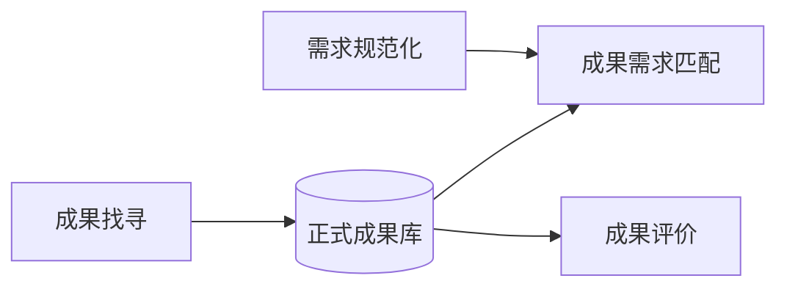
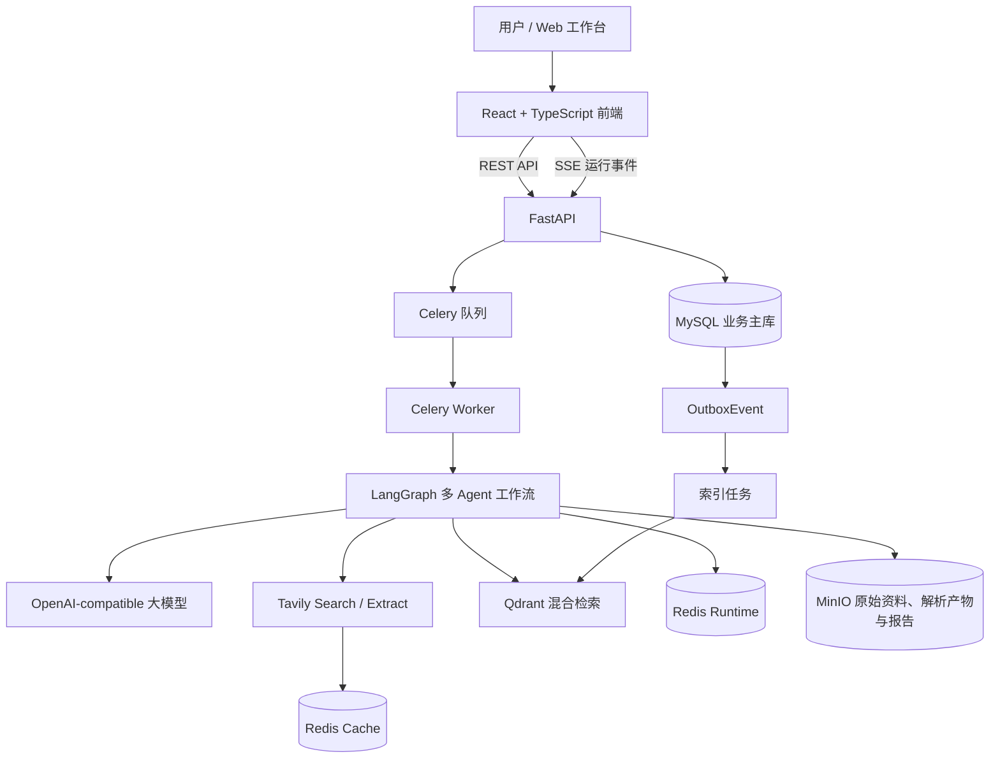
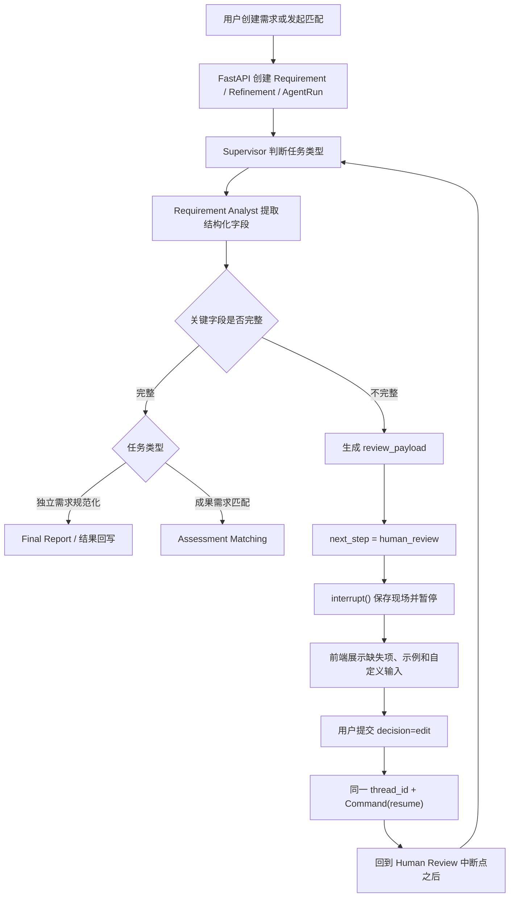
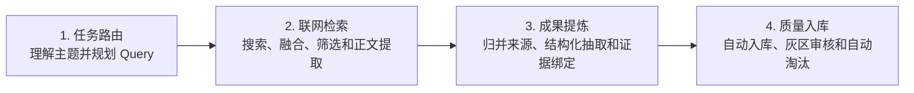
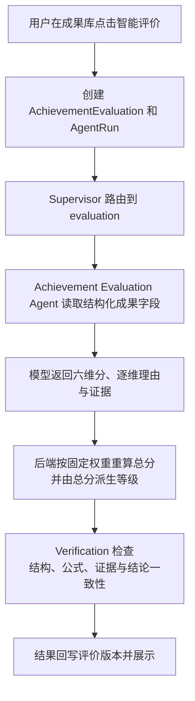
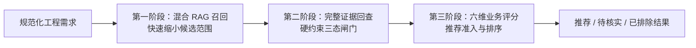
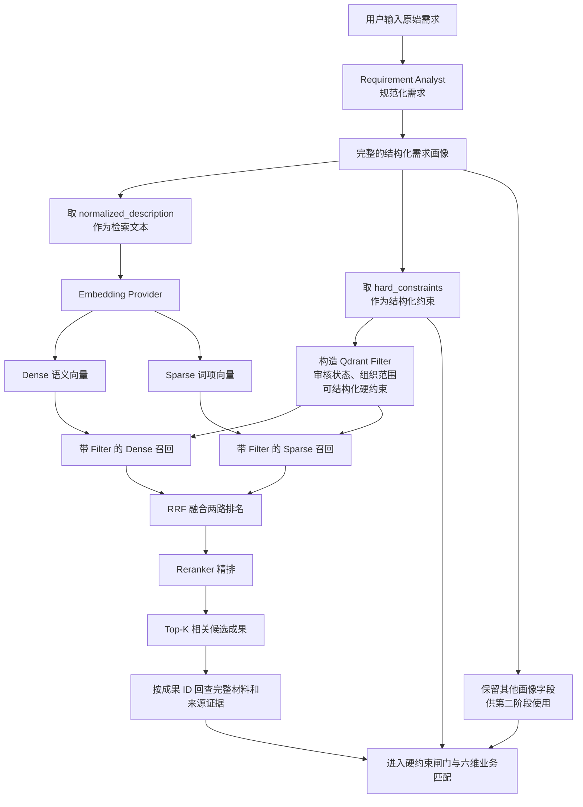
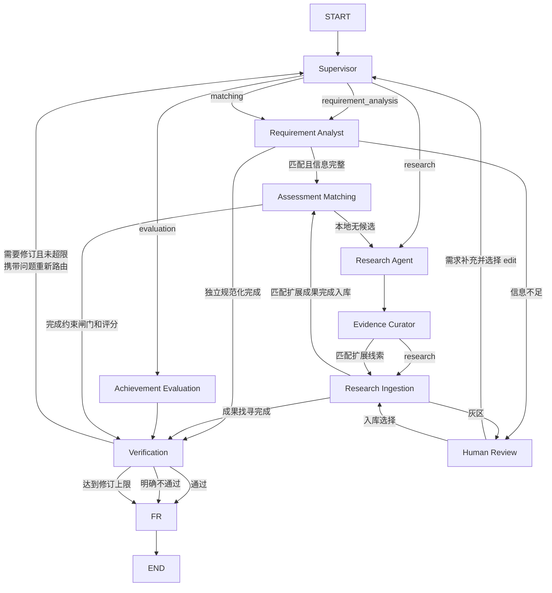
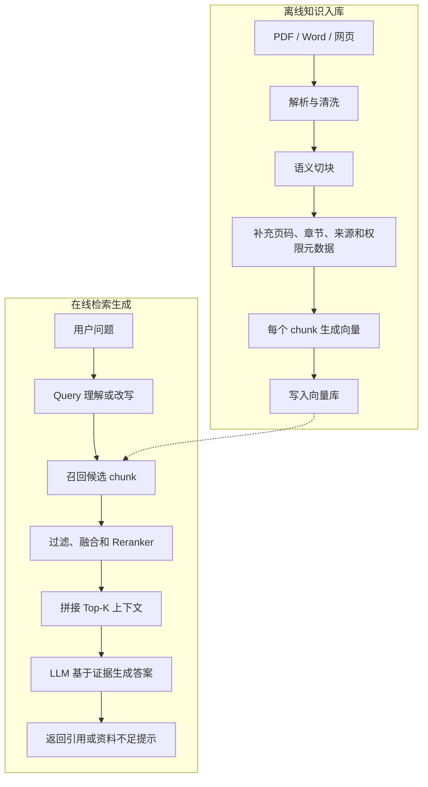

# HydroBridge 项目学习与面试手册（详细版）

> 本文围绕 HydroBridge 的完整项目设计展开。业务功能始终只有四个：**需求规范化、成果找寻、成果评价、成果需求匹配**。Supervisor、Evidence Curator、Verification、Final Report 和 Human Review 是支撑这四个功能的 Agent 或控制节点，不应被介绍成额外业务功能。

> 阅读约定：全文按照业务上准确、合理且自洽的方案讲解，不让临时代码差异改变主流程。每个字段都必须产生与语义一致的后果：硬约束不可被加权分抵消，证据不足不能默认通过，检索相关不能直接等同于工程适用。

## 目录

1. 如何使用这份手册
2. 项目背景、定位与总体架构
3. 核心数据和任务状态
4. 四大核心功能详解
5. LangGraph 多 Agent 设计
6. RAG 与检索原理
7. 后端与工程架构
8. 可靠性、安全、并发与测试
9. 项目介绍与面试表达
10. 40 个高频面试问题
11. 项目启动与四大功能演示
12. 源码阅读路线
13. 常见问题排查
14. 七天学习计划
15. 术语速查和最后速记

---

## 0. 如何使用这份手册

这份详细版同时服务于三种学习目标：

1. **体验项目**：知道页面上的按钮对应后端哪条工作流，以及运行完成后应该看到什么；
2. **理解技术**：理解 LangGraph、RAG、Human-in-the-loop、FastAPI、Celery、MySQL、Redis、Qdrant 和 MinIO 在项目中的真实作用；
3. **准备面试**：能够先用一两分钟讲清主线，再根据面试官追问深入到状态恢复、混合检索、评分可解释性、幂等性和一致性。

建议按下面顺序学习：

```text
先体验四大功能
→ 记住每个功能的输入、核心步骤和输出
→ 阅读 LangGraph 总图和 AgentState
→ 深入成果找寻与成果需求匹配
→ 理解后端组件为什么存在
→ 最后练习面试介绍和追问题
```

不要一开始就背所有类名。面试中最重要的是业务主线、关键技术为什么存在，以及你能否解释设计取舍。

---

## 1. 项目背景与定位

### 1.1 项目解决什么问题

HydroBridge 是一个面向水利科技成果转化的多 Agent 决策平台。它处理的不是普通聊天，而是把模糊的水利工程问题转化为一条可执行、可观察、可暂停、可恢复和可审计的任务流程。

水利科技成果转化通常存在四类问题：

- 成果资料散落在政府网站、高校网站、论文、专利和工程案例中，人工寻找成本高；
- 同一成果可能有多个网页来源，字段不一致，证据质量也不同；
- 工程需求通常由自然语言描述，场景、目标和关键边界可能表达不清；硬约束是可选信息，并非每个需求都必须有；
- “成果与需求文字相似”不等于“成果能在该工程落地”。召回后还要核验环境、预算、施工、成熟度和证据，明确违反硬约束的成果必须退出推荐。

因此项目没有把所有问题交给一个聊天模型，而是建立了四条业务能力：

| 业务功能 | 输入 | 核心判断 | 输出 |
| --- | --- | --- | --- |
| 需求规范化 | 用户的自然语言工程需求 | 信息是否完整，用户是否表达了硬约束或软偏好 | 结构化需求、完整度、缺失项、检索词 |
| 成果找寻 | 用户希望调研的技术主题 | 网页是否相关、可追溯，是否达到项目入库规则 | 候选成果、来源证据、质量分流和入库结果 |
| 成果评价 | 成果库中的单项成果 | 成果自身质量如何 | 六维评价、等级、优势、风险和建议 |
| 成果需求匹配 | 一条规范化需求和成果库 | 哪些成果先通过硬约束、通过者的综合适配度如何 | 正式推荐、适配度不足、待核验与排除结果，以及约束证据、六维评分、理由、差距和风险 |

### 1.2 项目不是什么

为了避免面试表达跑偏，需要明确项目不是什么：

- 它不是单纯的 ChatBot；
- 它不是把 Tavily 搜索结果原样展示的搜索页面；
- 它不是只靠向量相似度推荐成果；
- 它不是让多个 Agent 自由聊天的 Swarm；
- 它不会把向量分直接当匹配结论；评价与匹配都由模型判断维度、后端按固定公式计算总分，硬约束另外执行确定性闸门；
- 它也不是传统纯后端管理系统，后端组件服务于 Agent 工作流和业务可靠性。

### 1.3 四个功能之间的关系

四个功能相互关联，但保持业务边界：



- 需求规范化属于需求侧能力，并且会作为成果需求匹配的前置环节复用；
- 成果找寻属于成果侧增量能力，负责从开放网络发现候选，并把通过项目证据与质量规则的成果带入正式成果库；通过门控不代表资料天然绝对可信；
- 成果评价判断成果自身质量，不绑定某条具体需求；
- 成果需求匹配判断成果对某项工程是否适用，不能被成果评价替代。

成果自身评价可以作为候选的质量先验，但不能替代针对具体需求的匹配判断。两项功能共享成果主数据与证据，同一项成果可能评价很高，却因环境、施工或接口条件不符而无法满足某条需求。例如成果施工需要连续停水 8 小时，而需求规定不得超过 2 小时，该成果必须被排除，不能因为成熟度或创新性高而继续推荐。

---

## 2. 总体系统架构

### 2.1 架构总图



### 2.2 每一层负责什么

| 层次 | 技术 | 在项目中的职责 |
| --- | --- | --- |
| 展示层 | React、TypeScript、Vinext | 四大功能界面、人工审核、运行记录、系统状态、结果解释 |
| API 层 | FastAPI、Pydantic | 登录鉴权、业务接口、参数校验、权限判断、SSE 输出 |
| 任务层 | Celery、Celery Beat | 把联网检索、模型推理、评价、匹配和索引等耗时任务放到后台执行 |
| 编排层 | LangGraph | 节点编排、条件路由、状态共享、人工暂停、Checkpoint 恢复 |
| 模型层 | OpenAI-compatible Model Gateway | 统一调用豆包、DeepSeek 等兼容模型，并记录模型用量 |
| 业务主库 | MySQL | 保存用户、成果、需求、评价、匹配、运行、审核和审计事实 |
| 运行状态 | Redis Runtime | Celery Broker/Result、LangGraph Checkpoint、SSE 事件流 |
| 可重建缓存 | Redis Cache | 保存 Tavily 搜索缓存，减少重复外部调用 |
| 向量检索 | Qdrant | 保存成果级 Dense/Sparse 向量和检索 Payload |
| 对象存储 | MinIO | 保存 PDF/Word、网页快照、解析产物和 Agent 最终报告 |

### 2.3 一次业务请求的通用生命周期

四大功能虽然执行节点不同，但后台生命周期相似：

```text
用户发起操作
→ FastAPI 校验身份、权限和输入
→ MySQL 创建业务记录与 AgentRun
→ Celery 接收任务
→ Worker 构建 LangGraph 并开始执行
→ 各 Agent 更新共享 AgentState
→ 事件写入 Redis，前端通过 SSE 或轮询展示进度
→ 如需人工介入，任务进入 waiting_review
→ 人工决定后从 Checkpoint 恢复
→ 最终结果回写 MySQL
→ 前端展示业务结果和完整运行轨迹
```

### 2.4 为什么不能只使用大模型和向量库

大模型擅长语义理解和内容生成，但不能替代业务数据库、任务队列和事务机制：

- 用户、权限、状态和版本需要 MySQL；
- 长耗时任务不能一直占用普通 HTTP 请求，需要 Celery；
- 人工等待可能持续很久，需要可持久化 Checkpoint；
- 搜索缓存可以丢，但运行现场不能丢，因此使用两套 Redis；
- Qdrant 擅长相似检索，但不适合作为全部业务事实来源；
- PDF/Word、网页快照、解析产物和最终报告写入 MinIO，MySQL 保存 Artifact 元数据、版本与业务关联。

---

## 3. 核心数据与状态

### 3.1 业务实体

项目中最重要的业务实体可以分成四组：

| 分组 | 主要实体 | 用途 |
| --- | --- | --- |
| 身份权限 | Organization、User、Role、UserRole、RefreshToken | 多组织、用户、角色和登录会话 |
| 成果业务 | Achievement、AchievementSource、AchievementEvaluation | 成果主记录、来源证据和评价版本 |
| 需求匹配 | Requirement、RequirementRefinement、MatchRun、MatchItem | 原始需求、规范化版本、匹配任务和候选结果 |
| Agent 运行 | Conversation、Message、AgentRun、AgentStep、ToolCall、ApprovalTask、ModelUsage | 对话、任务、步骤、工具调用、人工审核和模型用量 |

### 3.2 MySQL 与 Qdrant 如何关联

MySQL 中的 `Achievement` 是成果的权威业务记录，Qdrant 中的一条 Point 是该成果的检索索引。两者通过 `achievement_id` 关联：

```text
Qdrant 找到相关 Point
→ 读取 payload 中的 achievement_id、标题、摘要、标签等
→ 业务详情接口可按 achievement_id 回查 MySQL
```

召回阶段使用 Qdrant Payload 提高效率；进入硬约束和业务判断前，系统按 `achievement_id` 回查 MySQL 中的完整成果字段与来源证据。这样检索索引负责“找得快”，业务主库负责“判断依据完整”。

因此可以用一句话记忆：

> Qdrant 回答“哪些成果可能相关”，MySQL 保存“这项成果当前已入库的权威业务记录”。这里的“权威”是系统数据源含义，不代表其中每个事实天然经过外部真实性认证。

### 3.3 AgentRun 与业务记录为什么都要有状态

`AgentRun.status` 表示通用 Agent 任务的运行状态；`RequirementRefinement.status`、`MatchRun.status`、`AchievementEvaluation.status` 表示具体业务任务的状态。两者不能只维护其中一个。

例如需求规范化等待人工补充时：

```text
AgentRun.status = waiting_review
RequirementRefinement.status = waiting_review
```

用户补充后：

```text
AgentRun.status = queued
RequirementRefinement.status = queued
```

这样运行记录和业务页面才能同时知道任务正在恢复。如果只恢复 AgentRun，后台可能已经执行，但需求页面会停止轮询，看起来像没有自动重新规范化。

### 3.4 常见状态含义

| 状态 | 含义 |
| --- | --- |
| `draft` | 业务记录刚创建，尚未处理 |
| `queued` | 已进入任务队列，等待 Worker |
| `running` | Agent 工作流正在执行 |
| `waiting_review` | LangGraph 已暂停，等待人工决定 |
| `completed` | 执行成功且结果已回写 |
| `failed` | 执行失败，错误信息已记录 |
| `cancelled` | 用户取消任务 |

---

## 4. 四大核心功能详解

## 4.1 需求规范化

### 4.1.1 目标与边界

需求规范化把用户的自然语言工程描述转换为后续成果检索和业务匹配能够直接使用的结构化需求。它不是简单润色，也不是生成一篇“需求规范书”，而是完成以下工作：

- 识别工程场景和具体对象；
- 提炼核心问题和业务目标；
- 区分已知条件、硬约束和软偏好；
- 生成检索词；
- 计算当前信息完整度；
- 判断是否缺少会实质改变结果的关键字段；
- 必要时生成面向用户的澄清表单。

### 4.1.2 输入和输出

示例输入：

> 某北方农村供水工程冬季最低温度约为 -20℃，泵站主要依赖人工巡检，希望引入智能监测和故障预警技术；改造期间连续停水不得超过 2 小时，并优先考虑低成本、低维护方案。

Requirement Analyst 的结构化输出对应 `RequirementProfile`，主要字段如下：

| 字段 | 含义 | 后续用途 |
| --- | --- | --- |
| `title` | 规范化后的需求标题 | 页面展示和版本识别 |
| `normalized_description` | 完整、清晰的标准需求描述 | 检索 Query 和报告 |
| `scenario` | 工程场景和对象 | 受控枚举可转为检索 Filter，其余作为语义检索和匹配依据 |
| `problem` | 当前核心问题 | 判断成果是否解决真实痛点 |
| `objectives` | 希望实现的目标 | 构造检索表达，并用于预期效果等业务维度评分 |
| `hard_constraints` | 用户明确表达的不能违反条件，可为空 | 可映射条件前置过滤；其余在候选证据回查后执行三态闸门 |
| `soft_preferences` | 可以权衡的偏好 | 候选排序和推荐解释 |
| `known_conditions` | 已知现场条件 | 完善上下文 |
| `search_terms` | 检索关键词 | 联网调研和 Sparse 检索补充；`normalized_description` 提供完整语义主干 |
| `missing_critical_fields` | 关键缺失项 | Human Review 表单 |
| `completeness_score` | 0 到 1 的完整度 | 页面提示和路由判断 |
| `requires_clarification` | 是否需要人工补充 | 是否进入 Human Review |

### 4.1.3 完整执行流程



流程中的关键点是：独立需求规范化和匹配前的需求处理复用同一个 Requirement Analyst，不是两套重复实现。

### 4.1.4 哪些信息缺失才需要人工介入

不能因为任意字段为空就暂停，否则用户会被反复打断。项目只针对会显著改变检索或匹配结果的关键缺失项介入，例如：

- 不知道具体工程对象是泵站、管网、水厂、水库还是灌区；
- 不知道当前最主要的问题是什么；
- 用户已明确表达存在“必须/不能”的施工、环境、兼容性或预算边界，但具体条件不清；
- 原始描述短到无法判断任务场景。

非关键软偏好缺失不一定阻断，可以在结果中标记不确定性并进行探索性匹配。**用户本来就没有硬约束时，`hard_constraints = {}` 是合法结果，不应强制澄清或让模型自行编造。**“预算有限”通常是软偏好；只有“总预算不得超过 50 万元”这类明确上限才适合作为硬约束。

无论使用大模型还是降级规则，都必须遵守同一字段语义：“农村供水泵站”属于场景，“冬季最低 -20℃”属于已知条件，只有“设备必须在 -20℃工作”才是可验证硬约束。降级模式可以降低语义理解能力，但不能改变硬约束定义；无法可靠分类时应要求用户确认，而不是猜测。

### 4.1.5 前端人工补充交互

当需求不完整时，前端不会显示原始 JSON，而是根据 `review_payload.fields` 动态生成业务表单。每个缺失项包含：

- 字段名称；
- 为什么该字段重要；
- 输入提示；
- 最多三条贴近水利业务的参考表达；
- 自由编辑的文本框。

用户可以点击示例直接填入，也可以继续修改，或者完全自行输入。必填项全部完成后才能提交。提交期间按钮显示“正在重新规范化”，避免重复提交。

例如缺少现场约束时，页面可以给出：

```text
1. 冬季最低温度较低，设备需适应高寒和室外潮湿环境
2. 工程需要连续供水，改造期间单次连续停水不得超过 2 小时
3. 现场通信条件一般，部分点位供电和网络不稳定
```

### 4.1.6 提交后为什么会自动重新规范化

前端提交的数据本质上是：

```json
{
  "decision": "edit",
  "edited_payload": {
    "message": "原始需求……\n\n用户补充信息：……",
    "fields": {
      "engineering_object": "农村供水泵站及其机电设备",
      "site_constraints": "改造期间单次连续停水不得超过 2 小时"
    }
  }
}
```

恢复后 `Command(resume=...)` 的数据成为 `interrupt()` 的返回值。Human Review 读取 `edited_payload.message`，更新 AgentState 中的 `user_message`，把 `next_step` 设置回 `supervisor`。Supervisor 再次路由，Requirement Analyst 使用补充后的完整内容重新生成 RequirementProfile。

这里返回 Supervisor 而不是直接进入匹配，是因为新信息可能改变工程对象、任务意图或后续计划。重新路由比沿用暂停前的旧判断更安全。

### 4.1.7 结果如何持久化

规范化完成后，运行时把 RequirementProfile 回写到：

- `RequirementRefinement.profile`：保存该次规范化版本的完整快照；
- `RequirementRefinement.completeness_score`：保存该版本完整度；
- `Requirement`：更新标准描述、场景、问题、目标、约束、检索词和缺失项；
- `AgentRun.output_payload`：保存运行输出，供运行记录和报告读取。

保留 Refinement 版本的价值是可以对比多次规范化，不必覆盖全部历史。

### 4.1.8 面试回答模板

> 需求规范化不是简单改写用户输入，而是通过 Requirement Analyst 将自然语言拆成场景、对象、问题、目标、硬约束、软偏好和检索词，并计算完整度。关键字段不足时，LangGraph 路由到 Human Review，通过 interrupt 保存检查点；前端按缺失字段生成可点击示例和自定义输入。用户补充后，同一 thread 使用 Command(resume) 恢复，更新 user_message，再经过 Supervisor 和 Requirement Analyst 自动重新规范化。

### 4.1.9 常见追问

**为什么不让大模型自动补全缺失条件？**

工程对象和硬约束如果猜错，后续检索和推荐会建立在错误前提上。模型可以指出缺什么、给表达示例，但关键事实应由用户确认。

**为什么保留原始需求？**

原始输入用于审计、对比和重新处理；规范化结果是 Agent 的结构化理解，两者职责不同，不能用后者覆盖前者。

**为什么可能再次进入 Human Review？**

用户补充后仍可能遗漏关键项。图会重新计算完整度；仍不完整时再次暂停，完整时才继续。前端要求一次填写当前全部必填项，因此正常情况下不会频繁中断。

## 4.2 成果找寻

### 4.2.1 目标与挑战

成果找寻用于从开放互联网发现新的水利科技成果。与本地成果库检索相比，互联网信息更新更快、覆盖更广，但噪声也更大：

- 同一成果可能被政府、高校、企业和媒体重复介绍；
- 网页标题相关，但正文可能只是会议新闻、招聘或营销内容；
- 来源权威性和发布时间差异很大；
- 某些字段来自直接证据，另一些只是推断；
- 搜索结果相关不代表可以直接进入正式成果库。

因此成果找寻不是一次 Tavily 调用，而是一条“发现—排序—提炼—门控”的质量控制链路。它能降低噪声入库风险，但不等同于对成果真实性的最终认证。

### 4.2.2 四大步骤总览



一句话记忆：

> 路由决定找什么，检索筛出较优网页，提炼形成结构化候选，门控决定是否达到当前入库规则。

### 4.2.3 第一步：任务路由与 Query 规划

Supervisor 首先判断用户任务是否属于 `research`，并生成执行计划。Research Agent 再从多个角度生成最多若干组 Query，例如：

```text
泵站预测性维护科技成果
泵组故障诊断示范工程
水利泵站智能运维研究
pumping station predictive maintenance
```

多 Query 的目的不是重复改写，而是覆盖：

- 技术术语和业务表达的差异；
- 中文和英文表达；
- 科技成果、论文、专利和工程案例等资料类型；
- 同一主题在不同机构中的不同命名。

Query 由模型规划时，输出受到 `ResearchPlan` Schema 限制；模型不可用时，项目可以使用确定性模板生成保守 Query。

### 4.2.4 第二步：联网检索

联网检索可以拆成五个子步骤。

#### A. 多 Query 并行搜索

系统对多组 Query 调用 Tavily Search。并行的目的主要是降低总等待时间，而不是无限增加吞吐。并发上限还要受到 Tavily 配额、网络情况和本机资源约束。

每条搜索结果通常包含标题、URL、摘要、Tavily 原始相关分和查询来源。

#### B. URL 规范化与去重

同一个网页可能带有不同跟踪参数、锚点或尾部斜杠。系统先规范化 URL，再进行去重，避免一个网页因为被多个 Query 命中而重复进入候选列表。

去重不能简单丢掉“重复项”的全部信息。不同 Query 对同一 URL 的命中排名会被保留，用于后续跨 Query 融合。

#### C. 跨 Query 融合排序

每个 Query 都有独立排名，系统需要把多份列表合成一份总排名。RRF 的常见形式是：

```text
RRF(d) = Σ 1 / (k + rank_i(d))
```

`rank_i(d)` 表示文档在第 i 路结果中的名次。某网页如果在多个 Query 下都靠前，会积累更高的融合分。

RRF 的优势是只依赖名次，不要求不同搜索列表的原始分数处在相同尺度。它在成果找寻和本地混合 RAG 中都可以出现，但用途不同：这里融合多 Query 的网页排名；本地 RAG 中融合 Dense 和 Sparse 排名。

#### D. 质量排序与规则筛选

融合排名后，项目还会结合以下信号形成更符合业务的排序：

| 信号 | 目的 |
| --- | --- |
| 语义相关性 | 网页内容是否真正回答用户主题 |
| 来源权威性 | 政府、高校、科研机构等来源优先；域名类型只是先验信号，不能替代原文证据 |
| Tavily 原始分 | 保留搜索服务提供的相关性信号 |
| RRF 分 | 奖励被多组 Query 稳定命中的网页 |
| 时效性 | 满足用户提出的年份范围，过期内容降权 |
| 页面类型 | 成果目录、论文、专利和工程案例优于营销页 |
| 特异性 | 是否描述具体技术或项目，而不是泛泛而谈 |

这一步不是“只写提示词让模型判断”。项目中同时使用确定性规则、URL 域名和页面特征、时间提取、Reranker 相关性信号以及来源类型加权。模型适合做语义理解，但硬过滤和分数计算应尽量可复现。

时间判断优先读取页面结构化元数据、官方发布日期、论文或专利日期，并记录日期来源；正文中的 `20xx` 年份只能作为弱线索，因为它可能是参考文献或历史年份。最终使用 `in_range/out_of_range/unknown` 三态，`unknown` 降权并可能进入人工审核，不能猜测一个确定日期。

#### E. MMR 多样化与正文提取

如果只按相关性取前几名，结果可能全部来自同一网站，或者内容高度相似。MMR 在相关性和多样性之间做平衡，典型思想为：

```text
选择分 = λ × 与用户主题的相关性
       - (1 - λ) × 与已选结果的最大相似度
```

MMR 不是“第二次搜索”，而是在候选已排好以后控制冗余。最终保留下来的优质网页再通过 Tavily Extract 获取正文，而不是只用很短的搜索摘要做成果提炼。

MMR 按下面的思想逐个选择结果：

```text
MMR(d) = λ × Rel(query, d)
       - (1 - λ) × max Sim(d, 已选结果)
```

`Rel` 可以使用融合后的相关性分，`Sim` 使用标题与摘要 Embedding 的余弦相似度；来源域名多样性可以作为并列时的附加信号。这样不是简单打散结果，而是在尽量保持相关性的同时减少内容重复。

### 4.2.5 第三步：Evidence Curator 成果提炼

网页不是成果业务对象。Evidence Curator 负责把原始网页整理为可审核的候选成果，核心包含三件事。它建立结构和证据关联，但不因为模型完成抽取就证明内容绝对真实：

1. **成果归并**：判断多个网页是否描述同一项成果，形成“一项成果、多个来源”；
2. **结构化抽取**：提取名称、完成单位、摘要、技术原理、应用场景、成熟度、优势、限制和指标；
3. **证据绑定**：为关键字段保留原文片段、来源 URL、支持类型和置信度。

候选成果对应 `CuratedAchievement`，证据对应 `EvidenceClaim`。证据的 `support_type` 可以是：

| 类型 | 含义 |
| --- | --- |
| `direct` | 原文直接支持该字段或结论 |
| `indirect` | 通过上下文能够间接支持 |
| `conflict` | 多个来源之间存在冲突 |
| `missing` | 暂无足够材料支持 |

因此 Evidence Curator 不等于普通摘要 Agent。摘要只压缩文字，而 Evidence Curator 要解决实体归并、字段抽取和可追溯证据三个问题。

### 4.2.6 第四步：质量门控与三段式分流

候选成果不能由模型一句“值得入库”决定。Research Ingestion 根据多个可解释维度计算质量置信分，并先执行硬拒绝规则。

质量判断重点包括：

| 维度 | 主要判断 |
| --- | --- |
| 相关性 | 是否真正覆盖用户调研主题 |
| 来源权威性 | 来源是否可信，是否有官方或学术材料 |
| 信息完整性 | 名称、单位、原理、场景等是否足够完整 |
| 证据可追溯性 | 关键字段是否能回到原文和 URL |
| 时效性 | 是否符合用户要求的时间范围 |
| 多来源一致性 | 对同一字段的独立证据做单位、时间和口径归一，判断相互支持、补充或冲突；来源数和 Query 覆盖率只表示覆盖度 |

多来源一致性不能只用来源数量代替。Evidence Curator 应按成果字段聚合 EvidenceClaim，统一单位和时间口径，再判断不同独立来源是相互支持、补充还是冲突；来源数量与 Query 覆盖率只作为覆盖度信号。关键数值或适用条件发生冲突时，即使总分较高也进入灰区审核。

典型硬拒绝条件包括：

- 缺少成果名称；
- 缺少来源 URL；
- 缺少字段级证据；
- 明确超出时间范围；
- 与核心主题明显无关；
- 全部来自低证据营销内容。

项目采用三段式分流，阈值由验证集校准并支持配置。示例默认值为：

| 结果 | 默认区间 | 处理 |
| --- | ---: | --- |
| 自动入库 | 不低于 80 且无明显风险 | 自动写入正式成果库 |
| 人工审核 | 不低于 60 且低于 80，或存在冲突、单位缺失、日期不明等风险 | LangGraph 暂停，用户批量选择 |
| 自动淘汰 | 低于 60，或命中硬拒绝 | 不进入正式库 |

一次审核默认最多展示质量分较高的 5 项灰区成果。超过上限的灰区项会被标记为 `deferred` 并作为待处理线索保留，不是直接淘汰。这个设计把人工能力放在“不确定性最高、决策价值最大”的中间区域：高质量结果不必人工逐条批准，低质量结果也不浪费审核时间。

### 4.2.7 灰区成果的 Human-in-the-loop

灰区审核与需求澄清复用同一个 Human Review 节点，但 `review_payload.type` 不同。成果入库审核的 Payload 会包含候选 ID、标题、分数、风险原因和来源链接。

用户可以批量勾选允许入库的候选，提交后这些 candidate IDs 写回 AgentState，再返回 Research Ingestion 执行实际入库。未选中的灰区候选不会进入正式成果库。

### 4.2.8 幂等入库

LangGraph 恢复或任务重试可能导致节点再次执行，因此入库必须幂等。项目通过以下方式降低重复：

- 成果标题先归一化；
- 组织与归一化标题形成唯一识别；
- 来源 URL 生成 canonical hash 去重；
- Outbox 事件按聚合对象、事件类型和版本做唯一约束；
- 已存在成果更新来源或版本，而不是无条件新增。

### 4.2.9 面试回答模板

> 成果找寻分为任务路由、联网检索、成果提炼和质量入库四步。Supervisor 识别 research 意图后，Research Agent 生成多组中英文 Query；搜索阶段用多 Query 扩大召回，规范化 URL 去重，用 RRF 融合跨 Query 排名，再结合相关性、权威性、时效性和页面类型排序，并用 MMR 控制重复，最后 Extract 正文。Evidence Curator 将同一成果的多来源归并，抽取结构化字段并绑定原文证据。Research Ingestion 再做可解释质量门控，高分自动入库、低分自动淘汰，灰区通过 LangGraph Human-in-the-loop 批量审核。

## 4.3 成果评价

### 4.3.1 评价与匹配的区别

成果评价回答“这项成果本身质量如何”，不绑定某条具体工程需求。成果需求匹配回答“这项成果是否适合当前工程”。

```text
成果评价：成果 → 自身质量
成果匹配：成果 + 具体需求 → 工程适用性
```

### 4.3.2 执行流程



评价 Agent 读取的是成果的完整结构化画像和与评价维度相关的来源证据，包括摘要、技术原理、应用场景、优势、限制、成熟度、量化指标、成本与工程案例。原始长文仍可按证据片段检索，但不能把没有进入上下文的材料当成评价依据。

### 4.3.3 六个评价维度

| 维度 | 权重 | 主要依据 |
| --- | ---: | --- |
| 创新性 | 20% | 技术原理、优势、与同类方案的差异 |
| 有效性 | 20% | 量化指标、实际效果和工程验证 |
| 成熟度 | 15% | TRL、示范应用和部署情况 |
| 证据质量 | 20% | 量化指标、检测报告、工程案例及其来源可追溯性 |
| 推广价值 | 15% | 场景覆盖、复制条件和推广范围 |
| 实施可行性 | 10% | 成本、限制、部署难度和运维条件 |

固定公式为：

```text
综合分 = 创新性 × 0.20
       + 有效性 × 0.20
       + 成熟度 × 0.15
       + 证据质量 × 0.20
       + 推广价值 × 0.15
       + 实施可行性 × 0.10
```

等级区间为：

| 分数 | 等级 |
| ---: | --- |
| 85 及以上 | 优秀 |
| 70 到 84.99 | 良好 |
| 60 到 69.99 | 中等 |
| 低于 60 | 待完善 |

### 4.3.4 为什么总分必须由代码重算

模型适合阅读语义材料并判断维度，但如果让模型额外生成一个综合分，可能出现：

- 总分与各维度不一致；
- 相同维度分得到不同总分；
- 面试和业务人员无法复现结果；
- 更换模型后评分口径漂移。

模型只负责需要语义理解的六维判断、逐维理由、证据引用和置信度。后端负责：校验六维分数范围；按照固定权重计算 `overall_score`；根据总分生成等级；检查每个高分是否有相应证据。这样同一组维度分一定得到同一个总分，更换模型也不会改变计算口径。

### 4.3.5 评价输出

结果不只包含一个分数，还包括：

- 六维得分；
- 每个维度的判断依据；
- 综合等级和摘要；
- 成果优势；
- 风险和限制；
- 缺失材料；
- 改进建议；
- 评价依据、来源引用和置信度；
- 使用的模型或降级模式。

每个维度都应保存“得分—理由—证据”三元组。优势、风险和缺失材料既可以来自成果结构化字段，也可以由模型在证据范围内归纳；任何无法回到来源或成果字段的解释都不能作为可靠依据。

### 4.3.6 模型不可用时如何处理

系统提供确定性保守回退，根据成熟度、量化指标数量、应用场景、证据质量、成本资料和限制信息生成基础评分。回退的目的有两个：

1. 自动测试和演示不因外部模型暂时不可用而完全中断；
2. 给出明确、可复现的保守基线。

不能把回退模式说成与正常大模型效果等价。页面和运行记录应保留 `generation_mode`，让用户知道结果来自模型还是确定性逻辑。

### 4.3.7 面试回答模板

> 成果评价判断成果自身质量。评价 Agent 根据完整成果画像和来源证据，按照统一 Rubric 给出六维分、逐维理由、引用和置信度；后端按固定权重重算总分并派生等级，Verification 再检查结构、公式和证据一致性。最终结果同时展示优势、风险、材料缺口和改进建议，而不是只给一个黑盒总分。

## 4.4 成果需求匹配

### 4.4.1 功能是否还存在，以及当前入口在哪里

成果需求匹配是完整保留的核心业务能力。当前前端没有把它单独放在左侧导航，而是提供三个实际入口：

1. Agent 工作台选择任务类型“成果匹配”；
2. 需求规范化列表中，每条需求右侧的“开始匹配”“探索性匹配”或“补充后匹配”；
3. 打开需求详情后，底部“开始成果匹配”，以及“匹配结果”“匹配历史”标签。

因此功能没有删除，只是当前信息架构把它嵌入需求工作区，独立入口不够明显。从业务表达看，成果需求匹配仍应作为四大功能之一单独介绍；在系统设计上，它复用 Requirement、MatchRun、MatchItem 和 Assessment Matching Agent。

### 4.4.2 为什么匹配要分三个阶段

匹配同时面对“规模问题”和“业务判断问题”：

- 成果库可能有很多成果，不可能把全部成果交给大模型逐项阅读；
- 文本相关只说明可能有关系，不代表满足工程条件。

因此采用三个阶段：



第一阶段以较高召回率为目标，把可能相关的候选找回来；第二阶段判断候选能否越过不可违反的业务底线；第三阶段再判断通过候选的综合适配度是否达到推荐阈值，并对达标者排序。三个阶段分别回答“相关吗”“允许继续评估吗”“是否值得推荐、谁更合适”，顺序不能颠倒。

如果本地成果库没有候选，可以转到成果找寻链路扩展外部线索，但外部成果必须先完成来源整理和质量门控。达到正式入库条件后才能参加正式匹配；未经审核的结果只能作为外部线索单独展示，不能与正式推荐混排。

### 4.4.3 成果入库侧：如何建立检索索引

成果可以来自上传的 PDF/Word，也可以来自联网找寻。原始资料先进入 MinIO，解析后保留来源、页码、章节和字段关系；Evidence Curator 抽取结构化成果写入 MySQL，并建立两种粒度的索引。

第一种是成果级索引。系统把以下字段拼接成“成果检索文本”：

- 标题；
- 摘要；
- 技术原理；
- 应用场景；
- 优势和限制；
- 标签和机构。

成熟度、审核状态、组织和其他适合过滤的字段单独保存在 Payload 中，不依赖向量相似度判断。

Embedding Provider 对这段文本生成两种表示：

| 表示 | 作用 |
| --- | --- |
| Dense 向量 | 表达整条成果的语义，用于同义表达和概念相似检索 |
| Sparse 向量 | 表达少量重要词项及权重，用于专业词、设备名和硬性表达检索 |

两种向量以及 `achievement_id`、状态、组织、版本、标题、摘要、场景、标签和成熟度等 Payload 写入成果级 Point，用于第一阶段候选召回。

第二种是证据 Chunk 索引。解析后的原始材料按语义切块，每个 Chunk 保存 `achievement_id`、`source_id`、页码、章节、字段标签和原文。候选成果确定后，系统限定 `achievement_id` 再检索与某条硬约束或评分维度最相关的 Chunk，用于证据判断。

### 4.4.4 查询侧：需求结构化与检索输入

“需求结构化”和“检索 Query”不是两次重复的需求改写，而是不同层次的两个概念：

- **需求结构化**：Requirement Analyst 将用户的自然语言整理为完整业务画像，供完整度判断、Human Review、检索、硬约束校验、六维评分和结果解释共同使用；
- **检索输入**：从完整画像中取出适合向量化的 `normalized_description`。结构化字段并不全部塞进 Embedding；硬约束继续作为可明确校验的业务条件保留。

因此，这一步更准确的叫法是“从需求画像中构造检索表达”，而不是“再次生成一套需求”。成果找寻中的 Research Agent 会为 Tavily 联网搜索生成多组 Query；成果需求匹配则以 `normalized_description` 为语义主干，并可把场景、目标和关键词组合成少量互补检索表达以提升召回。多路表达是同一需求画像的检索投影，不是重复做需求规范化。

#### 一个贯穿示例

假设用户输入：

> 我们想给冬季最低温度约为 -20℃的农村供水泵站做智能化改造，主要是减少人工巡检；设备必须能在 -20℃工作，改造期间连续停水不得超过 2 小时，并优先考虑低成本方案。

Requirement Analyst 会把它整理成类似下面的需求画像：

```yaml
title: 高寒地区农村供水泵站智能化改造
scenario: 高寒地区农村供水泵站
problem: 依赖人工巡检，设备异常发现不及时
objectives:
  - 减少人工巡检
  - 提高故障发现和预警能力
known_conditions:
  minimum_winter_temperature: -20℃
hard_constraints:
  minimum_operating_temperature: -20℃
  max_continuous_shutdown_hours: 2
soft_preferences:
  cost: 建设和维护成本较低
normalized_description: 面向冬季最低约 -20℃的农村供水泵站，寻找能够实现设备状态监测、故障预警和远程运维的智能化成果，要求设备覆盖 -20℃工作环境、改造期间连续停水不超过 2 小时，并兼顾较低成本。
```

进入第一阶段 RAG 时，系统不会把整个 JSON/YAML 对象原样丢给向量模型，而是分开使用：

```text
检索文本 Query = normalized_description
结构化约束   = hard_constraints
其他业务信息 = scenario + objectives + soft_preferences + 其他画像字段
```

- `normalized_description` 进入 Embedding Provider，分别生成 Dense 和 Sparse 表示；
- `hard_constraints` 保留结构化语义；能转换成数据库条件的数值、枚举和布尔约束前置过滤，其他约束留给召回后的证据校验；
- 完整需求画像继续供第二阶段硬约束校验和第三阶段六维匹配、差距分析与风险提示使用。

不是所有硬约束都适合在向量召回前处理。例如最低成熟度、允许地区和设备类型可以转成 Filter；“单次停水不得超过 2 小时”往往需要读取施工条件和案例材料后才能判断。无论主检索还是降级检索，都必须执行相同的审核状态、组织范围和可结构化约束，不能因为检索服务降级而绕过业务底线。

如果直接对整个结构化对象做 Embedding，字段名、布尔值、完整度分数和缺失字段等内容都会进入向量，容易引入无关噪声。另一方面，“不能长时间停水”这类硬条件不能被模糊成一个相似度分数，必须保留为可明确检查的业务约束。

#### 第一阶段 RAG 召回的完整流程



用一句话概括这条链路：

> 先把自然语言需求规范化成完整画像，再取规范化描述进行 Dense/Sparse 双路召回、RRF 融合和 Reranker 精排；同时保留硬约束和其他业务字段。召回 Top-K 后回查完整成果材料，先校验硬约束，再对通过者进行六维判断。

成果入库和需求查询都使用同一套 Embedding Provider，使成果文本和需求 Query 位于兼容的 Dense/Sparse 检索空间中。

### 4.4.5 Dense 召回

Dense 向量是固定长度的稠密浮点数组，项目默认维度配置为 1024，使用余弦距离。使用 BGE-M3 等真实语义模型时，它擅长发现语义相近但字面不同的表达；上面的候选即使没有完整复述需求，也可能与“减少人工巡检并提前发现设备异常”得到较高相关度。Hash 回退只是词项哈希向量，不具备同等级别的语义泛化，不能用回退结果证明 Dense 语义能力。

Dense 的局限是可能把概念相近但工程对象不一致的成果也召回，因此不能单独决定推荐结果。

### 4.4.6 Sparse 召回与 BM25 的区别

Sparse 向量保存少量 token 的索引和权重，适合守住“泵站、高寒、农村供水、不停水、闸门、堤防”等专业词和约束词。

Sparse 与 BM25 都强调词项，但不是同一个概念：

| 对比 | BM25 | 本项目 Sparse |
| --- | --- | --- |
| 本质 | 传统统计排序公式 | 稀疏词项权重表示 |
| 权重来源 | 词频、逆文档频率、文档长度 | BGE-M3 路径使用模型生成的 `lexical_weights`；Hash 回退使用词频哈希权重；Qdrant 配置 `Modifier.IDF` |
| 语义能力 | 主要依赖字面词 | 权重由模型生成，但仍偏重精确词项 |
| 当前项目 | 没有直接以 BM25 作为主链路 | 使用 Sparse Vector 检索 |

因此面试时不能说“Sparse 就是 BM25”。更准确的表述是：二者都补充关键词能力，但权重生成和检索机制不同。

### 4.4.7 RRF 融合

Dense 和 Sparse 的原始分数尺度不同，不能简单相加。RRF 将两路候选按名次融合：

```text
RRF(d) = 1 / (k + dense_rank(d))
       + 1 / (k + sparse_rank(d))
```

如果某成果在 Dense 和 Sparse 两路都靠前，它会获得更稳定的融合排名；如果只在一路命中，也仍有机会保留。

### 4.4.8 Reranker 精排

双路召回和 RRF 适合快速缩小范围，但对细粒度需求理解仍有限。真实 BGE Reranker 会联合读取 Query 和候选成果文本并输出相关性分，再对较小候选集重新排序；Hash 回退的 `rerank` 只是词项覆盖启发式，不能把两者效果等同。

这样做在效果和成本之间取得平衡：

- 不让昂贵的精排处理整个成果库；
- 只处理召回后的候选；
- 纠正单纯向量相似或关键词命中造成的误排。

### 4.4.9 Top-K 候选上下文如何组织

第一阶段返回的是成果级候选，不是传统长文档的零散 chunk。Qdrant Payload 包含标题、摘要、场景、标签、成熟度和成果 ID；系统再按 `achievement_id` 回查 MySQL 中的技术原理、适用条件、限制、来源和版本，形成可供业务判断的完整候选上下文。

上下文按以下方式组织：

```text
需求画像
+ Top-K 成果的完整结构化材料
+ 字段级来源证据
+ 融合分与 Reranker 信号
→ 硬约束闸门与业务匹配阶段
```

它不是把互不相关的文本片段直接拼成一篇长文字，而是按候选成果组织字段和证据，并控制每类字段的长度与数量，避免上下文过长或不同成果之间相互串扰。

候选数量应分层控制：混合检索可以召回较宽的候选池，Reranker 只精排其中一部分，业务匹配再处理较小的 Top-K，最终页面展示最有价值的推荐结果。具体 K 值应通过离线召回率、排序指标、模型上下文成本和在线延迟共同确定，不能把某个配置数字当成系统容量。

### 4.4.10 第二、三阶段：硬约束闸门与六维业务评分

第一阶段只得到“相关候选”。第二阶段首先回答“该成果是否允许被推荐”，然后才回答“通过的成果中谁更合适”。硬约束闸门必须先于六维排序执行。

先区分两种条件：

| 条件 | 处理方式 |
| --- | --- |
| 硬约束 | 不参与“加权平均后补回来”；明确违反者应移出推荐排名，证据不足者列为待核实 |
| 软偏好 | 用于排序和解释，不一定淘汰候选 |

每一条硬约束都输出三态结果：

| 判断 | 处理 |
| --- | --- |
| `passed` | 获得进入六维评分的资格；是否成为正式推荐还要看业务分是否达标 |
| `uncertain` | 放入待核实列表，输出缺失证据和核实建议，不与正式推荐混排 |
| `violated` | 不得留在推荐排名；放入已排除列表，展示违反项和证据 |

“排除”不等于隐藏。保留已排除列表可以让用户看到系统考虑过哪些成果、为什么不推荐，避免无法解释的“静默删除”。

约束判断由规则与模型协作完成：

1. 数值、枚举和布尔约束优先由代码比较，例如 `maturity_level >= 7`、停水时间 `<= 2h`；
2. 需要理解技术材料的约束由模型判断，例如“是否兼容现有控制系统”，但必须返回判断结论、引用字段、原文证据和置信度；
3. 后端汇总逐项结论：任一项 `violated`，整个候选进入已排除列表；没有违反但存在 `uncertain`，进入待核实列表；没有硬约束或已有约束全部 `passed`，才进入六维评分；
4. 模型不能修改这套分流规则，也不能因为候选综合分高而覆盖硬约束结论。

只有证据明确且口径一致时才能给出 `passed` 或 `violated`。如果来源互相冲突、单位或适用条件无法对齐、模型置信度过低，都应归为 `uncertain`，不能为了得到更多推荐而默认通过，也不能在证据不足时武断淘汰。

例如需求规定“单次连续停水不得超过 2 小时”：成果材料明确写明施工需停水 8 小时，则结论为 `violated` 并排除；材料没有提供施工时间，则为 `uncertain`；材料明确支持不停水安装或停水 1 小时，则为 `passed`。

六个匹配维度为：

| 维度 | 权重 | 含义 |
| --- | ---: | --- |
| 场景适配度 | 30% | 成果是否适用于当前工程对象和环境 |
| 预期效果 | 20% | 是否能解决需求中的核心问题 |
| 成熟度 | 15% | 是否具备工程部署条件 |
| 证据质量 | 15% | 推荐结论是否有足够可信材料 |
| 成本适配度 | 10% | 是否符合预算和维护要求 |
| 实施准备度 | 10% | 根据实施风险反向计算可落地程度 |

固定公式为：

```text
最终分 = 场景适配度 × 0.30
       + 预期效果 × 0.20
       + 成熟度 × 0.15
       + 证据质量 × 0.15
       + 成本适配度 × 0.10
       + (100 - 实施风险) × 0.10
```

模型可以判断维度并生成理由，但最终分由后端重算并按分数重新排序，防止模型给出与维度不一致的总分。

六维分同时承担排序和推荐准入。后端使用经验证集校准、可配置的 `recommendation_threshold`：达到阈值的候选进入正式推荐并按 `final_score` 排序；低于阈值的候选进入“适配度不足”区域，保留评分和短板说明，但不显示为推荐。Top-N 只是页面展示上限，不能代替推荐阈值。

### 4.4.11 六维分是只展示，还是用于筛选

六维业务分不是装饰信息。它只对通过硬约束闸门的候选执行，并完成三件事：

1. 后端根据固定公式得到 `final_score`；
2. 按推荐阈值区分“正式推荐”和“适配度不足”；
3. 正式推荐按 `final_score` 降序排名；
4. 页面展示理由、差距和风险，支持用户把推荐结果加入候选、淘汰或采用。

硬约束与业务分不能混为一谈。一个候选即使平均分很高，只要明确违反任一硬约束，就必须退出推荐排名，不能靠其他维度把平均分“补回来”。

### 4.4.12 最终输出

每个 MatchItem 应完整承载：

- 候选成果 ID 和标题；
- 结果状态：`recommended`、`low_fit`、`pending_verification` 或 `excluded`；
- 最终分，以及仅对正式推荐有效的排名；
- Dense、Sparse、融合和 Reranker 等检索信号字段；
- 六维业务得分；
- 每条硬约束的 `passed/uncertain/violated` 结论、判断依据和证据；
- 推荐理由；
- 差距；
- 风险；
- 引用证据字段；
- 人工业务决定：待处理、候选、淘汰或采用。

最终页面分成四个区域：正式推荐按六维最终分排序；适配度不足候选展示低分维度；待核实候选按核实优先级展示缺失材料；已排除候选展示违反项和证据。这样既不把不合格成果混进推荐，也不会把判断过程隐藏起来。

### 4.4.13 面试回答模板

> 成果需求匹配分三步。第一步用 Qdrant 对规范化需求做 Dense/Sparse 双路召回、RRF 融合和 Reranker 精排，得到 Top-K 相关候选；第二步回查完整成果材料，对每条硬约束做通过、待核实、违反三态判断，违反者排除、待核实者单列；第三步对通过候选进行六维业务评分，达到推荐阈值者进入正式推荐并按后端计算的总分排序，同时输出证据、理由、差距和风险。

---

## 5. LangGraph 多 Agent 设计

### 5.1 为什么使用 LangGraph

四大功能都包含多步骤、工具调用、条件分支和状态回写，一次 Prompt 很难稳定完成。例如成果找寻需要 Query 规划、并行搜索、融合排序、正文提取、成果归并、质量门控和可能的人工审核；匹配需要需求规范化、检索、评分、核验和结果持久化。

LangGraph 在项目中解决以下问题：

- 把每个专业职责表示为明确节点；
- 用共享 State 传递结构化结果；
- 用条件边表达不同任务和异常分支；
- 使用 Checkpoint 保存任务现场；
- 通过 interrupt 实现真正的人工暂停；
- 恢复时从原图继续，而不是重新开始；
- 对 Verification 的修订回路设置迭代上限，降低该分支无限循环风险；
- 让每个节点可以单独测试和观察。

### 5.2 项目属于哪种多 Agent 模式

项目属于 **Supervisor/Router 风格的 Custom Workflow**：

- Supervisor 识别任务类型并生成计划；
- 专业 Agent 是图中的固定节点；
- 节点通过 AgentState 共享数据；
- 条件边根据 `next_step` 路由；
- Agent 不进行无边界自由对话。

这与自由 Swarm 的区别是：执行路径和输入输出契约由开发者控制，Verification 修订分支还有迭代上限，更适合有审计和可靠性要求的业务系统。

### 5.3 节点分工

| 节点 | 主要职责 | 服务的业务功能 |
| --- | --- | --- |
| Supervisor | 判断需求规范化、成果找寻、成果评价和成果需求匹配，生成计划 | 四大功能的入口编排 |
| Requirement Analyst | 需求结构化、完整度和缺失字段 | 需求规范化、成果需求匹配 |
| Research Agent | Query 规划和联网搜索 | 成果找寻；本地匹配无候选时也可用于扩展线索 |
| Evidence Curator | 来源归并、成果抽取和证据绑定 | 成果找寻；也整理匹配回退的外部候选 |
| Research Ingestion | 质量评分、分流和幂等入库 | 成果找寻 |
| Achievement Evaluation | 单成果六维评价 | 成果评价 |
| Assessment Matching | 混合召回、证据回查、硬约束闸门和六维业务匹配 | 成果需求匹配 |
| Verification | 按任务分支检查结构、证据、公式、约束分流与结论一致性 | 质量控制，不是独立业务功能 |
| Human Review | interrupt 暂停、接收人工决定和恢复路由 | 需求关键事实澄清、成果入库灰区审核 |
| Final Report | 汇总 Markdown 结果和引用 | 输出节点，不是独立业务功能 |

### 5.4 图结构

图注册 10 个节点，所有节点通过统一 `route(state)` 读取 `next_step`：



图中只保留四大业务任务。成果评价必须携带成果 ID；缺少必要业务参数时应在 API 或 Supervisor 层返回明确错误或要求补充，不能静默路由到另一个功能。匹配无本地候选时可以调用一次成果找寻，外部结果经过 Research Ingestion 质量门控后再进入正式匹配；State 中记录已扩展标志，防止“无候选—搜索—再无候选”无限循环。

### 5.5 AgentState 详解

AgentState 是 TypedDict，字段可以按职责分组：

| 分组 | 主要字段 | 用途 |
| --- | --- | --- |
| 任务身份 | `run_id`、`thread_id`、`conversation_id`、`user_id`、`organization_id` | 找到任务、用户、组织和 Checkpoint |
| 路由控制 | `task_type`、`plan`、`next_step`、`iteration_count`、`visited_agents` | 决定工作流路径，并限制 Verification 的修订回路 |
| 需求 | `user_message`、`context`、`requirement_profile`、`clarification` | 保存原始需求和结构化画像 |
| 搜索 | `search_queries`、`search_results`、`rejected_sources` | 多 Query 和网页候选 |
| 证据入库 | `evidence_records`、`ingestion_candidates`、`ingested_achievement_ids`、`ingestion_summary` | 候选成果、审核和入库结果 |
| 匹配评价 | `retrieval_hits`、`assessment_results`、`achievement_evaluation` | RAG 候选、匹配和评价 |
| 核验 | `verification` | 核验结论、冲突和行动建议 |
| 人工介入 | `needs_human_review`、`review_reason`、`review_payload`、`human_decision` | 暂停原因、表单数据和人工决定 |
| 输出错误 | `final_answer`、`citations`、`errors` | 最终报告、引用和错误 |

结构化 State 比让 Agent 通过自然语言聊天传递关键数据更可靠：字段可以校验、持久化、测试和审计，下游不必从一段文本中重新猜测上游结论。

### 5.6 Supervisor 是不是意图路由

可以把 Supervisor 理解为意图路由，但它不只输出一个标签。它通常输出：

- `task_type`：任务类型；
- `plan`：本次任务计划；
- `reason`：路由原因；
- `next_step`：图的下一节点。

用户显式指定任务类型时，Supervisor 可以尊重指定类型；选择 `auto` 时，才根据消息判断。专业 Agent 的调用不是 Supervisor 自由发挥，而是条件边根据 `next_step` 进入固定节点。

### 5.7 `next_step`、条件边和 `interrupt()` 的区别

这是最常见的面试问题：

| 概念 | 作用 | 是否暂停 |
| --- | --- | --- |
| `next_step` | State 中的路由值，表示下一站 | 否 |
| 条件边 | 读取 `next_step` 并选择节点 | 否 |
| `interrupt()` | 保存中断位置，将控制权交还给外部系统 | 是 |
| Checkpoint | 持久化 State 和执行位置 | 为恢复提供数据 |
| `thread_id` | 定位同一条图执行线程 | 为恢复提供身份 |
| `Command(resume=...)` | 向中断点注入人工决定 | 恢复执行 |

准确顺序为：

```text
Requirement Analyst 判断缺失关键字段
→ 写入 review_payload
→ next_step = human_review
→ 条件边进入 Human Review
→ Human Review 执行 interrupt(...)
→ LangGraph 返回 __interrupt__
→ Runtime 标记 waiting_review 并创建 ApprovalTask
```

所以 `next_step = human_review` 并没有暂停，只有执行到 `interrupt()` 才暂停。

### 5.8 Checkpoint 和恢复机制

中断时 LangGraph 保存 State 和执行位置。恢复时运行时重新构建图，但使用同一个 `thread_id`：

```python
graph.ainvoke(
    Command(resume=resume_payload),
    config={"configurable": {"thread_id": original_thread_id}},
)
```

恢复不是从 START 创建一个新任务，而是：

1. 通过 `thread_id` 找到 Checkpoint；
2. 回到上一次 `interrupt()` 的位置；
3. `resume_payload` 成为 `interrupt()` 的返回值；
4. 从 Human Review 的下一行继续；
5. 根据审核类型决定返回 Supervisor、Research Ingestion 或 Final Report。

因此原 Python 进程不必一直存活，只要 Checkpoint 持久化存在，就能在新的 Worker 中恢复。

### 5.9 为什么有副作用的节点必须幂等

恢复、超时和重试都可能让中断附近节点重新执行。如果节点包含“写数据库、发外部请求、创建索引”等副作用，就可能重复处理。

项目的典型幂等策略包括：

- 归一化成果标题；
- canonical URL hash；
- 数据库唯一约束；
- Outbox 事件版本唯一；
- 先查已有记录再新增；
- 人工审核只接受 `pending` 状态一次。

### 5.10 Verification 的作用

Verification 的设计目标包括：

- 结构是否完整；
- 分数是否越界或互相矛盾；
- 引用是否缺失；
- 结论是否存在无证据支持的主张；
- 硬约束是否冲突；
- 是否需要返回上游补充证据或重新计算。

Verification 根据任务类型执行不同检查：需求规范化检查字段完整性和分类一致性；成果找寻检查来源、证据和入库分流；成果评价检查六维结构、加权公式、等级和引用；成果匹配检查每个候选的硬约束结论、证据、分流结果和六维公式。它可以返回 `passed`、`revision_required` 或 `rejected`。

Verification 是运行级质量控制节点，不是第五个业务功能。它发现问题后应返回产生问题的上游节点修订，不能自己改写业务结果。匹配中的逐候选硬约束仍由匹配节点执行，Verification 只检查该闸门是否正确执行，不能用一个运行级结论替代逐候选判断。

### 5.11 为什么设置最大迭代次数

Verification 返回 `revision_required` 时，图根据问题类型回到相应上游节点，例如证据不足回到 Research、评价公式异常回到 Evaluation、匹配约束缺证据回到 Matching。`iteration_count` 限制修订回路，避免模型在多个节点之间无限循环；达到上限后必须输出明确的“质量检查未通过/需补充材料”状态和未解决问题，不能把未通过结果伪装成正常成功。

---

## 6. RAG 与检索原理

### 6.1 主流长文档 RAG

标准 RAG 分成离线入库和在线检索生成两个阶段。



长文档需要切块，是因为一整篇几十页文档生成一个向量会平均掉局部主题，也无法准确引用某页某段。

### 6.2 为什么采用成果级与 Chunk 级双粒度索引

本项目的主目标是判断“哪项成果适合工程需求”，但判断硬约束时又需要定位原始材料中的具体证据。因此只用成果级或只用 Chunk 级都不够。

第一阶段采用成果级检索：

```text
一条正式成果 = 一个成果级 Point = 候选召回的最小业务单元
```

以成果为检索单元，可以避免同一成果的多个片段挤占 Top-K。第二阶段在候选成果内部使用 Chunk 级索引：按 `achievement_id` 限定范围，再根据某条约束检索页码明确的相关证据。成果级索引负责“找候选”，Chunk 级索引负责“找依据”，两者通过成果 ID 关联。

### 6.3 BGE-M3、Dense、Sparse 与 Reranker

当前配置支持 BGE-M3 类 Embedding Provider：

- Dense：固定长度语义向量；
- Sparse：词项索引和权重；
- Reranker：对 Query 与候选文本进行交叉判断。

Qdrant 负责保存和检索向量，不负责理解原始文本并自动生成向量。向量由 Embedding Provider 生成。

### 6.4 Hash Embedding 回退

本地模型依赖不可用或自动测试环境中，可以使用确定性 Hash Embedding，让接口、索引和测试流程继续运行；它不保证真实语义检索质量，效果不能与 BGE-M3 等模型等价。

面试时应说“项目提供可用性回退”，不能说“Hash Embedding 也能达到真实语义模型效果”。

### 6.5 检索分和业务分必须分开

| 分数 | 回答的问题 | 是否能直接推荐 |
| --- | --- | --- |
| Tavily/联网排序分 | 哪个网页更值得阅读 | 否 |
| Dense/Sparse/RRF/Reranker 分 | 哪项成果与需求文本更相关 | 否 |
| 硬约束结论 | 候选是否具备进入正式评分的资格 | 是准入闸门，但 `passed` 本身不等于最终推荐 |
| 六维业务匹配分 | 在已通过硬约束的候选中，哪项成果综合适配度更高 | 同时用于推荐阈值判断和正式推荐排序 |

如果把检索分直接作为匹配结论，会把“文字相似”误当成“工程可落地”。三阶段设计把相关性、准入条件和优先级分开，正是为了解决这个问题。

### 6.6 知识库更新与 Outbox

MySQL 和 Qdrant 无法加入同一个本地事务。直接在 API 中“先提交 MySQL，再写 Qdrant”存在第二步失败的不一致风险。

项目采用 Outbox：

```text
同一 MySQL 事务：更新成果状态 + 写入 OutboxEvent
→ Celery Beat / Worker 扫描待处理事件
→ 生成成果检索文本和向量
→ Upsert Qdrant
→ 成功后更新 qdrant_indexed
→ 失败则保留事件并重试
```

Outbox 的核心价值不是“异步更快”，而是让跨系统写入失败可追踪、可重试，避免静默不一致。当前事件每次领取会增加 `attempts`，失败少于 8 次会回到 `pending`，达到 8 次后标记 `failed`；因此它提供的是可运维的最终一致机制，不是永不失败的保证。

---

## 7. 后端与工程架构详解

### 7.1 FastAPI

FastAPI 负责：

- 登录、刷新 Token 和当前用户；
- 成果、需求、评价和匹配 CRUD/业务接口；
- Agent Run 创建、查询、取消和恢复；
- ApprovalTask 查询和决定提交；
- Trace、ToolCall、ModelUsage 和 SSE 事件；
- Readiness 系统状态检查；
- Pydantic 参数与响应校验；
- 用户和组织权限控制。

耗时 Agent 工作不在普通 HTTP 请求中同步阻塞，而是创建 AgentRun 后交给 Celery。接口通常快速返回 `202 Accepted`，前端再根据业务状态和事件更新页面。

### 7.2 Celery 与 Celery Beat

Celery Worker 在后台执行 Agent Run，因此模型推理、联网检索、成果评价和需求匹配不会阻塞 HTTP 请求；Outbox Worker 负责索引更新。耗时特征和资源需求不同的任务应使用 `research`、`evaluation`、`matching`、`indexing` 等队列隔离，避免一次大规模联网检索阻塞短评价任务。

Celery Beat 用于周期性任务，例如扫描 Outbox。任务队列的价值包括：

- 将耗时工作与 HTTP 请求解耦；
- 控制不同任务并发；
- 对网络超时、限流等可重试错误执行指数退避，对参数错误和业务拒绝不盲目重试；任务必须幂等，超过上限后进入失败状态等待运维处理；
- Worker 可以横向扩展；
- 后台任务重启不影响 API 进程。

### 7.3 MySQL

MySQL 是业务事实来源，保存关系、状态、版本和审计。主要数据包括：

- 组织、用户、角色和 Refresh Token；
- 成果、来源、评价和评价版本；
- 需求、规范化版本、匹配任务和候选结果；
- 对话、消息、AgentRun、AgentStep 和 ToolCall；
- ApprovalTask 和 ModelUsage；
- Artifact、知识库记录和 OutboxEvent。

使用关系数据库是因为这些数据需要事务、外键、唯一约束、分页查询和历史版本，不能全部依赖 Redis 或 Qdrant。

### 7.4 Redis Runtime

Redis Runtime 保存不可随意淘汰的运行数据：

- Celery Broker；
- Celery Result Backend；
- LangGraph Checkpoint；
- SSE 事件流；
- 与任务恢复有关的短期运行状态。

它采用更保守的持久化和淘汰策略。等待人工审核的任务可能停留很久，如果 Checkpoint 被缓存淘汰策略删除，就无法从原现场恢复。

### 7.5 Redis Cache

Redis Cache 保存可重建的数据，主要是 Tavily 搜索缓存。缓存丢失只会导致重新搜索，不应影响 AgentRun 和 Checkpoint。

使用两套 Redis 的根本原因是隔离可靠性等级不同的数据：

```text
运行状态：不可随意丢失
搜索缓存：可以淘汰并重建
```

### 7.6 Qdrant

Qdrant 保存成果级 Dense/Sparse 向量和 Payload。每次检索都先执行确定性 Filter，包括 `status=approved`、`organization_id` 和可以直接表达的成熟度、地区、设备类型等约束。若切换到数据库降级检索，也必须执行相同的状态、组织和业务过滤，不能因为降级而放宽权限或硬约束。

关键设计：

- Dense 向量使用余弦距离；
- Sparse 向量用于词项检索；
- Payload 至少包含成果 ID、状态、版本和必要业务字段；
- 主检索和数据库降级检索都必须过滤未审核成果和非当前组织数据；
- 权限与业务 Filter 在数据层执行，不能仅依赖 API 资源归属判断或 Prompt；
- `qdrant_indexed` 反映 MySQL 成果是否已完成索引同步。

### 7.7 MinIO

MinIO 是 S3 兼容对象存储，用于保存原始 PDF/Word、网页快照、解析产物和 Agent 最终 Markdown 报告。MySQL 中的 Artifact 记录保存对象 Key、SHA-256、MIME、版本、用户、成果和来源关联。文件更新时保留版本与哈希，便于追踪某条证据来自哪一版材料。

### 7.8 SSE

前端使用 SSE 接收运行事件，例如：

- Run 创建和开始；
- Agent 开始和完成；
- 工具调用开始和结果；
- 等待人工审核；
- 任务恢复；
- 最终完成或失败。

SSE 适合服务器单向持续推送，协议比 WebSocket 简单。断线后可以借助事件 ID 或游标继续读取，避免用户只能盲目刷新页面。

### 7.9 Model Gateway

Model Gateway 对不同 OpenAI-compatible 模型提供统一调用接口，支持结构化输出和纯文本输出，并记录：

- Provider 和模型名；
- 输入、输出 Token；
- 缓存读取 Token；
- 延迟；
- 对应 AgentRun 和 AgentStep。

不同 Agent 不一定使用不同模型。角色差异主要由系统提示词、Pydantic Schema、可用工具和图中职责决定。

### 7.10 Pydantic 和结构化输出

Pydantic Schema 限定字段名、类型、范围和必填项。DeepSeek JSON mode 等场景还会把 JSON Schema 显式加入提示词，防止模型：

- 自造中文字段；
- 漏掉必填字段；
- 把数值输出成无法解析的文字；
- 输出 Markdown 包裹而不是 JSON；
- 给出越界分数。

Schema 不能保证语义绝对正确，但能把自由生成约束为可校验的数据契约。

---

## 8. 可靠性、安全、并发与测试

### 8.1 可靠性设计总览

| 风险 | 处理方式 |
| --- | --- |
| 大模型输出格式不稳定 | Pydantic Schema、JSON mode、范围校验 |
| 大模型不可用 | 关键功能提供确定性保守回退 |
| 搜索服务重复调用 | Redis Cache |
| 人工等待期间进程退出 | Redis Checkpoint + thread_id |
| 恢复导致重复副作用 | 唯一约束、URL hash、版本和幂等 Upsert |
| MySQL 与 Qdrant 双写不一致 | Outbox + 异步重试 |
| 长任务阻塞 API | Celery 后台执行 |
| 用户看不到任务进展 | SSE、业务状态、AgentStep 和 ToolCall |
| 向量相关但业务不适用 | 召回后回查完整证据，先执行硬约束三态闸门，再对通过者六维评分 |
| 开放搜索噪声进入成果库 | 来源排序、证据绑定和三段式质量门控 |

### 8.2 如何降低幻觉

项目通过多层机制降低幻觉，而不是声称完全消除：

1. 匹配优先使用已审核的本地成果；
2. 开放网页先经过来源排序、正文提取和质量门控；
3. EvidenceClaim 保留原文和 URL；
4. 输出受 Pydantic Schema 约束；
5. 成果评价与成果匹配都由后端按固定公式计算总分和等级；
6. 状态、组织范围和可结构化约束在检索前过滤，复杂约束在完整证据回查后执行三态闸门；
7. Verification 检查无证据主张、引用、公式、约束分流和冲突；
8. 需求关键事实缺失和成果入库灰区进入 Human Review，其他不确定结果明确标记而不伪装成确定结论；
9. 结果展示差距、风险和资料不足，而不是强行给确定结论。

### 8.3 权限和数据边界

API 根据当前用户、组织和超级管理员身份检查资源归属。成果、需求、Run 和业务记录不能只依靠前端隐藏按钮保护，后端接口必须再次判断权限。

向量检索必须在 Qdrant Filter 中同时加入审核状态和组织边界，数据库降级检索使用完全相同的 AND 语义。不能先把未授权候选召回，再依靠 Prompt 告诉模型“不要展示”；权限判断必须在数据访问层执行，并通过跨组织、未审核数据和超级管理员场景测试。

### 8.4 并发能力应该怎样回答

项目支持多层并发：

- Research Agent 的多个 Query 可以并行调用搜索；
- Celery Worker 可以同时处理多个不同 Run；
- research、evaluation、indexing 等队列可以隔离；
- Worker 可以横向扩展；
- 数据库和 Qdrant 使用连接池/客户端复用。

但是不能根据代码里的 `agent_max_parallel_tools=4` 或 Worker `concurrency=2` 就声称系统最大并发为某个固定值。真实容量还取决于：

- 大模型 QPS、TPM/RPM 和延迟；
- Tavily 配额；
- MySQL 连接池和慢查询；
- Redis、Qdrant 和 MinIO 性能；
- Worker 数量和机器 CPU/内存；
- 单任务候选数量和上下文长度。

正确回答是：架构支持横向扩展，但容量必须通过压测得到。需要关注吞吐、P95/P99、失败率、外部限流、队列长度、任务等待时间和资源利用率。

### 8.5 可观察性

项目使用多种记录回答“任务发生了什么”：

| 记录 | 回答的问题 |
| --- | --- |
| AgentRun | 整个任务状态、输入、输出、耗时和错误是什么 |
| AgentStep | 执行过哪些 Agent，每步何时开始结束 |
| ToolCall | 调用了哪些工具，参数、重试和错误是什么 |
| ModelUsage | 使用哪个模型，Token 和延迟是多少 |
| ApprovalTask | 为什么暂停，谁在何时做了什么决定 |
| SSE Event | 前端实时看到的执行事件是什么 |

### 8.6 降级不等于正常效果

确定性回退、Hash Embedding 和缓存结果用于让接口、演示和测试流程在外部依赖异常时继续。面试时需要明确边界：

- 能让流程继续，不代表与真实模型具有同等语义质量；
- 能提供保守基线，不代表线上最佳效果；
- 需求画像、评价、匹配和 Verification 都标记 `generation_mode` 与降级原因；
- 对高风险业务结论仍需证据和人工判断。

### 8.7 测试策略

项目测试可分成五层：

1. **Schema 和纯函数测试**：分数重算、URL 规范化、RRF、质量分流；
2. **Agent 节点测试**：Supervisor 路由、Requirement Analyst、评价和匹配结构；
3. **LangGraph 流程测试**：中断、Checkpoint、Command(resume) 和路由恢复；
4. **API 业务测试**：创建成果、规范化、匹配、评价、审核和状态同步；
5. **前端测试**：生产构建、服务端渲染和关键交互结构。

尤其需要覆盖：

- 补充需求后 Requirement Analyst 确实再次执行；
- AgentRun 和业务记录同时从 `waiting_review` 回到 `queued`；
- 灰区候选只入库人工选择的 ID；
- 评价和匹配总分都由代码重算，并测试维度加权总分、等级与展示结果的一致性；
- 重复恢复不会产生重复成果或索引事件；
- 模型单元测试不会误调用真实外部 API。

---

## 9. 项目介绍与面试表达

### 9.1 简历项目描述（两条）

1. 基于 LangGraph 构建水利科技多 Agent 平台，编排需求规范化、成果找寻、成果评价、供需匹配与运行级质量检查等节点，并通过结构化 State、条件路由与 Human-in-the-loop 实现可暂停、可恢复的任务流程。

2. 在成果找寻中，通过多 Query 检索、跨 Query 融合、来源与时效排序、证据治理和质量门控，实现高分自动入库、灰区人工审核与低质淘汰；在成果需求匹配中，以 Qdrant 完成 Dense/Sparse 召回、RRF 融合和 Reranker 精排，回查完整成果证据后执行硬约束三态闸门，再以六维评分完成推荐准入与可解释排序。

简历中可以不主动强调 MySQL 和 Redis；面试官追问系统如何持久化、恢复和异步执行时再展开。

### 9.2 30 秒版本

> 我做了一个面向水利科技成果转化的多 Agent 平台，包含需求规范化、成果找寻、成果评价和成果需求匹配四个功能。系统用 LangGraph 编排专业 Agent，成果找寻通过多 Query、来源排序和质量门控降低开放搜索噪声；成果匹配用 Qdrant 混合 RAG 召回候选，回查完整证据后先执行硬约束三态闸门，再对通过者进行六维评分；需求关键字段缺失或联网成果处于入库灰区时使用 Human-in-the-loop 暂停并恢复。

### 9.3 一分钟版本

> HydroBridge 是一个水利科技成果转化平台，包含需求规范化、成果找寻、成果评价和成果需求匹配。成果找寻通过多 Query 联网搜索、跨 Query 排序、证据整理和质量门控发现成果；成果匹配先用 Qdrant 做 Dense/Sparse 混合召回、RRF 融合和 Reranker 精排，再回查完整材料，对硬约束做通过、待核实、违反三态判断，通过者经六维评分达标后才进入正式推荐。系统使用 LangGraph 的结构化 State 和条件路由编排 Agent，在需求缺失或联网成果处于入库灰区时通过 interrupt 暂停并恢复。

### 9.4 三分钟版本

> 这个项目解决的是水利科技成果与工程需求之间的信息不对称。成果资料散落在政府、高校、论文、专利和工程案例里，同一成果还可能有多个来源；需求侧则经常只有一段自然语言，工程对象、核心问题或关键边界可能表达不清。硬约束不是必填字段，用户未提出时可以为空。
>
> 我把系统设计为四个业务功能。第一是需求规范化，Requirement Analyst 将需求拆成场景、问题、目标、可选硬约束、软偏好和检索词，关键信息不足时进入 Human Review。第二是成果找寻，Research Agent 生成多组 Query，Tavily 搜索后做 URL 去重、RRF 跨 Query 融合、来源与时效排序、MMR 多样化和正文提取，Evidence Curator 再合并同一成果的不同来源并绑定字段级证据。入库阶段采用高分自动入库、低分淘汰、灰区批量人工审核。第三是成果评价，模型按六个维度输出判断、理由和证据，后端重算总分与等级。第四是成果需求匹配，先通过 Dense/Sparse、RRF 和 Reranker 得到相关候选，再回查完整成果材料执行硬约束三态闸门，违反者排除、证据不足者单列，通过者再以六维评分判断是否达到推荐阈值并排序。
>
> Agent 编排使用 LangGraph 的 Supervisor/Router 模式，每个 Agent 是固定图节点，共享结构化 AgentState。`next_step` 负责路由，`interrupt()` 才真正暂停；Checkpoint 保存在 Runtime Redis，恢复时用同一个 `thread_id` 和 `Command(resume)` 回到原中断点。后端使用 FastAPI、Celery、MySQL、两套 Redis、Qdrant 和 MinIO；Outbox 将 MySQL 到 Qdrant 的同步变成可追踪、可重试的最终一致过程，而不是跨库强事务。

### 9.5 五分钟介绍结构

五分钟时不要继续堆技术名词，建议按下面结构：

1. 30 秒讲业务背景；
2. 60 秒讲四个功能；
3. 60 秒重点讲成果找寻；
4. 60 秒重点讲三阶段匹配；
5. 45 秒讲 LangGraph 和 Human Review；
6. 30 秒讲工程可靠性；
7. 15 秒总结项目价值。

### 9.6 最值得讲的四个亮点

1. **受控的多 Agent 编排**：结构化 State、固定节点、条件边、Checkpoint，以及 Verification 修订回路上限，而不是自由对话；
2. **成果找寻质量链路**：从多 Query 到字段证据和三段式入库门控，降低开放搜索噪声直接入库的风险；
3. **分阶段成果匹配**：把 RAG 相关性、硬约束闸门和六维业务评分分开，避免相似度等同推荐；
4. **可恢复人工介入**：人工输入真实改变 State、路由和业务结果，而不是只弹出一个确认框。

### 9.7 面试表达边界

- 不说“消除了幻觉”，说“通过证据、Schema、固定公式、核验和人工介入降低风险”；
- 不说“Tavily 结果全部入库”，要说明质量门控；
- 不说“Sparse 就是 BM25”；
- 不说“向量相似度就是匹配分”；
- 不把相关性检索分直接说成成果匹配分；
- 不把软偏好说成硬约束，也不允许其他维度高分抵消硬约束违反；
- 不把证据不足当成通过，应单列为待核实；
- 不让大模型决定固定权重、等级映射、阈值和否决规则，这些由后端执行；
- 不把未经质量门控的外部线索混进正式成果推荐；
- 不把成果自身评价分等同于针对具体需求的匹配分；
- 不让 Verification 代替评价和匹配节点自身的业务校验；
- 不把尚未进入模型上下文的材料说成结论依据；
- 不把 Evidence Curator、Verification 和 Final Report 说成业务功能；
- 不说“每个 Agent 使用不同模型”；
- 不编造准确率、用户量、效率提升和并发数；
- 不说“Hash Embedding 与 BGE-M3 效果一样”；
- 不说“只要使用 LangGraph 就自动拥有多 Agent”，Agent 职责和协作关系仍由开发者设计。

---

## 10. 高频面试问题与参考回答

### 10.1 多 Agent 与 LangGraph

**Q1：为什么需要多 Agent，一个 Prompt 不够吗？**

一次 Prompt 可以生成文本，但难以稳定完成多次工具调用、分支、暂停、恢复和业务回写。项目把需求、搜索、提炼、评价、匹配和核验拆成固定节点，每个节点有结构化输入输出，便于测试、观察和恢复。

**Q2：LangGraph 支持多 Agent 吗？**

LangGraph 提供 State、Node、Edge、条件路由、Checkpoint 和 interrupt 等基础能力，可以构建多 Agent 工作流。但它不会自动替开发者设计 Agent，需要开发者定义职责、状态契约和协作关系。

**Q3：你的项目属于哪种多 Agent 模式？**

属于 Supervisor/Router 风格的 Custom Workflow。Supervisor 识别任务，专业 Agent 是固定图节点，通过 AgentState 和条件边协作，不是自由 Swarm。

**Q4：Supervisor 是否就是意图路由？**

可以这样理解，但它还生成计划和路由原因。用户显式指定 task type 时可以直接遵循；auto 模式下才由 Supervisor 判断。

**Q5：Agent 之间如何传递信息？**

通过结构化 AgentState，而不是靠自然语言聊天。需求画像、搜索结果、证据、候选、评价、核验和人工决定都有固定字段。

**Q6：如何防止工作流无限循环？**

使用 `iteration_count` 和 `agent_max_iterations` 限制 Verification 修订回路。Verification 会把问题类型写入 State，再由 Supervisor 路由到真正负责该问题的上游节点：证据不足回到 Research/Evidence Curator，评价公式或证据异常回到 Evaluation，匹配约束判断异常回到 Matching。达到上限后输出明确的“质量检查未通过/需补充材料”状态和未解决问题，不能把失败包装成成功。

### 10.2 Human-in-the-loop

**Q7：Human-in-the-loop 在什么情况下触发？**

Human-in-the-loop 只放在两类人工输入真正必要的位置：需求缺少会改变检索或匹配结果的关键事实，以及联网成果处于入库质量灰区。高分和低分成果由规则自动分流；Verification 发现问题时优先返回上游节点修订，避免把人工审核扩散到每个步骤。

**Q8：`next_step = human_review` 是否已经暂停？**

没有。`next_step` 只是条件路由值。图进入 Human Review 并执行 `interrupt()` 后才真正暂停。

**Q9：Python 进程退出后为什么还能恢复？**

State 和执行位置写入持久化 Checkpoint。恢复时重新构建图，使用同一 `thread_id` 和 `Command(resume)` 定位原现场，因此不依赖原进程存活。

**Q10：用户补充需求后为什么返回 Supervisor？**

补充内容可能改变工程对象和任务意图。返回 Supervisor 可以重新路由，再由 Requirement Analyst 重新规范化，避免沿用暂停前的错误理解。

**Q11：如何避免用户重复提交审核？**

前端提交时禁用按钮，后端只接受 `pending` ApprovalTask；处理后状态改为 completed，再提交返回冲突。

**Q12：为什么不让模型自动猜缺失信息？**

硬约束和工程对象猜错会导致错误推荐。模型只指出缺失项并提供表达示例，关键事实由用户确认。

### 10.3 成果找寻

**Q13：为什么使用多 Query？**

同一技术可能有不同术语、中英文表达和资料类型。多 Query 从成果、论文、案例和同义表达等角度扩大召回，减少漏检。

**Q14：多 Query 结果怎样排序？**

先规范化 URL 去重，保留每条结果在不同 Query 下的名次，再用 RRF 融合，之后结合语义相关性、来源权威性、时效性和页面类型形成业务排序。

**Q15：RRF 为什么适合融合？**

它基于名次而不是原始分数，不要求不同检索器的分数尺度一致。被多路稳定命中的结果会获得更高融合分。

**Q16：MMR 是什么？**

MMR 在相关性与多样性之间平衡：用 `λ × Query 相关性 - (1-λ) × 与已选结果的最大相似度` 逐个选择结果。它发生在候选排序之后，不是再次联网搜索；来源域名多样性可以作为附加信号。

**Q17：Evidence Curator 和摘要有什么区别？**

它不仅压缩网页，还要判断多个网页是否属于同一成果，抽取统一字段，并为关键字段绑定原文证据和 URL。

**Q18：为什么搜索结果不能直接入库？**

搜索结果可能重复、过期、营销化或缺少证据。必须经过正文提取、成果归并、字段证据和质量门控。

**Q19：为什么只有灰区需要人工审核？**

人工资源应集中到不确定性最高的中间区域。高质量结果自动入库，低质量结果自动淘汰，可以避免人工成为瓶颈。

**Q20：如何避免重复成果？**

使用归一化标题、组织维度唯一识别、canonical URL hash、版本和幂等 Upsert。

### 10.4 RAG 与匹配

**Q21：Dense 和 Sparse 分别解决什么问题？**

在真实 BGE-M3 路径中，Dense 负责语义和同义表达，Sparse 守住专业词、设备名、地区和精确表达，两者互补；Hash 回退主要基于词项，不具备同等级别的语义能力。

**Q22：Sparse 和 BM25 有什么区别？**

BM25 是基于词频、逆文档频率和文档长度的统计排序公式；Sparse 是少量词项索引及权重的表示。本项目 BGE-M3 路径使用模型生成的 `lexical_weights`，Hash 回退使用词频哈希权重，Qdrant 配置 IDF Modifier；不等同于直接使用 BM25。

**Q23：为什么 Dense 和 Sparse 分不能直接相加？**

两路分数的尺度和分布不同。直接相加会让某一路天然占优，所以先使用基于排名的 RRF 融合更稳妥。

**Q24：为什么还需要 Reranker？**

向量和关键词适合大范围召回，真实 BGE Reranker 联合阅读 Query 和候选文本，能做更细的相关性判断；Hash 回退只做词项覆盖启发式。只精排较小候选集，成本更可控。

**Q25：为什么不直接按向量相似度推荐？**

相似度只说明文本相关，不代表满足预算、施工、环境和成熟度。项目先检索候选，再回查完整成果证据，对每条硬约束做通过、待核实、违反三态判断；违反者退出推荐，待核实者单列，通过者进入六维评分并在达标后进入正式推荐。

**Q26：项目为什么同时使用成果级和 Chunk 级索引？**

成果级索引用于召回“哪些成果相关”，避免同一成果多个片段挤占 Top-K；Chunk 级索引用于在候选成果内部定位“哪段原文支持或否定某条约束”。两者通过 `achievement_id` 关联，兼顾候选召回和证据精确定位。

**Q27：Qdrant 和 MySQL 分别存什么？**

Qdrant 存成果级和 Chunk 级向量及检索 Payload，用于找候选和定位证据；MySQL 存成果 Schema、状态、来源、评价、证据关系和版本；MinIO 保存原始文件与解析产物。三者通过成果 ID、来源 ID 和 Artifact ID 关联。

**Q28：六维匹配分有什么用？**

后端按固定公式得到最终分，先与经验证集校准的推荐阈值比较，再对达标候选排序；页面同时展示维度、理由、差距和风险。因此六维分不是只用于展示，而是用于推荐准入与排序。但它只处理已经通过硬约束的候选，不能让违反者凭综合高分重新进入推荐。

**Q29：硬约束和软偏好有什么区别？**

硬约束和软偏好的根本区别是：软偏好可以通过加权评分取舍；硬约束不能被其他高分“补回来”。每条硬约束做通过、待核实、违反三态判断：明确违反者移出推荐排名，证据不足者单列待核实，全部通过者才进入六维评分。

**Q30：成果评价与成果匹配为什么不能合并？**

评价是成果自身质量，匹配是成果对具体工程的适用性。相同成果对不同需求的匹配结果可能完全不同。成果评价可以作为质量先验和证据摘要输入匹配，但不能替代针对当前需求的硬约束校验与六维适配判断。

### 10.5 后端与工程

**Q31：为什么使用 FastAPI？**

它适合 Python AI 项目，支持异步接口、Pydantic 校验和自动 OpenAPI；项目用它承载鉴权、业务接口、任务创建和 SSE。

**Q32：为什么使用 Celery？**

模型、搜索和索引是长任务。Celery 把它们从 HTTP 请求解耦，并按任务耗时与资源类型隔离队列。网络超时、限流等瞬时错误执行有上限的退避重试，参数错误和业务拒绝直接失败；所有可能重试的写操作必须幂等，超过上限后进入可观察的失败状态。

**Q33：为什么使用两套 Redis？**

Runtime Redis 保存 Checkpoint、Celery 和事件，不能随意淘汰；Cache Redis 保存可重新搜索的数据，可以使用淘汰策略。隔离后缓存压力不会破坏任务恢复。

**Q34：为什么需要 MySQL？**

用户、权限、成果、需求、版本、匹配、审核和审计需要事务、关系和唯一约束，Redis 和 Qdrant 都不能替代这些职责。

**Q35：为什么需要 MinIO？**

MinIO 保存原始 PDF/Word、网页快照、解析产物和最终报告，MySQL 中的 Artifact 保存对象 Key、哈希、版本和业务关联。原始文件上传失败时不能继续入库；最终报告对象写入失败可以保留主业务结果并进入补偿重试。

**Q36：为什么需要 Outbox？**

MySQL 和 Qdrant 无法使用同一事务。Outbox 在 MySQL 事务里记录待同步事件，再由 Worker 写 Qdrant，失败可重试和追踪。

**Q37：SSE 和 WebSocket 如何选择？**

当前场景主要是服务器向前端单向推送运行事件，SSE 协议简单并支持自动重连；如果需要高频双向实时交互，再考虑 WebSocket。

**Q38：模型不可用怎么办？**

关键 Agent 有确定性保守回退，Embedding 有 Hash 回退，可让流程和测试在外部模型异常时继续；但必须标记降级，不能宣称效果与正常模型一致，也不能把降级用例当作效果评测。

**Q39：如何观察一次 Agent 任务？**

通过 AgentRun 看整体状态，AgentStep 看节点，ToolCall 看工具，ModelUsage 看模型成本和延迟，ApprovalTask 看人工决定，SSE 看实时事件。

**Q40：系统最大能处理多少并发？**

没有压测数据不能给固定数字。架构支持并行 Query、Celery 多 Worker 和队列扩展，但真实容量由模型限流、外部配额、数据库、Qdrant 和机器资源决定，应通过压测报告吞吐、P95/P99、失败率和队列堆积。

---

## 11. 项目启动、体验与演示

### 11.1 项目目录和启动

项目目录：

```text
E:\HydroBridge-Agent-Platform
```

推荐使用完整 Docker 环境：

```powershell
Set-Location E:\HydroBridge-Agent-Platform
.\scripts\start.ps1 -Build
```

常用入口：

| 入口 | 地址 |
| --- | --- |
| Web 工作台 | http://localhost:3000 |
| OpenAPI 文档 | http://localhost:8000/docs |
| 后端就绪检查 | http://localhost:8000/api/v1/readiness |
| Qdrant Dashboard | http://localhost:6333/dashboard |
| MinIO Console | http://localhost:9001 |

日常体验应使用 `http://localhost:3000`。临时启动的前端或测试后端可能无法解析 Docker 内部的 `qdrant`、`minio` 等服务名，从而把健康服务误报为异常。

### 11.2 需求规范化演示

建议第一次故意输入不完整需求：

> 帮我找一个合适的供水技术。

观察点：

1. 创建需求后自动产生规范化任务；
2. Requirement Analyst 识别信息不足；
3. Run 和 Refinement 进入 `waiting_review`；
4. 人工审核卡片显示已理解内容、缺失项、原因和三条示例；
5. 点击示例并继续修改，或自己输入；
6. 提交时按钮显示“正在重新规范化”；
7. 同一任务回到 `queued/running`；
8. Requirement Analyst 再次执行；
9. 页面自动更新完整度、标准描述、目标和约束。

第二次可以输入相对完整需求，观察系统是否不再暂停：

> 高寒地区农村供水泵站主要依赖人工巡检，希望建设低功耗设备监测和故障预警能力；设备需兼容现有接口，改造期间单次连续停水不得超过 2 小时，并优先考虑低成本、低维护方案。

### 11.3 成果找寻演示

推荐输入：

> 调研 2024 年以来水利泵站预测性维护和智能运维成果，优先政府、高校和科研机构来源。

观察点：

- Supervisor 路由到 research；
- Research Agent 生成多组 Query；
- Tavily Search 和 Extract 工具记录；
- 运行轨迹中是否显示来源排序和 Evidence Curator；
- 高分候选是否自动入库；
- 灰区候选是否进入批量审核；
- 审核卡片是否展示分数、风险和来源；
- 选择候选后是否写入成果库；
- 成果 `qdrant_indexed` 是否在 Outbox 处理后更新。

### 11.4 成果评价演示

操作步骤：

1. 进入科技成果库；
2. 选择资料较完整的一项成果；
3. 点击“智能评价”；
4. 查看六维分、综合等级、摘要、优势、风险和建议；
5. 进入运行记录查看 Achievement Evaluation 和 Verification；
6. 再次评价，观察是否形成新的评价版本，而不是覆盖历史。

### 11.5 成果需求匹配演示

当前可从三个入口发起：Agent 工作台的“成果匹配”、需求列表的匹配按钮、需求详情底部的成果匹配按钮。

推荐使用这条需求：

> 高寒农村供水泵站需要低功耗智能监测和故障预警；设备必须覆盖 -20℃运行环境并兼容现有接口，改造期间单次连续停水不得超过 2 小时，优先低成本、低维护方案。

观察点：

1. 是否先得到完整需求画像；
2. 匹配任务是否进入 queued/running；
3. 运行轨迹是否经过 Requirement Analyst 和 Assessment Matching；
4. 是否产生多个候选；
5. 通过硬约束的候选是否有最终分和六维分，且只有正式推荐是否具有推荐排名；
6. 是否把结果分为正式推荐、适配度不足、待核实和已排除四类；
7. 每条硬约束是否展示结论、依据和来源证据，违反者是否确实退出推荐排名；
8. 已评分候选是否展示六维分、推荐理由、差距和风险，低于阈值者是否没有混入正式推荐；
9. 是否可以标记候选、淘汰或采用，并查看历史匹配版本。

### 11.6 推荐面试演示顺序

如果只有 5 到 8 分钟，建议：

```text
先展示一条已完成的成果匹配结果
→ 说明 RAG 召回与六维业务分的区别
→ 打开运行记录展示 LangGraph 节点
→ 展示一次需求不完整的 Human Review
→ 最后快速展示成果找寻的灰区入库
```

这样先让面试官看到业务结果，再解释技术过程，不会一开始陷入后台日志。

---

## 12. 源码阅读路线

### 12.1 第一阶段：先理解图

| 文件 | 重点 |
| --- | --- |
| `backend/app/agents/graph.py` | 节点注册、条件路由、Human Review 和最终报告 |
| `backend/app/agents/state.py` | AgentState 字段和 TaskType |
| `backend/app/agents/schemas.py` | Supervisor、需求、成果、评价、匹配和核验的 Pydantic Schema |

阅读时回答三个问题：图有哪些节点；每个节点读写哪些 State 字段；什么条件进入下一节点。

### 12.2 第二阶段：阅读专业 Agent

| 文件 | 重点 |
| --- | --- |
| `backend/app/agents/specialists.py` | Supervisor、Requirement、Research、Evaluation、Matching 和 Verification 实现 |
| `backend/app/agents/prompts.py` | 各 Agent 的系统提示词和业务口径 |
| `backend/app/agents/model_gateway.py` | 模型调用、结构化输出、Token 和延迟记录 |

重点确认两条链路遵循同一职责边界：模型输出维度判断、理由和证据，后端执行固定权重、等级映射和一致性校验。Prompt 中写了权重不等于规则已执行，最终必须有可测试的代码计算。

### 12.3 第三阶段：阅读成果找寻

| 文件 | 重点 |
| --- | --- |
| `backend/app/services/search.py` | Tavily Search/Extract、缓存和并发 |
| `backend/app/services/research_ranking.py` | URL 规范化、跨 Query 聚合、权威性、时效性、RRF 和 MMR |
| `backend/app/services/research_ingestion.py` | 质量分、硬拒绝、三段式分流和幂等入库 |

### 12.4 第四阶段：阅读 RAG

| 文件 | 重点 |
| --- | --- |
| `backend/app/services/embeddings.py` | BGE-M3/Hash Provider、Dense、Sparse 和 Reranker |
| `backend/app/services/retrieval.py` | Qdrant Collection、索引、双路召回、融合、精排和回退 |
| `backend/app/db/models/domain.py` | Achievement、Requirement、Evaluation、MatchRun 和 MatchItem |

### 12.5 第五阶段：阅读运行时与 API

| 文件 | 重点 |
| --- | --- |
| `backend/app/services/agent_runtime.py` | Run 创建、执行、waiting_review、恢复和业务结果回写 |
| `backend/app/api/routes/runs.py` | Run、Trace、SSE、取消和人工决定接口 |
| `backend/app/api/routes/requirements.py` | 需求、规范化、匹配和人工业务决定 |
| `backend/app/api/routes/achievements.py` | 成果、评价和审核接口 |
| `backend/app/worker/tasks.py` | Celery 任务和 Outbox 处理 |

### 12.6 第六阶段：阅读前端

| 文件 | 重点 |
| --- | --- |
| `app/HydroBridgeApp.tsx` | 页面状态、业务入口、人工审核卡片、需求抽屉、评价和匹配结果 |
| `app/types.ts` | 前后端类型契约 |
| `app/lib/api.ts` | REST、Token、SSE 和错误处理 |
| `app/globals.css` | 业务页面与人工审核交互样式 |

---

## 13. 常见问题排查

### 13.1 页面提示“无法连接后端”

先打开：

```text
http://localhost:8000/api/v1/health
http://localhost:8000/api/v1/readiness
```

如果后端未响应，检查 API 容器；如果后端正常但前端仍报错，检查前端配置的 API Base URL 和浏览器控制台中的 CORS/网络错误。

### 13.2 Qdrant 或 MinIO 异常

系统状态页中的名称是 Qdrant 和 MinIO，不是 QPS 和 WER。Readiness 中：

```json
{
  "qdrant": true,
  "minio": true
}
```

表示正式后端连接正常。临时本地后端如果继续使用 Docker 内部服务名 `qdrant:6333`、`minio:9000`，会因为无法解析容器服务名而误报异常。

### 13.3 人工补充后没有自动重新规范化

检查：

1. ApprovalTask 是否从 pending 变成 completed；
2. AgentRun 是否从 waiting_review 回到 queued/running；
3. RequirementRefinement 或 MatchRun 是否同步回到 queued；
4. 是否使用原来的 thread_id；
5. Checkpoint 是否仍存在；
6. Worker 是否收到恢复任务；
7. 前端是否继续轮询需求详情和规范化记录。

### 13.4 成果需求匹配入口找不到

当前功能没有删除，入口在：

- Agent 工作台任务类型“成果匹配”；
- 需求列表每条需求的匹配按钮；
- 需求详情底部和“匹配结果/匹配历史”标签。

左侧导航暂未单独列出，因此容易被误认为功能消失。这是信息架构问题，不是后端能力缺失。

### 13.5 Qdrant 有成果但匹配不到

检查：

- 成果是否为允许检索的审核状态；
- `qdrant_indexed` 是否为 true；
- Collection 和向量维度是否与当前 Embedding Provider 一致；
- Payload 中是否包含正确的 `status`、`organization_id` 和可过滤约束字段，并确认主检索与降级检索都执行相同的状态、组织权限和结构化约束 Filter；
- Query 是否经过需求规范化；
- Dense、Sparse 两路是否都返回；
- Reranker 是否把候选分压得过低；
- 是否被成熟度或其他基础 Filter 排除。

### 13.6 搜索结果很多但入库很少

这是可能的正常现象。需要区分：

```text
搜索网页数量
≠ 结构化成果数量
≠ 通过质量门控的正式成果数量
```

多个网页可能合并成同一成果，营销页和无证据页面会被淘汰，灰区还需人工确认。

---

## 14. 七天学习计划

### 第 1 天：业务主线

- 体验四大功能；
- 记住每个功能的输入、四五个核心步骤和输出；
- 练习 30 秒项目介绍。

### 第 2 天：LangGraph

- 阅读 graph.py、state.py 和 schemas.py；
- 画出完整工作流图；
- 讲清 next_step、interrupt、Checkpoint、thread_id 和 Command(resume)。

### 第 3 天：成果找寻

- 记住四大步骤；
- 理解多 Query、URL 去重、RRF、权威与时效排序、MMR、Extract、Evidence Curator 和三段式门控；
- 练习 Q13 到 Q20。

### 第 4 天：RAG 与成果匹配

- 理解成果级索引；
- 理解 Dense、Sparse、BM25 区别、RRF 和 Reranker；
- 手算一次六维最终分；
- 练习 Q21 到 Q30。

### 第 5 天：后端组件

- 理解 FastAPI、Celery、MySQL、两套 Redis、Qdrant、MinIO 和 SSE；
- 重点理解 Outbox 和状态同步；
- 练习 Q31 到 Q40。

### 第 6 天：源码和故障

- 按第 12 章阅读核心源码；
- 跟踪一次需求规范化和一次匹配的 Run；
- 练习排查后端连接、Checkpoint 和索引问题。

### 第 7 天：模拟面试

- 背熟两条简历描述；
- 分别练习 30 秒、1 分钟和 3 分钟版本；
- 随机抽 15 道追问题；
- 用自己的语言讲，不逐字背文档。

---

## 15. 术语速查与最后速记

| 术语 | 一句话解释 |
| --- | --- |
| Agent | 有固定职责、Prompt、Schema、工具和工作流位置的执行角色 |
| Supervisor | 判断任务类型并选择专业 Agent 的路由节点 |
| AgentState | 所有节点共享的结构化任务状态 |
| 条件边 | 根据 State 中的值决定下一节点 |
| Checkpoint | 保存 State 和图执行位置的持久化现场 |
| `interrupt()` | 真正暂停 LangGraph 并等待外部输入 |
| `Command(resume)` | 将人工决定注入中断点并恢复图 |
| Dense | 稠密语义向量，擅长理解同义表达 |
| Sparse | 稀疏词项权重，擅长专业词和硬表达 |
| BM25 | 基于词频、IDF 和文档长度的传统检索公式 |
| RRF | 基于名次融合多路检索结果 |
| Reranker | 同时阅读 Query 和候选，做细粒度相关性重排 |
| MMR | 在相关性和多样性之间平衡，减少重复结果 |
| RAG | 先检索外部知识，再把证据用于生成或判断 |
| Evidence Curator | 归并来源、抽取成果字段并绑定原文证据 |
| Hard Constraint | 不能违反的工程条件 |
| Soft Preference | 可以权衡、主要影响排序的偏好 |
| Outbox | 通过业务库事件实现跨系统写入的可重试一致性 |
| SSE | 服务器向前端持续推送任务事件的协议 |
| 幂等 | 同一操作重复执行不会产生重复业务副作用 |

最后只记住这五句话，也能讲清项目主线：

1. **需求规范化把模糊自然语言变成场景、目标、可选硬约束和检索词。**
2. **成果找寻通过多 Query、融合排序、证据提炼和三段式门控解决开放搜索噪声。**
3. **成果评价判断成果自身质量，成果匹配判断它是否适合具体工程。**
4. **成果匹配先用混合 RAG 找候选，再回查完整证据执行硬约束三态闸门，最后用六维分完成推荐准入与排序。**
5. **LangGraph 用结构化 State 和条件路由编排 Agent，用 interrupt、Checkpoint 和 Command(resume) 实现可恢复人工介入。**
