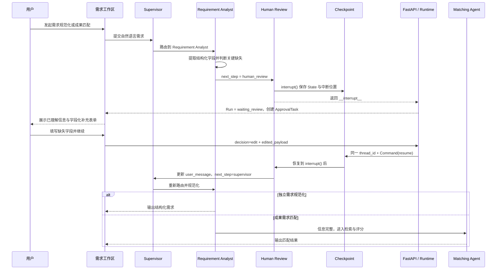

# LangGraph Human Review：需求规范化中的暂停、补充与恢复

本文只解释 HydroBridge 水利项目里的 Human-in-the-loop（HITL）机制，重点回答四个问题：需求何时需要人工介入，`next_step` 与 `interrupt()` 有什么区别，用户补充的信息如何回到原工作流，以及前端为什么能够展示可填写的业务表单而不是原始 JSON。

Human Review 不是第五个业务功能。项目的业务功能仍然是：**需求规范化、成果找寻、成果评价、成果需求匹配**。Human Review 是嵌在需求规范化和成果找寻中的流程控制机制。

## 1. 先记住四个结论

1. `next_step = "human_review"` 只决定图的下一站，**不会让图暂停**。
2. `interrupt(...)` 才是真正的暂停点，它把当前图状态交给 Checkpoint 保存，并把控制权交还给外部系统。
3. 恢复时必须使用原来的 `thread_id`，并传入 `Command(resume=...)`，否则无法找到原工作流的检查点。
4. 需求澄清不是“点一下同意”。用户应补充缺失字段，前端以 `edit + edited_payload` 提交，图更新 `user_message` 后重新规范化需求。

一句话记忆：**`next_step` 决定去哪里，`interrupt()` 决定何时停，Checkpoint 保存现场，`thread_id + Command(resume)` 负责回到现场。**

## 2. 为什么需求规范化需要人工介入

需求规范化把用户的自然语言描述整理为后续成果找寻和成果匹配能够使用的结构化需求，包括：工程场景、工程对象、核心问题、业务目标、硬约束、软偏好和检索词。

例如用户只输入：

> 帮我找一个合适的供水技术。

这句话虽然表达了大致方向，但不足以支撑可靠匹配。系统不知道对象是泵站、管网、水厂还是水库；不知道问题是漏损、能耗、巡检、故障还是水质；也不知道低温、不停水施工、预算和工期等条件。

这时不能让模型自行猜测。猜错工程对象或硬约束，比少推荐一个结果更危险。因此 Requirement Analyst 只在**缺少会实质改变推荐结果的关键字段**时触发人工补充；可选信息不足不必阻断，系统仍可进行探索性检索或匹配。

项目只把人工介入放在最有价值的两个位置：

| 场景 | 自动处理 | 人工负责 |
| --- | --- | --- |
| 需求规范化 | 提取现有信息、判断完整度、生成缺失字段 | 补充工程对象、核心问题或硬约束 |
| 成果找寻入库 | 高分自动入库、低分自动淘汰 | 批量确认质量灰区候选 |

这样既保留人的控制权，也不会让人工审核成为全链路瓶颈。

## 3. 从用户输入到图暂停的完整过程

### 3.1 Supervisor 先做意图路由

初始 `AgentState` 可以简化为：

```python
{
    "run_id": "run_001",
    "thread_id": "thread_001",
    "user_message": "帮我找一个合适的供水技术",
    "task_type": "auto",
    "context": {"requirement_id": "req_001", "match_id": "match_001"}
}
```

图从 `START` 进入 Supervisor。Supervisor 判断这是独立的需求规范化任务，还是成果需求匹配前的需求侧处理，然后把 `next_step` 设置为 `requirement_analyst`。

两种入口复用同一个 Requirement Analyst：

- 用户在“需求规范化”功能中发起任务：`task_type = requirement_analysis`；
- 用户在“成果需求匹配”中发起任务：先经过 Requirement Analyst，再进入 RAG 与业务评分。

因此需求规范化既是一个可独立体验的业务功能，也是成果需求匹配的前置能力，但代码中不是两套重复实现。

### 3.2 Requirement Analyst 生成结构化需求

Requirement Analyst 按 Pydantic Schema 生成结构化结果。对模糊输入，结果可以理解为：

```python
{
    "scenario": "供水工程",
    "problem": "",
    "objectives": [],
    "hard_constraints": {},
    "soft_preferences": {},
    "completeness_score": 0.35,
    "missing_critical_fields": ["工程场景和问题描述", "现场约束"],
    "requires_clarification": True,
    "clarification_question": "请补充具体工程对象、核心问题和现场限制。"
}
```

真正决定是否暂停的是 `requires_clarification`，而不是单纯用完整度分数做机械判断。完整度是给用户和系统看的连续指标；`requires_clarification` 表示当前缺失项是否足以阻止可靠执行。

### 3.3 Requirement Analyst 只准备暂停，不直接暂停

当前代码位于 `backend/app/agents/graph.py` 的 `requirement_node()`。当需要澄清时，它做四件事：

1. 保存 `requirement_profile`；
2. 设置 `needs_human_review = True` 和审核原因；
3. 生成前端可直接渲染的 `review_payload`；
4. 设置 `next_step = "human_review"`。

核心逻辑可以概括为：

```python
next_step = (
    "human_review"
    if profile.requires_clarification
    else "final_report_agent"  # 独立需求规范化
    if state["task_type"] == "requirement_analysis"
    else "assessment_matching_agent"  # 成果需求匹配
)
```

这里仍没有暂停。LangGraph 只是根据条件边把图送到 `human_review` 节点。

### 3.4 为什么后端要生成 UI-ready payload

旧交互只传 `question` 和 `missing_fields`，通用审核卡片只能把对象作为 JSON 打印出来，用户不知道该填写什么，也无法逐项补充。

现在 `_requirement_clarification_payload()` 会生成面向前端的业务契约：

```python
{
    "type": "clarification",
    "title": "需求信息还不完整",
    "description": "补充以下关键信息后，系统会自动继续原来的任务。",
    "question": "请补充具体工程对象、核心问题和现场限制。",
    "completeness_score": 0.35,
    "missing_fields": ["工程场景和问题描述", "现场约束"],
    "fields": [
        {
            "key": "scenario_and_problem",
            "label": "工程对象与核心问题",
            "reason": "工程对象和核心问题会直接决定候选成果范围。",
            "placeholder": "例如：北方农村供水泵站，人工巡检成本高……",
            "suggestions": [
                "北方农村供水泵站，人工巡检成本高且故障发现不及时",
                "大型灌区输水渠道，渗漏定位慢且巡检范围大",
                "山区小型水库，汛期水位与渗压异常难以及时发现"
            ],
            "input_type": "textarea",
            "required": True
        },
        {
            "key": "site_constraints",
            "label": "施工与环境约束",
            "reason": "施工、气候和运行条件会影响成果是否可落地。",
            "placeholder": "例如：高寒环境，改造期间尽量不停水",
            "input_type": "textarea",
            "required": True
        }
    ],
    "current_profile": {
        "scenario": "供水工程",
        "problem": "",
        "objectives": [],
        "hard_constraints": {},
        "soft_preferences": {}
    },
    "original_message": "帮我找一个合适的供水技术",
    "requirement_id": "req_001",
    "match_id": "match_001",
    "resume_action": "requirement_matching"
}
```

各字段的职责如下：

| 字段 | 作用 |
| --- | --- |
| `fields` | 告诉前端需要生成哪些输入框、标签、说明和示例 |
| `fields[].suggestions` | 为对应缺失字段提供三条可点击参考表达；点击只会填入文本框，用户仍可修改 |
| `current_profile` | 展示 Agent 已经理解到的内容，避免用户重复填写 |
| `original_message` | 恢复时与用户新增信息合并，保留原始语义 |
| `requirement_id`、`match_id` | 把审核任务与具体需求工作区和匹配任务关联起来 |
| `resume_action` | 告诉前端提交后将继续需求规范化还是成果匹配 |

后端同时发布 `approval.required` 事件，运行时在真正收到 `__interrupt__` 后创建 `ApprovalTask`。事件用于实时通知，ApprovalTask 用于持久化待处理任务，两者职责不同。

### 3.5 条件路由进入 Human Review

项目的统一路由逻辑可简化为：

```python
def route(state):
    return state.get("next_step", "final_report_agent")
```

Requirement Analyst 返回 `next_step = "human_review"` 后，条件边把 State 传给 Human Review 节点。到这一步，图仍处于正常执行状态。

### 3.6 `interrupt()` 才是真正的暂停点

Human Review 节点执行：

```python
decision = interrupt(
    {
        "run_id": state["run_id"],
        "reason": state.get("review_reason", ""),
        "payload": state.get("review_payload", {}),
        "allowed_decisions": ["approve", "edit", "reject"],
    }
)
```

执行到 `interrupt()` 后，LangGraph：

- 将当前 State 和中断位置写入 Checkpoint；
- 返回 `__interrupt__`，停止后续节点；
- 不再进入 Matching、Verification 或 Final Report；
- 由 Agent Runtime 把运行状态更新为 `waiting_review`；
- 创建一条待处理的 ApprovalTask。

这时可以把执行过程记为：

```text
Requirement Analyst
→ next_step = human_review
→ 条件边到达 Human Review
→ interrupt() 保存现场并暂停
→ Run.status = waiting_review
→ 前端显示字段化补充卡片
```

## 4. 前端现在如何展示人工补充

前端 `ClarificationApprovalCard` 根据 `review_payload.fields` 动态生成表单，而不是显示原始 JSON。卡片会展示：

- “需求信息还不完整”的明确标题；
- 当前需求完整度；
- Agent 已理解的场景、问题和目标；
- 每个缺失字段为什么重要；
- 每项最多三条贴近水利场景的参考表达；
- 可点击填入且仍可编辑的示例，以及完全自由输入的文本框；
- “补充完成并继续”与“取消本次任务”操作。

该卡片有两个入口：

1. 在“人工审核队列”统一处理；
2. 在对应需求的抽屉工作区内直接处理。

第二个入口解决了旧版交互割裂的问题：用户在某条需求上发起规范化或匹配后，不必离开当前业务页面去猜哪个审核任务属于它。

“补充完成并继续”只有在必填项全部填写后才可提交。示例按钮不是固定答案：第一次点击会把表达写进文本框，用户可以继续改写，再次点击同一示例可取消选择。提交期间按钮变为“正在重新规范化”，并禁止重复提交。前端将原始需求和各字段答案组织成一条增强后的 `message`，然后提交：

```json
{
  "decision": "edit",
  "comment": "已补充需求信息，请继续执行",
  "edited_payload": {
    "message": "原始需求……\n\n用户补充的关键信息：\n工程对象与核心问题：……\n施工与环境约束：……",
    "fields": {
      "scenario_and_problem": "……",
      "site_constraints": "……"
    }
  }
}
```

当前图实际使用 `edited_payload.message` 更新 `user_message`；`fields` 同时保留了结构化表单答案，便于后续扩展审计或字段级回写。

## 5. 用户补充后如何恢复原工作流

API 接收决定后先完成 ApprovalTask，并把 Agent Run 及其关联的 RequirementRefinement 或 MatchRun 一起从 `waiting_review` 更新为 `queued`，随后用原 `thread_id` 重新调用图。业务记录同步回到队列非常重要：前端依据这些状态判断是否继续轮询；如果只更新 Agent Run，后台虽然已经恢复，需求工作区却可能停留在旧结果，看起来就像“没有自动重新规范化”。核心语义是：

```python
graph.ainvoke(
    Command(resume=resume_payload),
    config={"configurable": {"thread_id": original_thread_id}},
)
```

这不是从 `START` 创建一个新图。恢复过程是：

1. `thread_id` 找到之前的 Checkpoint；
2. LangGraph 回到上一次 `interrupt()` 所在位置；
3. `Command(resume=...)` 的数据成为 `interrupt()` 的返回值；
4. Human Review 从 `decision = interrupt(...)` 的下一行继续执行；
5. `edit` 决定中的 `edited_payload.message` 覆盖 State 里的 `user_message`；
6. `next_step` 被设置为 `supervisor`；
7. Supervisor 和 Requirement Analyst 用补充后的完整描述重新判断和规范化。
8. 前端在 `queued/running` 期间同时刷新规范化记录和需求详情，完成后自动显示新的结构化字段、完整度及剩余缺失项。

为什么返回 Supervisor，而不是直接进入匹配？因为用户补充的信息可能改变任务意图、工程对象和执行计划。重新路由与重新规范化可以防止沿用暂停前的错误理解。

重新规范化后有两种出口：

- 如果仍缺少关键字段，再次进入 Human Review；
- 如果关键字段完整，独立需求规范化任务进入 Final Report，匹配任务进入 Assessment Matching。

实际前端要求用户一次补齐当前列出的必填项，因此正常情况下不会反复中断。

这里的“自动重新规范化”是后端工作流行为，不依赖用户再点击一次“AI 需求规范化”。API 会把审核类型写入恢复载荷，Agent Runtime 先保存补充后的增强消息，再恢复原图。正常情况下从 Checkpoint 继续；如果本地进程重启或历史测试记录导致需求澄清 Checkpoint 缺失，运行时只针对 `clarification + edit` 这一安全场景，使用增强消息重新进入同一个需求规范化流程。成果入库审核不会使用这个降级路径，避免重复入库。

## 6. 三种人工决定分别意味着什么

Human Review 的通用协议支持 `approve`、`edit`、`reject`，但不同审核类型的业务含义不同。

| 决定 | 需求澄清中的含义 | 成果入库灰区中的含义 |
| --- | --- | --- |
| `edit` | 用户补充信息，返回 Supervisor 重新规范化 | 用户选择部分候选入库 |
| `approve` | 接受当前信息；独立规范化结束或匹配继续 | 全部灰区候选入库 |
| `reject` | 取消本次任务并进入最终收尾 | 本轮灰区候选不入库 |

需求澄清前端只突出“补充完成并继续”和“取消本次任务”，不把“直接批准不完整需求”作为主操作。这是业务 UX 对底层通用协议的合理收敛。

## 7. 时序图



## 8. 成果找寻灰区审核如何复用同一机制

成果找寻的 Human Review 与需求澄清共享同一个 `human_review` 节点，但 `review_payload.type = "research_ingestion"`。

流程是：高质量候选自动入库，低质量候选自动淘汰，灰区候选最多批量展示若干项供用户勾选。人工决定恢复后，Human Review 写入：

- `ingestion_review_completed`；
- `ingestion_approved_candidate_ids`；
- `ingestion_reviewer_id`。

下一步进入 `research_ingestion_agent`，只把人工选择的候选写入 MySQL，并由后续索引流程同步到 Qdrant。

这说明 Human-in-the-loop 不是一个普通弹窗，而是**人工修改 AgentState，并真实改变后续节点、入库数据和最终结果**。

## 9. Checkpoint、业务数据库与 Redis 的关系

需要区分三类状态：

| 状态 | 保存内容 | 作用 |
| --- | --- | --- |
| LangGraph Checkpoint | AgentState、当前节点、中断位置 | 让图可以从暂停现场恢复 |
| MySQL | AgentRun、ApprovalTask、需求、匹配结果 | 保存可查询、可审计的业务事实 |
| Redis 运行态 | 事件流、短期状态与缓存 | 支持实时进度、并发和性能优化 |

Checkpoint 不能依赖可能被随时淘汰的普通缓存 Key。长时间等待人工输入时，只有可靠的持久化检查点和稳定的 `thread_id` 才能保证恢复。

## 10. 为什么恢复流程必须考虑幂等性

中断恢复后，中断点附近的节点可能重新执行。如果节点包含写库、发消息或建立索引等副作用，就必须避免重复处理。

项目在成果找寻入库中使用：

- 归一化成果标题，避免同一成果重复创建；
- 来源 URL 规范化和哈希去重，避免同一网页重复保存；
- Outbox 版本唯一约束，避免同一成果版本重复触发 Qdrant 索引。

面试时可以概括为：**Checkpoint 解决“从哪里继续”，幂等性解决“继续时不要重复做坏事”。**

## 11. 当前实现对应的关键代码

| 代码位置 | 作用 |
| --- | --- |
| `backend/app/agents/graph.py` | `requirement_node`、UI-ready payload、`human_review_node`、`interrupt()` 和恢复路由 |
| `backend/app/services/agent_runtime.py` | 使用 `thread_id` 执行/恢复图，把 `__interrupt__` 转成 `waiting_review` 和 ApprovalTask |
| `backend/app/api/routes/runs.py` | 接收 approve/edit/reject，并构造 `resume_payload` |
| `backend/app/schemas/run.py` | 定义 `RunDecision` 协议 |
| `app/HydroBridgeApp.tsx` | 字段化补充卡片、需求抽屉内联审核、提交 `edited_payload` |
| `backend/tests/unit/test_agent_graph.py` | 验证澄清中断载荷、edit 恢复和后续图执行 |

## 12. 面试问题与回答

### Q1：`next_step = human_review` 是否已经暂停图？

没有。它只是条件路由的值，让图进入 Human Review 节点。真正的暂停发生在该节点调用 `interrupt()` 时。

### Q2：为什么不用普通接口返回“信息不足”，而要使用 LangGraph interrupt？

普通接口只能结束本次请求，后续往往需要重新创建任务并重建上下文。`interrupt()` 会保留图状态和中断位置，用户补充后可以在同一个工作流中继续，Agent 轨迹也保持完整。

### Q3：为什么恢复必须使用同一个 `thread_id`？

Checkpoint 按 thread 标识工作流实例。没有原 `thread_id`，LangGraph 不知道应该加载哪一个状态和中断点。

### Q4：为什么用户补充后要返回 Supervisor？

补充内容可能改变任务意图、工程对象和执行计划。返回 Supervisor 后重新路由，再由 Requirement Analyst 重新结构化，能够避免直接沿用暂停前的不完整理解。

### Q5：为什么需求完整度低不一定都需要人工介入？

完整度是连续评分，而是否中断取决于缺失项是否会实质改变结果。缺少工程对象或硬约束必须补充；缺少非关键偏好时可以执行探索性匹配。

### Q6：为什么前端不直接展示后端 JSON？

Human Review 是业务交互，不是调试控制台。后端提供字段定义、原因、占位示例和已识别内容，前端动态渲染表单，用户才能知道补什么、为什么补以及提交后会继续什么任务。

### Q7：人工输入是否真的影响工作流？

会。需求澄清把补充后的 `message` 写回 `AgentState.user_message` 并重新规范化；成果灰区审核把选择的 candidate IDs 写回 State，Research Ingestion 只入库被确认的候选。

### Q8：怎样避免一个模糊需求让用户反复补充？

后端一次返回当前全部关键缺失字段，前端逐项展示且要求必填项全部完成后才能继续。恢复后模型基于“原始需求 + 全部补充内容”重新规范化，正常情况下只中断一次。

## 13. 面试表达

完整表达：

> 在需求规范化节点中，Requirement Analyst 会输出结构化需求、完整度和关键缺失字段。若工程对象、核心问题或硬约束不足，节点先生成包含字段定义、缺失原因、已识别信息和恢复目标的审核载荷，再把 `next_step` 设置为 `human_review`。条件边只负责把图路由过去，真正的暂停由 Human Review 节点的 `interrupt()` 完成，LangGraph 会通过 Checkpoint 保存 AgentState 和中断位置。前端据载荷渲染字段化补充表单；用户提交后，后端用相同 `thread_id` 和 `Command(resume=...)` 恢复原图，把补充内容写回 `user_message`，再经过 Supervisor 和 Requirement Analyst 重新规范化。需求完整后，独立规范化任务输出结果，匹配任务继续进入 RAG 和业务评分。

最短记忆版：

> `next_step` 负责路由，`interrupt()` 负责暂停，Checkpoint 保存现场；用户补充后用原 `thread_id + Command(resume)` 恢复，更新 State 后继续原任务。
