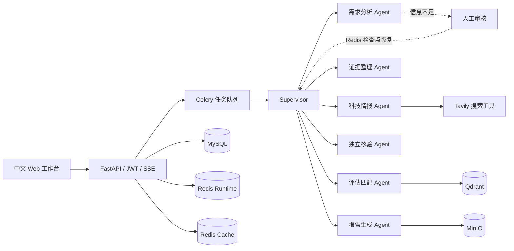

# HydroBridge Agent Platform

HydroBridge 是一个可直接在本机体验的水利科技成果发现、证据核验和工程供需匹配多 Agent 平台。项目以 Python/FastAPI 和 LangGraph 为核心，完整使用 MySQL、两套 Redis、Qdrant、MinIO、Celery，并提供中文 Web 工作台、人工审核、实时轨迹、断点恢复和可下载报告。

项目默认导入本机整理后的 15 项真实水利科技成果。即使未配置外部 API Key，也可以使用离线推理与混合检索完成全链路体验；配置模型和 Tavily 后会启用真实大模型推理及联网调研。

## 一键启动

前置条件：

- Windows 10/11 与 Docker Desktop
- Docker Desktop 已切换到 Linux Containers
- 建议预留 8 GB 以上内存

在 PowerShell 中运行：

```powershell
Set-Location E:\HydroBridge-Agent-Platform
.\scripts\start.ps1 -Build
```

首次启动会构建镜像、创建数据库结构、创建对象存储桶、导入成果数据并建立向量索引。所有容器就绪后访问：

| 入口 | 地址 | 用途 |
| --- | --- | --- |
| Web 工作台 | http://localhost:3000 | 主要体验入口 |
| OpenAPI 文档 | http://localhost:8000/docs | 调试后端接口 |
| MinIO 控制台 | http://localhost:9001 | 查看资料与报告文件 |
| Qdrant Dashboard | http://localhost:6333/dashboard | 查看向量集合 |
| API 健康检查 | http://localhost:8000/api/v1/readiness | 查看依赖状态 |

默认本地管理员：

```text
账号：admin@hydrobridge.cn
密码：ChangeMe123!
```

这是本地演示账号。若用于共享环境，请先修改 `.env` 中的密码、JWT 密钥以及 MySQL/MinIO 密码。

停止服务：

```powershell
.\scripts\stop.ps1
```

默认只停止容器，不删除 MySQL、Redis、Qdrant 和 MinIO 数据卷。

## 可以体验什么

- 在 Agent 工作台输入水利工程问题，观察 Supervisor 自动规划并调度专业 Agent。
- 通过 SSE 实时查看 Agent 开始、完成、工具调用、审核等待和最终完成事件。
- 对水利科技成果执行稠密向量、中文稀疏词项、RRF 融合与业务重排。
- 查看候选成果的适用性、成熟度、证据质量、实施风险和最终评分。
- 当关键需求信息不足时进入人工审核；提交补充信息后从 Redis 检查点继续执行。
- 在运行记录中检查 AgentStep、ToolCall、耗时、Token 和错误信息。
- 将最终 Markdown 报告保存到 MinIO，并通过鉴权接口下载且校验 SHA-256。
- 新建成果、审核成果并通过事务 outbox 异步更新 Qdrant 索引。
- 新建工程需求，并直接带入成果匹配工作台。
- 查看 MySQL、Redis、Qdrant、MinIO、LLM 和 Tavily 的实时就绪状态。

## 多 Agent 架构



Agent 分工：

1. **Supervisor**：识别任务类型、制定计划、选择下一节点、控制最大迭代次数。
2. **需求分析 Agent**：把自然语言问题转为场景、目标、硬约束、软偏好和检索词。
3. **科技情报 Agent**：只通过 Tavily 执行外部搜索，并保留来源和检索轨迹。
4. **证据整理 Agent**：去重、分级、保留可追溯来源，避免把弱证据包装为确定事实。
5. **评估匹配 Agent**：调用 Qdrant 混合检索，按场景、效果、成熟度、风险和成本评分。
6. **独立核验 Agent**：检查引用覆盖、分数一致性、约束冲突与结论风险。
7. **报告生成 Agent**：输出结构化 Markdown 报告、引用、候选排序和下一步建议。

## MySQL 和 Redis 在项目中的真实作用

这不是为了“把技术栈写进简历”而接入数据库；各组件承担不同一致性和性能职责。

### MySQL：事实来源与审计底座

- 用户、角色、组织和刷新令牌
- 成果、证据、需求、评估规则与匹配结果
- 对话、AgentRun、AgentStep、ToolCall 和模型用量
- 人工审核任务与决策记录
- 报告 Artifact 元数据及 SHA-256
- 事务 outbox：成果审核与索引更新同事务提交，避免数据库成功但向量库漏更新

### Redis Runtime：不可随意丢失的运行状态

- Celery Broker 与任务结果
- LangGraph 检查点和人工审核后的恢复
- SSE 事件流及断线续传游标
- AOF 每秒持久化与 `noeviction`，避免检查点因内存策略被淘汰

### Redis Cache：允许丢失、可重建的缓存

- Tavily 搜索结果缓存
- 与运行态 Redis 物理隔离
- `volatile-lfu` 淘汰策略；缓存故障不会破坏 MySQL 事实数据或 LangGraph 检查点

这种拆分能在面试中清楚回答：为什么不能把缓存、任务队列和 Agent 检查点混在一套随时淘汰数据的 Redis 中。

## 检索与数据链路

1. 启动时从 `seed-data/achievements.json` 幂等导入成果。
2. MySQL 保存完整结构化记录，并写入 outbox。
3. Celery 定时领取 outbox，写入版本化 Qdrant 索引。
4. 查询时同时执行稠密和稀疏检索，通过 RRF 融合并进行领域重排。
5. Agent 对候选成果进行多维评分；核验 Agent 检查证据与结论。
6. 报告元数据进入 MySQL，正文进入 MinIO，前端通过鉴权下载。

未安装本地 BGE 模型时，平台使用确定性的离线向量与重排器，便于无 Key 启动和自动测试。安装 `backend` 的 `rag-local` 可选依赖后，可以启用 BGE-M3 与 BGE Reranker。

## 配置真实 LLM 与 Tavily

编辑项目根目录 `.env`：

```dotenv
LLM_API_KEY=你的模型服务密钥
LLM_BASE_URL=https://你的-openai-compatible-endpoint/v1
LLM_MODEL=你的模型名称
TAVILY_API_KEY=你的-tavily-key
```

如果使用 OpenAI 兼容供应商，`LLM_BASE_URL`、`LLM_MODEL` 必须与该供应商文档一致。联网搜索只使用 Tavily，不混入第二套搜索提供商。

修改后重新创建后端容器：

```powershell
docker compose up -d --build api worker scheduler
```

然后打开“系统状态”，确认 LLM 和 Tavily 均显示正常配置。

## 测试

运行后端静态检查、24 项自动化测试、前端 ESLint、生产构建和服务端渲染测试：

```powershell
.\scripts\test.ps1
```

服务已经启动时，可追加容器健康冒烟测试：

```powershell
.\scripts\test.ps1 -Smoke
```

当前自动化覆盖：

- JWT 登录、当前用户、刷新令牌轮换、防重放与退出撤销
- 成果、需求、概览和健康接口
- Artifact 元数据、鉴权下载和 SHA-256
- Redis 事件流
- 水利 JSON 归一化导入
- 离线向量与领域重排
- 外部来源相关性/权威性排序与策展后引用过滤
- 多 Agent 完整运行
- 人工中断与检查点恢复
- 任务取消与安全响应头

交付验收还实际执行过 Redis Cache 停机/恢复和 Redis Runtime 重启测试：API 能正确降级再恢复，AOF 数据保留，Celery 能自动重连并继续消费任务。

## 目录

```text
app/                         Web 界面与 API 客户端
backend/app/agents/          LangGraph 状态、节点和路由
backend/app/api/             FastAPI 路由与鉴权
backend/app/db/              SQLAlchemy 模型与数据库会话
backend/app/services/        Redis、Qdrant、MinIO、检索和运行服务
backend/app/worker/          Celery 配置与任务
backend/tests/               后端自动化测试
seed-data/                   已归一化水利成果
scripts/                     启动、停止和测试脚本
docs/                        架构、测试和面试说明
docker-compose.yml           本地完整基础设施
```

更深入的实现说明见：

- [架构说明](docs/ARCHITECTURE.md)
- [测试与验收](docs/TESTING.md)
- [面试讲解提纲](docs/INTERVIEW_GUIDE.md)
