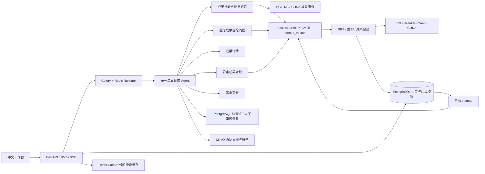

# HydroBridge Agent Platform

水利科技成果检索、证据问答与工程需求匹配平台。当前实现以 **PostgreSQL + Elasticsearch + 一个工具调用 Agent** 为核心，保留中文工作台、JWT 登录、Celery、SSE 实时轨迹、人工审核和 MinIO 报告下载。

本机已导入经确认范围内的完整水利成果资料：**3,860 项成果、324 份去重原始文档**，包括成果目录、申请材料、研究报告、评价意见及对应结构化 JSON。原件保存在 MinIO，精确片段与来源保存在 PostgreSQL，检索使用 **BGE-M3 + Elasticsearch IK/BM25 + BGE-reranker-v2-m3**。仓库仍只附带 15 项种子数据；本机原始资料与导入缓存不提交 Git。

## 启动

当前默认配置需要支持 CUDA 的 NVIDIA GPU（本机为 8 GB 显存 RTX 4060）、Docker Desktop 的 Linux 容器 GPU 支持，以及已下载的模型。本机以 16 GB 内存、约 8 GB Docker 内存完成验收。PowerShell：

```powershell
.\backend\.venv\Scripts\python.exe scripts\download-bge-models.py
.\scripts\start.ps1 -Build
```

下载脚本按固定 Hugging Face revision 下载两份 BGE 权重并核对 SHA-256，总计约 4.5 GB；重复执行会复用已验证文件。可用 `MODEL_DOWNLOAD_PROXY` 设置下载代理。启动脚本在缺少 `.env` 时从 `.env.example` 创建文件；已有 `.env` 保留。Compose 显式设置容器内 PG/ES 地址和 BGE 服务。首次启动构建带 **IK 8.19.3** 的 Elasticsearch 8.19.3 镜像，执行 Alembic、初始化账号、幂等导入种子数据，再由 Outbox worker 建立分块索引。

已有镜像时运行 `.\scripts\start.ps1` 即可。前端使用 Debian Node 镜像以满足 workerd 的 glibc 要求；MinIO 从官方固定提交构建，运行时 Redis 使用普通 Redis 7.4。MinIO 上游源码已归档，此配置用于本地开发，后续生产部署需单独评估维护方案。

| 入口 | 地址 |
| --- | --- |
| 中文工作台 | http://localhost:3000 |
| API 文档 | http://localhost:8000/docs |
| 依赖状态 | http://localhost:8000/api/v1/readiness |
| Elasticsearch | http://localhost:9200 |
| PostgreSQL | localhost:5433 |
| MinIO 控制台 | http://localhost:9001 |
| BGE 模型健康状态（仅本机） | http://127.0.0.1:8081/health |

本地演示账号为 `admin@hydrobridge.cn` / `ChangeMe123!`。共享环境需更改 `.env` 中的账号、JWT 与服务密码。运行 `scripts/stop.ps1` 只停止容器；不要用 `down -v` 清理已有数据。

**旧数据库说明：** PostgreSQL 使用新的 `postgres-data` 数据卷；旧 MySQL/Qdrant 数据卷未被自动删除，也不会自动导入 PostgreSQL。旧库中的业务记录需要先备份，再迁移；当前启动流程导入仓库内 15 项种子成果。原 Redis 检查点不能直接用于新的单 Agent 图，旧审核中任务需在旧版结束，或在新版新建任务。

## 当前架构



活动图只有 `agent → tools/workflow → respond` 和审核节点。模型通过原生 function calling 从以下八个工具中选择；模型未配置时使用明确的确定性路由和原文摘录模式。

| 工具 | 行为 |
| --- | --- |
| `research_achievements` | 联网搜寻、证据提取与质量分流，高置信度入库、灰区转审核 |
| `evaluate_achievement` | 按成果 ID、准确名称或当前唯一成果启动自身质量评价；对象不明确时先澄清 |
| `normalize_requirement` | 独立整理和澄清需求，本次不自动执行匹配 |
| `search_achievements` | 最多两轮检索、证据充分性判断、带逐字引用的问答 |
| `match_achievements` | 固定的需求解析、过滤、混合召回、重排、成果聚合与硬约束核验流程 |
| `get_achievement` | 读取有权访问的已审核成果详情 |
| `compare_achievements` | 在指定成果 ID 范围内检索并对比 |
| `update_requirement` | 更新当前需求描述；持久化时验证需求归属 |

联网调研、成果评价、需求规范化既能由聊天中的工具调用触发，也可通过显式任务类型直接启动固定流程。其辅助类名称保留部分历史 `Agent` 命名，但不再由 Supervisor 动态调度。联网调研仍使用 Tavily，并保留证据策展、质量分流及灰区批量审核。

### 聊天入口与管理页面

聊天工作台按三个业务方向组织：成果搜寻与评价、需求分析与匹配、成果知识问答。默认自动选择任务，手动任务类型放在高级选项。成果库和需求页面保留评价、规范化、匹配快捷按钮；聊天和页面共用业务记录创建与结果保存逻辑，评价记录、需求画像、匹配历史与候选决策可以在管理页继续查看和处理。

聊天首次整理或匹配需求时会建立当前用户的需求记录，后续轮次延续该需求；新建会话可开始独立需求。评价对象必须来自有权访问的成果，模型不得编造成果 ID。入围、淘汰、采纳及入库审批仍由用户在页面上明确操作。

需求信息不足时，工作台显示本次任务的澄清问题，既可直接在输入框补充，也可展开字段表单。提交后恢复同一运行及检查点，不会创建另一条匹配任务；审核中心也保留集中处理入口。等待补充时结束当前事件流，提交补充后重新订阅并显示后续结果。

同一会话可继续追问已检索成果，服务端读取此前完成轮次的历史与成果范围。每个运行使用独立的 PostgreSQL 检查点 ID，恢复审核时复用该运行 ID。点击“新建会话”可开始新的检索范围。

## 证据与检索规则

1. PostgreSQL 保存成果、来源、版本、精确片段、业务记录、对话与审计轨迹。
2. 对结构化字段和原始文档正文切块，默认 700 字符、100 字符重叠。片段保留字段名、起止字符位置、SHA-256、成果版本及确定性 ID。原文片段还保留文档 ID、PDF 页码或工作表行号等定位信息；扫描文档使用中文 OCR。位置对应解析后的规范化文本，原件可从引用处下载核对。
3. 审核或修改与 Outbox 同事务提交。worker 锁定成果，幂等写入片段与 ES，成功后标记事件；失败退避重试，过期 processing 事件可重新领取。
4. ES 的两路召回都带审批状态、组织、显式成果范围和可计算的约束过滤。数值 TRL 低于要求时排除，TRL 缺失时保留待核验。
5. BM25 和 dense_vector 的候选按 chunk ID 进行 RRF，重排后聚合为成果。返回前再次读取 PostgreSQL，核对权限、审批、版本和片段哈希，拒绝滞后索引中的旧证据。
6. 问答事实携带 chunk ID 与原文 quote。服务端剔除未知片段和不在原文中的引文；若仍不足，最多追加一次检索并说明缺口。逐字引文校验不能证明模型释义必然正确，关键工程结论仍须人工复核。
7. 硬约束使用 `satisfied / violated / unknown` 三态，分两级核验：先按字段规则核验有证据的 TRL、同口径数值范围及布尔值；规则无法判定的自然语言约束（如不停水施工、高寒地区），对排名前 `MATCH_EVIDENCE_VERIFY_LIMIT`（默认 5）项成果在该成果范围内按约束检索原文片段，由模型给出判断，且必须引用片段中逐字存在、不少于 6 个字的原文，否则仍为未知。规则结果不会被模型覆盖；结果标注 `method=rule/evidence`。
8. 匹配分标记为 `retrieval_relevance`，仅用于相关度排序。未知成本与效果不伪装为已验证的业务评分，推荐文案同时考虑约束状态。

原始资料未明确给出 TRL 时，导入器不会根据“存在应用案例”推算成熟度。`evidence_score` 是资料字段完整度启发式分，不是经专家标定的真实性概率；其计算依据写入 `structured_data`。

## 模型与检索配置

```dotenv
LLM_API_KEY=你的密钥
LLM_BASE_URL=https://你的兼容服务/v1
LLM_MODEL=你的模型
TAVILY_API_KEY=你的搜索密钥

RETRIEVAL_BACKEND=elasticsearch
RETRIEVAL_ALLOW_FALLBACK=false
ELASTICSEARCH_VECTOR_INDEX_TYPE=int8_hnsw   # 新建索引的 HNSW 类型；等同 ES 8.x 默认
ELASTICSEARCH_HNSW_M=16
ELASTICSEARCH_HNSW_EF_CONSTRUCTION=100
KNN_NUM_CANDIDATES_FACTOR=3                 # num_candidates = k × 3
MATCH_EVIDENCE_VERIFY_LIMIT=5
ELASTICSEARCH_INDEX=hydrobridge-chunks-bge-v4
ELASTICSEARCH_ANALYZER=ik_max_word
KNOWLEDGE_INDEX_VERSION=4
EMBEDDING_BACKEND=bge_service
BGE_SERVICE_URL=http://bge:8080
```

Compose 默认启用独立 `bge` 服务：BGE-M3 输出 1024 维归一化向量，BGE-reranker-v2-m3 对混合召回片段进行重排；使用 CUDA FP16、batch 8、最多 1024 token。只有一个进程持有 GPU 模型，API 与 Celery 通过 HTTP 共用，避免各 worker 重复加载显存。PyTorch 2.6.0 cu124 与本机驱动兼容，权重由本地目录只读挂载，推理不联网。

`bge_service` 加载或调用失败会明确报错，不退回 hash。`hash` 仅供独立开发测试；旧 `auto` / 本地 `bge_m3` 模式仍可用于特定环境，但不是当前 Compose 的生产预览配置。宿主机运行后端命令时用 `scripts/backend-local.py`，它会设置正确的本地 PG/ES/MinIO/BGE 端口并加载现有密钥，不输出密钥。

`RETRIEVAL_BACKEND=local` 是独立的本地冒烟检索；不是 ES BM25/IK。ES 故障默认向上报错，仅显式开启 fallback 时才退回本地，并在结果记录后端和降级原因。

改变向量模型、维度或切块规则后，应换新的 `ELASTICSEARCH_INDEX` 并增加 `KNOWLEDGE_INDEX_VERSION`，然后重启 bootstrap 触发重建。不同模型的向量不得混用。`cjk` 分词仅供没有 IK 的独立开发环境使用。

Compose 也会可选读取 `%USERPROFILE%\.continuum\.env`，其中 `CONTINUUM_LLM_*` 优先，无需把密钥复制进仓库。测试会清空真实模型密钥。

## 验证与可复现评测

当前 BGE 和完整文档库的清单、逐题检索结果、真实问答与浏览器验证见 [BGE 全库验收记录](docs/BGE_FULL_CORPUS_VERIFICATION.md)。前一阶段的架构迁移、人工审核恢复和 15 项种子数据验证保留在 [PG/ES 历史验收记录](docs/PG_ES_VERIFICATION.md)。

```powershell
# 后端静态检查/离线测试、前端 lint/生产构建/渲染测试
.\scripts\test.ps1

# 服务启动后检查所有容器与 readiness
.\scripts\test.ps1 -Smoke

# 在临时 schema 和临时索引上验证真实 PG、ES/IK、Outbox 重放与检查点重连
docker compose exec api python -m app.verify_infrastructure

# 不依赖 Docker 的检索消融
Set-Location backend
$env:DATABASE_URL = 'sqlite+aiosqlite:///:memory:'
.\.venv\Scripts\python.exe -m app.evaluate_retrieval
```

对当前完整文档库执行只读的真实 ES/BGE 消融：

```powershell
.\backend\.venv\Scripts\python.exe scripts\backend-local.py app.evaluate_live_corpus --cases evaluation\full_corpus_cases.json --output evaluation\results\full-corpus-bge.json
```

40 道验收问题分别执行 BM25、BGE dense、RRF hybrid、hybrid + BGE reranker。指标使用 Hit@1/5/10（前 k 名中至少命中一个标注目标）与 MRR@10，逐题排名、来源证据、标签 SHA-256 和耗时保存在 `evaluation/results/full-corpus-bge.json`。标签在运行前固定，属于开发验收集，未经过专家独立验证，也不是穷尽式相关性标注，不能作为线上准确率。

`app.evaluate_retrieval` 和 `evaluation/retrieval_cases.json` 保留用于旧 15 项种子数据的隔离测试；历史 hash 结果不代表当前全库 BGE 效果。

## 完整文档库导入与核验

范围是 `E:\水利部` 下的成果原始材料、成果目录和结构化 JSON；排除代码、开发说明、汇报稿及知识图谱学习论文。重复文件按 SHA-256 合并，成果按规范化后的精确标题合并，异名成果不凭相似度强行合并。原件不修改，转换与 OCR 缓存放在 `tmp/corpus/`。

本机已完成以下流程，无须再次导入。重新导入前先备份 PG，并暂时停止 `worker`、`scheduler`，避免批量导入事件与离线索引器同时处理：

```powershell
# 需要 backend[corpus]、LibreOffice、Tesseract chi_sim+eng；工具路径见准备脚本
.\backend\.venv\Scripts\python.exe scripts\prepare-water-corpus.py --source E:\水利部
.\backend\.venv\Scripts\python.exe scripts\assemble-water-corpus.py
.\backend\.venv\Scripts\python.exe scripts\backend-local.py app.importers.corpus --package output\corpus\corpus-package.json --report output\corpus\full-import.json
.\backend\.venv\Scripts\python.exe scripts\backend-local.py app.index_corpus --progress output\corpus\bge-index-progress.json
.\backend\.venv\Scripts\python.exe scripts\backend-local.py app.verify_corpus --package output\corpus\corpus-package.json --output output\corpus\verification-final.json --verify-index
docker compose up -d api worker scheduler frontend
```

`evaluation/water_corpus_mappings.json` 保存已人工核对的 10 个申请材料包归属、排除理由及通用附件规则。原目录 3,966 个序号由原始 XLSX、HTML 和 PDF 交叉核对，重复标题合并后为 3,824 项；补充原始成果材料后共 3,860 项。原件、导入包、数据库备份均只留在本机。改用另一套资料时必须重新核对文件映射，不能沿用现有归属假设。

## 主要代码

- `backend/app/agents/graph.py`：单 Agent 与八个工具
- `backend/app/services/workflow_records.py`：聊天与页面共用业务记录及运行关联
- `backend/app/agents/workflows.py`：业务流程、审核和报告
- `backend/app/agents/checkpoint.py`：PostgreSQL 检查点
- `backend/app/services/chunking.py`：可定位原文片段
- `backend/app/services/retrieval.py`：检索、RRF、重排、PG 再校验
- `backend/app/services/matching.py`：三态约束与证据匹配
- `backend/app/services/rag.py`：两轮受限检索和引用校验
- `backend/app/worker/tasks.py`：事务 Outbox 消费
- `backend/alembic/versions/20261018_0003_chunk_retrieval.py`：证据表与字段迁移
- `app/HydroBridgeApp.tsx`：追问、引用展开、约束状态和结果工作台

历史学习手册描述的是改造前架构，当前实现以本 README 和代码为准。

Windows 本地生产预览通过 `npm start` 运行。`scripts/start-web.mjs` 对当前固定版本 vinext 0.0.50 的 Windows 静态资源缓存路径作兼容处理，避免脚本 404 导致页面一直等待连接；Linux 容器仍使用同一 vinext 服务实现。回归测试会实际请求生产 HTTP 页面及其脚本、CSS。
