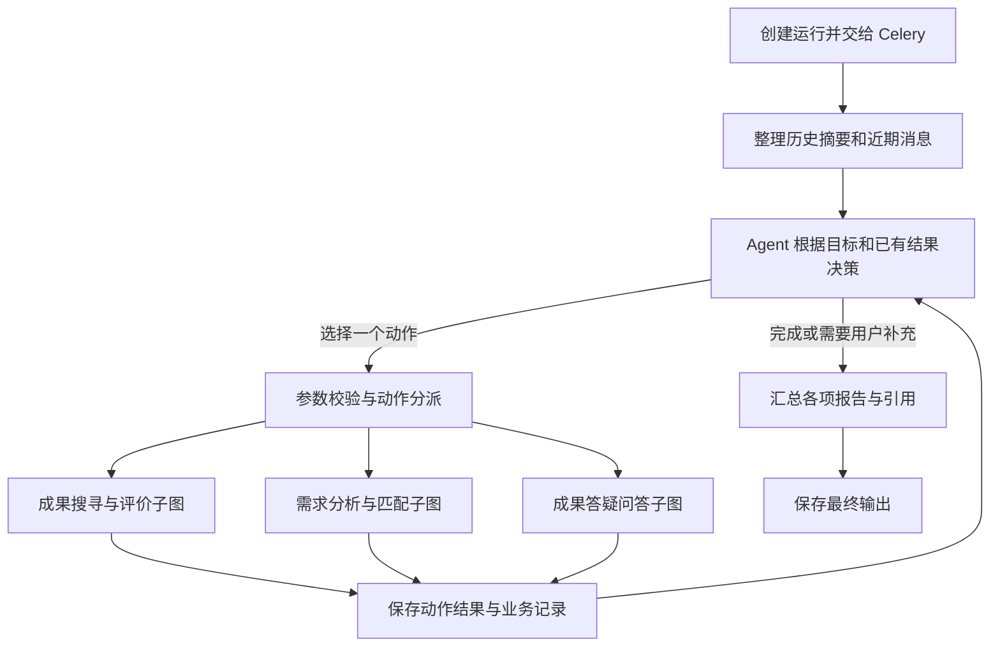

# HydroBridge 架构说明

当前新运行图版本：`3.1.0-three-business-tools`。业务分为成果搜寻与评价、需求分析与匹配、成果答疑问答三组。

## 一个主 Agent 与三个业务子图

主 Agent 使用模型原生 Function Calling 选择三个业务工具之一：`research_achievements`、`match_achievements`、`ask_achievements`。各工具通过模式区分搜寻/评价、分析/匹配/局部更新、问答/详情/对比。应用校验工具白名单、Pydantic 参数、权限与成果范围，再转换为稳定的内部动作。内部历史动作名供业务记录及旧检查点兼容，不再是额外的模型可见工具。

使用自定义 `dispatch` 和 `collect`，没有使用预置 ToolNode/ToolMessage。显式任务类型为首步提供意图；已有需求的分析/匹配请求由模型选择新分析或局部修改。参数错误在业务绑定前拦截，以观察返回 Agent；未知异常不通用捕获后自动重试。模型需要向用户澄清时可以停止工具调用并返回具体问题。

管理页面已经预建业务记录的明确请求仍先执行所绑定的动作，避免留下未启动记录。主 Agent 的澄清回复结束当前运行并标记需要输入，下一条消息创建新运行；业务子图中的 `interrupt` 则通过检查点恢复原运行，两条路径分别处理。

三个子图均通过 `StateGraph(AgentState).compile()` 编译，再作为主图节点注册，共享状态并继承父图检查点。子图的 `END` 表示返回主图。专业步骤中的历史 `Agent` 类名并不代表另一个自主规划者。

| 子图 | 动作和内部步骤 |
| --- | --- |
| 成果搜寻与评价 | 搜寻 → 证据整理 → 入库分流及必要的人工审核 → 核验 → 报告；或单项自身评价 → 核验 → 报告 |
| 需求分析与匹配 | 独立分析 → 必要的澄清 → 报告；或分析 → 澄清 → 匹配 → 约束核验 → 报告；局部修改直接合并已有画像后选择报告或匹配 |
| 成果答疑问答 | 结构化详情；或准备范围 → 检索 → 生成 → 逐字引用与充分性校验 → 必要的补检索 → 输出 |

例如“匹配适合该工程的成果，再比较前两项”，匹配子图返回排序结果、成果 ID、约束状态和记录 ID，Agent 据此选择对比动作。原始任务单独保存在 `original_request`，不会被某次检索查询覆盖。模型停止调用时，`respond` 合并各项报告并统一引用编号，不额外要求模型重写事实。

`active_candidates` 独立保存最近展示的序号、ID 和标题。详情与对比不重排它；匹配或未指定成果 ID 的检索更新它，报告明确展示当前序号。工具可传序号，由程序映射 ID，并继续校验范围和权限。新输出单独持久化 `scope_limit`，避免把一次发现的候选当成未来检索的永久边界。旧输出缺少该字段时保守沿用原范围，不猜测用户授权。

`refine` 的 `patch` 只允许需求画像业务字段。硬约束、软偏好和已知条件按字典键合并，未指定键保留；键值为 null 表示明确删除，一个键的值整体替换。缺少已有完整画像、空补丁、非法 TRL 或删除不存在的键都会拒绝。该模式不重新调用模型提取整套画像，但模型仍负责把自然语言对应到字段和值。报告列出修改，完整参数保存在动作记录。关键条件澄清的编辑恢复仍走原来的重新解析流程。

默认最多 12 项业务动作；相同参数及范围的重复调用会停止。问答子图最多两轮检索，总运行超时默认600秒；另设图递归上限。模型未配置时只执行可确定的首步，并明确说明没有继续自动规划。`task_completion` 区分正常完成、需要补充和因限制结束的部分结果；运行状态 `completed` 本身不代表所有工程问题都已解决。

## 上下文压缩

发送给决策模型的上下文包括：原始目标、当前需求原文及结构化画像、允许的成果范围、历史摘要、预算内近期消息，以及本轮各动作的紧凑结果。问答模型使用同一历史摘要和近期消息，但事实依据必须来自本轮检索证据。

1. 从上一已完成运行的 `output_payload.memory` 读取摘要和 `through_sequence`。
2. 读取该覆盖序号之后的已完成轮次消息。历史超出预算时，把较早完整轮次分批增量摘要，保留近期轮次；默认近期边界为8条消息。
3. 摘要成功后才推进覆盖序号。异常时保留旧摘要及旧序号，使用窗口裁剪降级；原始消息仍在数据库，后续轮次可以重新处理。
4. 摘要与近期消息的合计估算预算默认6000，摘要预算1000，每批待压缩内容预算6000；对应 `CONTEXT_*` 配置见根目录 README。
5. 本轮完整动作报告保存在状态和运行输出；后续决策接收短摘录、动作参数摘要、状态、候选 ID 和记录 ID，避免反复传输完整报告。

字符估算不等同于供应商 tokenizer，也不是整个模型输入的硬上限。新问题、结构化业务状态和检索证据有各自大小限制，另行传入。单个近期消息过大时可能裁剪。摘要有损，不能代替原件、授权信息或需求参数；预算、硬约束和成果范围不从摘要中恢复。原始历史不删除。

## 业务保存与恢复

`Conversation`、用户 `Message` 和 `AgentRun` 先提交 PostgreSQL，再发布事件并投递 Celery。每次主循环动作使用 `run_id:序号` 作为动作 ID，在执行前关联业务记录。页面预先创建的评价、规范化或匹配记录只供当前运行首个对应动作复用。

`collect` 在同一数据库事务中保存该动作的业务结果和运行内动作记录。匹配结果、评价版本、需求分析结果各自保存，不等最后一个动作完成才写入。重复收集相同动作不重复创建候选条目；已完成业务记录不会被后续步骤的失败、取消或恢复状态改回未完成。

检查点与业务事务不是同一个事务。已提交动作结果可按动作 ID 与指纹复用，但不能宣称任意外部副作用都恰好执行一次。入库等步骤仍依赖各自的幂等实现。

主图使用 PostgreSQL 检查点，配置中的 `thread_id` 实际取 `run.id`。会话 ID 用于跨轮历史与业务关联；两者用途不同。人工审核和需求澄清在子图中使用 `interrupt`，用户提交后以 `Command(resume=...)` 恢复同一个运行。澄清后的需求继续在当前子图处理，完成后返回 Agent。

新运行保存 v3.1 图版本，v3.0 与 v3.1 共用未改变的节点布局及内部动作名；原 v2 运行仍按原图布局恢复，防止已存在的 `workflow` 等检查点节点失去对应实现。v3 系列均使用动作结果保存路径及恢复点检查，不能因版本号不同误走 v2 逻辑。更早的 Redis 检查点不兼容。新版恢复点缺失时会报错，已完成业务记录保留，不能自动重做整轮来掩盖恢复失败。此次仅静态检查了图构建，没有真实恢复验证。

## 检索与存储分工

| 组件 | 职责 |
| --- | --- |
| PostgreSQL | 成果、版本、精确片段、来源、需求、评价、匹配、对话、动作轨迹、检查点 |
| Elasticsearch | IK/BM25 与 dense_vector 召回索引，可由事实数据重建 |
| BGE 服务 | BGE-M3 向量化和 BGE-reranker-v2-m3 重排 |
| Redis Runtime | Celery broker/backend、SSE Stream、取消信号；AOF、noeviction |
| Redis Cache | 可重建的外部搜索缓存，volatile-lfu |
| MinIO | 原始文件和最终 Markdown 报告 |

成果变更与 Outbox 事件在同一 PostgreSQL 事务提交，worker 幂等更新片段与 Elasticsearch。ES 两路召回先应用元数据过滤，经 RRF 后回查 PostgreSQL 的权限、审批、版本和片段哈希，再按成果分组并重排片段，以各成果最高片段分排序。

检索降级元数据随单次结果返回，空结果同样携带，不挂在共享服务实例上。问答和匹配报告展示本地降级提示；约束补充取证失败会说明限制并保留未知。未开启降级时的 ES 异常、其他未处理的基础设施异常由运行层记录失败，不允许模型编造成功。

问答引用必须指向已检索片段，且 quote 在原文中逐字存在；这种校验不能证明模型释义一定正确。需求匹配使用满足、不满足、未知三态约束，排名分数表示检索相关度。成果自身评价与针对某项工程的匹配判断分别保存。

## 可观测性与改造验证范围

AgentStep 记录各步骤，ToolCall 记录动作及重试，ModelUsage 记录模型调用和 token。摘要调用也计入用量。SSE 展示任务进度；完整业务结果和动作列表可从运行输出查阅。

本次改造按要求未运行单元、集成或真实模型测试。交付检查包括改动文件的静态规则检查、Python 语法编译、LangGraph 图构建及子图拓扑检查。静态图构建不执行节点，不连接检索或数据库，不能替代对复合请求、真实模型选择和审核恢复的运行验收。
