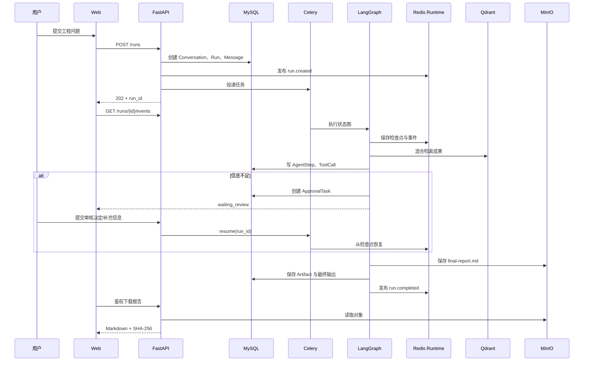

# 架构说明

## 设计目标

HydroBridge 不是普通聊天机器人，而是一个可以解释“任务如何被拆解、数据从哪里来、失败后如何恢复、结论是否经过核验”的 Agent 后端项目。核心目标是：

- 业务事实、运行轨迹和成果文件可追溯。
- 长任务异步执行，浏览器断开不影响任务。
- 需求信息不足时可暂停并交给人工补充。
- 外部模型或 Tavily 未配置时仍能离线演示和测试。
- 缓存、检查点、任务队列与事实数据采用适合各自语义的存储。

## 请求链路

## 一致性边界

### 创建 Agent 任务

Conversation、用户 Message 和 AgentRun 在一个 MySQL 事务中提交。事务完成后才发布 Redis 事件和投递 Celery，避免消费者拿到不存在的 run。

### 成果审核与向量索引

成果状态变化和 OutboxEvent 在同一个 MySQL 事务提交。Celery 周期性使用抢占、重试和最大重试次数处理 outbox。Qdrant 失败不会让 MySQL 已审核成果“假装未发生”，恢复后可继续补索引。

### 最终报告

报告正文写入 MinIO，MySQL 保存对象键、类型、所有者、运行 ID 和 SHA-256。下载必须经过 JWT 鉴权，API 代理 MinIO 内容，不向浏览器暴露内部对象存储地址。

## Redis 拆分

| 实例 | 数据 | 持久性 | 淘汰策略 | 故障影响 |
| --- | --- | --- | --- | --- |
| Redis Runtime | LangGraph 检查点、SSE Stream、Celery Broker/Backend | AOF everysec | noeviction | 新任务暂不可投递；恢复后继续 |
| Redis Cache | Tavily 搜索缓存 | 可重建 | volatile-lfu | 命中率下降，不破坏业务事实 |

运行态和缓存分离是刻意设计：缓存需要淘汰，检查点不能被淘汰。

## Agent 状态与恢复

- 每个 Run 有稳定的 `thread_id`，LangGraph 使用它定位 Redis 检查点。
- 节点输入输出只保存可序列化、必要的摘要，避免检查点无限膨胀。
- 人工审核通过 `interrupt` 产生暂停状态；恢复时使用 `Command(resume=...)`。
- 每个 Agent 节点在 MySQL 写入开始、完成、耗时和错误。
- 工具调用使用幂等键记录，便于分析重试和避免重复副作用。
- Run 有最大迭代次数和总超时，取消信号写入 Redis 并在节点边界检查。

## 检索

- Qdrant 中保存稠密向量、稀疏词项向量和必要业务字段。
- 查询时分别获取候选，使用 Reciprocal Rank Fusion 合并。
- 领域重排补充“农村饮水、泵站、混凝土、防渗”等水利场景规则。
- 最终评分与检索分数分离：检索解决召回，评估 Agent 解决场景、成熟度、证据和风险。
- `KNOWLEDGE_INDEX_VERSION` 变化会触发版本化 outbox 重建，避免代码与旧索引字段不一致。

## 安全与可观测性

- 密码使用 Argon2 哈希。
- Access Token 短期有效，Refresh Token 只存指纹；刷新时轮换并阻断旧令牌重放。
- 数据接口执行所有权校验，管理员可以跨用户审计。
- 统一返回安全响应头，OpenAPI 与 Prometheus `/metrics` 可用于本地调试。
- AgentStep、ToolCall、ModelUsage 和结构化日志共同组成可审计运行轨迹。

## 主要技术取舍

- 使用 Python：Agent 生态、LangGraph、模型和检索 SDK 最成熟，同时不妨碍完整使用 MySQL/Redis。
- 使用 LangGraph：需要显式状态、条件路由、中断恢复和持久化，不适合只靠顺序函数调用。
- 使用 Celery：Agent 运行可能超过 HTTP 生命周期，队列提供重试、并发和 worker 隔离。
- 使用 Qdrant 而不是把向量塞入 MySQL：向量检索、稀疏检索和过滤能力职责更清晰；MySQL 仍是事实来源。
- 使用 MinIO：报告与原始文件不适合放进 MySQL 大字段，S3 兼容接口也便于迁移云对象存储。
