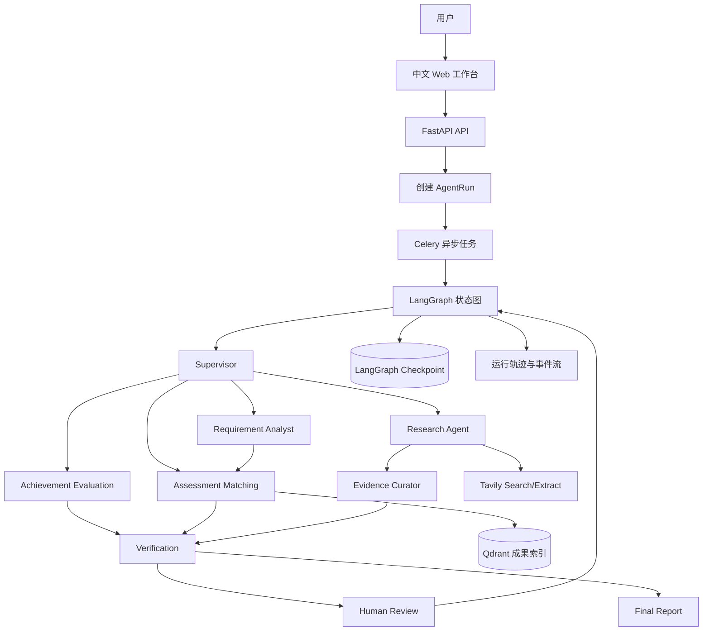
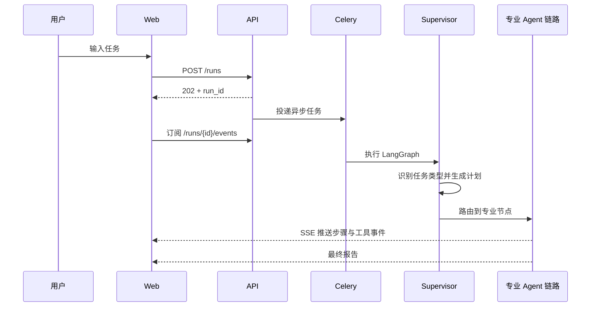
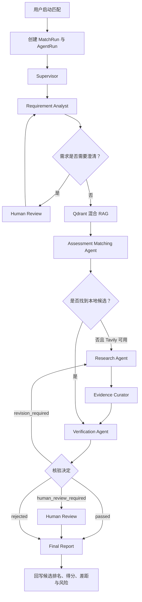

# HydroBridge 水利科技多 Agent 平台：项目学习与面试手册

> 适用对象：项目开发者、Agent 开发岗位求职者、需要演示本项目的面试者  
> 文档目标：从“会运行”走到“讲得清、答得深、不过度包装”  
> 核对基线：以当前仓库代码为准，而不是只依据 README 或旧简历描述  
> 最后更新：2026-08-17

---

## 0. 先记住这四句话

如果时间有限，先把下面四句话记牢：

1. **HydroBridge 是一个面向水利科技成果转化的多 Agent 决策支持平台，不是普通聊天机器人。**
2. **系统使用 LangGraph 编排 Supervisor、需求分析、科技情报、证据治理、成果评价、供需匹配、独立核验和报告生成等专业 Agent。**
3. **需求匹配的核心是混合 RAG：Dense/Sparse 双路召回、RRF 融合、Reranker 重排，再进行硬约束检查和六维业务评分。**
4. **系统通过结构化输出、独立核验和 Human-in-the-loop 降低幻觉风险，但最终结论仍是决策支持，不能替代工程专家论证。**

一句话项目介绍：

> HydroBridge 是一个基于 LangGraph 的水利科技多 Agent 决策平台，通过专业 Agent 分工、混合 RAG 检索、独立核验和人工复核，实现科技成果评价、需求结构化、科技情报检索与可解释供需匹配。

---

## 1. 推荐学习路线

### 第一遍：先形成整体认识

按顺序阅读：

1. 第 2 节：项目解决什么问题；
2. 第 3 节：系统有什么功能；
3. 第 5 节：多 Agent 到底是什么意思；
4. 第 7～12 节：每个功能的执行流程；
5. 第 22 节：30 秒和 2 分钟口述稿。

### 第二遍：准备技术追问

重点阅读：

1. 第 13 节：RAG 完整链路；
2. 第 14 节：评价与匹配评分；
3. 第 15 节：可靠性与幻觉治理；
4. 第 16 节：Human-in-the-loop；
5. 第 17～20 节：运行、模型、并发和测试。

### 第三遍：模拟面试

1. 不看文档完成一次 2 分钟项目介绍；
2. 从第 24 节随机抽取问题回答；
3. 回答后对照“参考回答”；
4. 特别检查第 25 节中的“不能夸大”边界。

---

## 2. 项目背景：它解决什么问题？

### 2.1 业务背景

水利行业存在大量科技成果，例如泵站智能监测、农村供水、水库大坝安全监测、节水灌溉、防渗材料、水处理等技术。但成果转化通常面临以下问题：

- 成果信息分散，人工查找成本高；
- 需求方使用自然语言描述问题，表达不标准；
- “检索相关”不等于“工程上适合”；
- 成果材料里的指标、适用条件和证据质量不统一；
- 单纯依靠大模型容易产生无来源结论或虚构数字；
- 高风险工程结论不能完全自动决策，需要专家参与。

### 2.2 项目目标

HydroBridge 希望建立一条可追踪的智能决策链路：

```text
自然语言问题
  → 任务识别
  → 需求结构化或科技情报检索
  → 本地成果混合 RAG 召回
  → 多维评价/匹配
  → 独立核验
  → 必要时人工复核
  → 可解释报告
```

### 2.3 系统定位

这个项目的正确定位是：

> **面向水利科技成果转化的 Agentic RAG 决策支持系统。**

它不是：

- 单纯的知识库问答；
- 只套一个聊天界面的 LLM Demo；
- 自动替代水利专家的决策系统；
- 多个大模型自由聊天；
- 只依靠向量相似度进行推荐的搜索系统。

---

## 3. 用户能够体验哪些功能？

系统最终形态是一个中文 Web 平台，默认入口为 `http://localhost:3000`。

### 3.1 Agent 工作台

用户可以选择或自动识别任务类型，然后输入自然语言问题。

支持的任务类型包括：

- 智能路由；
- 成果匹配；
- 联网调研；
- 成果评估；
- 通用问答。

工作台能够实时展示：

- 任务是否排队、运行、等待审核、完成或失败；
- Supervisor 生成的计划；
- 当前正在执行的 Agent；
- Tavily 搜索和抽取等工具调用；
- 最终报告与引用来源。

### 3.2 科技成果库

用户可以：

- 浏览和搜索科技成果；
- 查看成果摘要、应用场景、成熟度、证据质量和量化指标；
- 新建成果；
- 对成果执行“智能评价”；
- 查看六维评价、总分、等级、优势、风险、缺失信息和建议；
- 查看多次评价版本；
- 从评价结果跳转到完整 Agent 执行轨迹。

### 3.3 需求中心

用户可以：

- 新建工程需求；
- 保存原始自然语言描述；
- 使用“AI 需求凝练”提取场景、问题、目标、硬约束和软偏好；
- 查看需求完整度和缺失字段；
- 启动成果匹配；
- 查看候选排名、六维得分、差距和风险；
- 对候选成果做采纳、备选或拒绝等业务反馈；
- 查看每次匹配的 Agent 运行轨迹。

### 3.4 运行记录

每个任务都不是一次不可观察的黑盒调用。运行记录展示：

- AgentRun 的整体状态；
- 各 AgentStep 的执行顺序、输入摘要、输出摘要和耗时；
- ToolCall 的工具名、输入、状态、重试次数和耗时；
- 模型输入/输出 Token 与延迟；
- 最终 Markdown 报告；
- 失败原因或取消状态。

### 3.5 人工审核

当需求信息不足、评价维度异常或核验认为风险较高时，系统暂停工作流并创建审核任务。用户可以：

- 批准；
- 编辑后继续；
- 拒绝；
- 提交补充说明。

### 3.6 系统状态

用户可以查看模型、Tavily、数据库、Redis、Qdrant 和对象存储等依赖是否就绪。它主要用于本地演示和故障定位，不是项目面试介绍的第一重点。

---

## 4. 总体架构



### 4.1 架构分层

| 层次 | 主要职责 | 面试关键词 |
| --- | --- | --- |
| Web 交互层 | 功能入口、实时状态、结果展示、审核操作 | 用户体验、SSE、可解释性 |
| API 层 | 鉴权、资源访问、创建任务、查询结果 | FastAPI、JWT、资源权限 |
| 异步执行层 | 长任务排队、Worker 隔离、恢复执行 | Celery、异步任务、重试 |
| Agent 编排层 | 状态、节点、条件路由、中断、报告 | LangGraph、StateGraph、HITL |
| 智能能力层 | 结构化需求、联网研究、评价、匹配、核验 | Agent、Structured Output |
| 检索层 | 成果索引、混合召回、融合、重排 | Qdrant、Dense/Sparse、RRF |
| 数据与运行层 | 业务事实、检查点、事件、报告 | 追问时再讲，不必放进简历主描述 |

### 4.2 为什么使用 LangGraph？

项目需要的不是一条固定的 `prompt → model → answer` 链路，而是：

- 显式共享状态；
- 多个职责隔离的处理节点；
- 根据任务类型走不同分支；
- 根据核验结果循环修订或转人工；
- 在人工审核处暂停；
- 使用相同 `thread_id` 从检查点恢复；
- 将确定性代码与 LLM 判断组合在同一个工作流中。

LangGraph 官方将其定位为长时间、有状态 Agent 的低层编排框架，并强调 durable execution、streaming、human-in-the-loop 和 persistence。官方资料：

- <https://docs.langchain.com/oss/python/langgraph/overview>
- <https://docs.langchain.com/oss/python/langchain/multi-agent/custom-workflow>
- <https://docs.langchain.com/oss/python/langgraph/interrupts>
- <https://docs.langchain.com/oss/python/langgraph/persistence>

---

## 5. 项目里的“多 Agent”是什么意思？

### 5.1 多 Agent 的准确含义

本项目的 Agent 是具有以下特征的专业角色：

- 有独立业务职责；
- 有独立 System Prompt；
- 有独立结构化输入输出；
- 能访问特定工具或数据；
- 在 LangGraph 中对应独立节点；
- 能将结果写回共享 `AgentState`；
- 能被条件路由选择。

所以，多 Agent 的关键不是“调用了几次模型”，而是：

> **角色分工 + 状态协作 + 条件路由 + 独立验证 + 人工控制。**

### 5.2 本项目属于哪种多 Agent 模式？

最准确的说法是：

> **Supervisor/Router 风格调度的 LangGraph Custom Workflow。**

它不是完全自由自治的 Agent Swarm，也不是严格意义上“主 Agent 把所有子 Agent 封装成 Tool”的官方 Subagents 模式。项目中的专业 Agent 主要作为图节点被编排。

### 5.3 多 Agent 不等于并行执行

需求分析完成后才能匹配，匹配完成后才能核验。因此一次任务内部的主链路通常是顺序执行和条件分支。

多 Agent 解决的是**职责分离和工作流控制**；并发解决的是**吞吐量和等待时间**。两者不是同一概念。

### 5.4 为什么不用一个超级 Agent？

如果把意图识别、需求分析、搜索、证据过滤、评价、匹配和验证全部交给一个 Agent，会带来：

- Prompt 过长；
- 上下文相互污染；
- 工具权限过宽；
- 难以单独测试；
- 结果生成者同时验证自己，容易产生确认偏差；
- 出错后只能整体重跑；
- 难以在特定节点插入人工复核。

### 5.5 是否所有节点都是“大模型 Agent”？

不是。项目刻意混合了两类步骤：

1. **Agentic 步骤**：需要语义理解、归纳、评价或自然语言生成；
2. **Deterministic 步骤**：公式算分、状态路由、过滤、重排、持久化、权限检查。

成熟的 Agent 项目不是所有逻辑都交给模型。能用确定性代码保证的部分，应优先使用确定性代码。

---

## 6. 每个 Agent 的职责与面试重点

### 6.1 Supervisor Agent

**职责**：识别任务类型、创建计划、选择第一个专业节点。

支持类型：`research`、`requirement_analysis`、`evaluation`、`matching`、`qa`。

**当前实现特点**：

- 用户明确选择任务类型时直接确定性路由；
- 只有 `task_type=auto` 且模型可用时，才优先让模型做结构化意图识别；
- 模型不可用或结构化输出失败时，使用关键词规则回退。

**面试重点**：为什么混合“模型路由 + 规则路由”？

参考回答：

> 自然语言开放输入适合模型分类，但业务按钮已经明确表达意图，不需要额外消耗一次模型调用。显式任务采用确定性路由可以降低延迟和成本；自动模式才使用模型，并保留规则回退保证可用性。

### 6.2 Requirement Analyst Agent

**职责**：把非结构化需求转换成 `RequirementProfile`。

主要字段：

- 标题与规范化描述；
- 工程场景；
- 核心问题；
- 目标；
- 硬约束；
- 软偏好；
- 已知条件；
- 缺失关键字段；
- 检索词；
- 完整度；
- 是否需要澄清。

**面试重点**：硬约束和软偏好有什么区别？

参考回答：

> 硬约束是不能违反的条件，例如最低成熟度、不停水施工、高寒环境；违反后候选应被过滤或明确判为不通过。软偏好是排序因素，例如低成本、维护简单，可以影响得分但不一定直接淘汰候选。

### 6.3 Research Agent

**职责**：生成最多 6 条检索查询，通过 Tavily 搜索并抽取正文。

当前流程：

1. 根据用户问题和结构化需求生成查询；
2. 对 Query 去重、压缩并保留核心技术对象和时间范围，同时补充英文论文检索切面；
3. 最多 4 路受控并发执行，每条查询最多获取 6 条结果；
4. 将“2024 年以来”等条件转换为 Tavily `start_date`；
5. 规范化 URL，去除 UTM 等追踪参数并合并跨 Query 重复结果，同时累积各 Query 的摘要证据；
6. 通过跨 Query RRF、语义相关性、Tavily 原始分、来源权威性和主题覆盖融合排序；
7. 识别专利、论文、工程案例、成果目录等证据类型并提供适度加权；
8. 对过期或时间不可核实来源、宽泛标题、用途不匹配文档和普通商业营销页施加可解释惩罚；
9. 使用 MMR 风格选择兼顾相关性、内容新颖性和域名多样性的来源；
10. 对高排名 URL 调用带 Query 和 Chunks 控制的 Tavily Extract；
11. 将结果写入 `search_results`。

外部结果的综合排序信号为：

```text
ranking_score = 0.36 × local_relevance
              + 0.15 × tavily_score
              + 0.22 × authority_score
              + 0.17 × cross_query_rrf
              + 0.10 × focus_coverage

ranking_score *= temporal_penalty
ranking_score *= marketing_penalty
ranking_score *= title_specificity_penalty
ranking_score *= evidence_purpose_penalty
ranking_score *= source_type_boost
```

融合排序之后再执行 MMR 风格选择，避免 Top-K 被同一网站或内容高度重复的页面占满。中文需求可通过技术词别名与英文论文中的 `pumping station`、`predictive maintenance`、`intelligent scheduling` 等表达对齐。商业页不会被一律删除，但普通商业域名的通用页面和纯营销页面不能仅凭多 Query 重复出现就压过政府、科研机构和原始论文；年度报告、培养文件、会议新闻、站点首页等“关键词相关但文档用途不匹配”的页面也不会作为核心成果。明确早于用户时间范围、时间无法核实，或正文完全不覆盖核心技术主题的来源，会在证据策展阶段被拒绝。

**面试重点**：为什么不直接把搜索结果交给大模型？

参考回答：

> 搜索引擎返回的结果可能重复、离题或来源质量不同。先做主题过滤、URL 去重和来源权威性排序，可以降低噪声，控制上下文长度，并避免模型把低质量网页包装成高可信结论。

### 6.4 Evidence Curator Agent

**职责**：对外部资料进行证据治理。

主要工作：

- 过滤不相关结果；
- 合并重复来源；
- 提取可支持具体字段的证据；
- 标注直接证据、间接证据和置信度；
- 保留 URL；
- 记录被拒绝来源及原因；
- 从长正文中截取围绕核心技术词的证据窗口，而不是机械取开头；
- 防止网页中的提示注入内容影响系统指令。

**面试重点**：Research 与 Evidence Curator 为什么要拆开？

参考回答：

> Research 负责提高召回，Evidence Curator 负责提高证据精度。把“找资料”和“判断资料是否足以支撑结论”拆开，能够减少一个 Agent 自己搜索、自己相信、自己下结论的确认偏差。

### 6.5 Achievement Evaluation Agent

**职责**：独立评价某一项成果自身质量，不依赖某个具体需求。

评价维度：

- 创新性；
- 应用成效；
- 成熟度；
- 证据质量；
- 推广价值；
- 实施可行性。

输出包括：

- 六维得分；
- 综合分与等级；
- 维度解释；
- 摘要；
- 优势；
- 风险；
- 缺失信息；
- 改进建议；
- 证据；
- 置信度。

**面试重点**：成果评价与需求匹配有什么区别？

参考回答：

> 成果评价回答“这项成果自身质量怎么样”，需求匹配回答“这项成果对当前工程需求是否合适”。一项成果可以自身评价很高，但由于场景、预算或施工条件不符合，在某个需求中匹配分很低。

### 6.6 Assessment Matching Agent

**职责**：检索候选成果，再根据结构化需求进行业务匹配。

它不会把向量相似度直接当最终分数，而是单独分析：

- 场景适配度；
- 技术成效；
- 成熟度；
- 证据质量；
- 成本适配度；
- 实施风险。

输出还包括：推荐理由、差距、风险、硬约束违反项和引用来源。

**面试重点**：RAG 与 Matching Agent 如何分工？

参考回答：

> RAG 负责从大量成果中召回高相关候选，Matching Agent 负责结合结构化需求、硬约束和业务维度做决策分析。检索分数反映相关性，最终匹配分反映工程适用性，两者必须分离。

### 6.7 Verification Agent

**职责**：独立检查前面 Agent 的输出。

可返回：

- `passed`；
- `revision_required`；
- `human_review_required`；
- `rejected`。

检查内容：

- 评价维度是否完整；
- 分数是否在合法范围；
- 是否存在无证据结论；
- 硬约束是否冲突；
- 外部来源是否足够；
- 是否需要重新调研；
- 是否需要人工参与。

**面试重点**：为什么独立核验不能完全消除幻觉？

参考回答：

> Verification Agent 仍然可能使用同类模型，因此不能从理论上保证绝对正确。它的价值在于增加独立上下文、结构检查和证据覆盖检查。更可靠的方式是将确定性校验、来源约束、模型核验和人工复核组合起来。

### 6.8 Final Report Agent

**职责**：把结构化中间结果组织成面向用户的 Markdown 报告。

报告可能包含：

- 需求理解；
- 成果综合评价；
- 推荐成果及排名；
- 推荐理由；
- 风险与差距；
- 核验结论；
- 引用来源；
- 下一步建议。

模型不可用时，系统使用确定性模板生成基础报告，而不是让整个任务失败。

### 6.9 Human Review 节点

Human Review 是工作流节点，但不是 LLM Agent。它通过 LangGraph `interrupt()` 暂停执行，并在用户提交决定后使用 `Command(resume=...)` 恢复。

---

## 7. 功能一：Agent 工作台与智能路由

### 7.1 用户操作

1. 进入“Agent 工作台”；
2. 选择“智能路由”或明确任务类型；
3. 输入工程问题；
4. 点击执行；
5. 查看实时 Agent 轨迹和最终报告。

### 7.2 完整执行流程



### 7.3 路由规则

| 任务类型 | 第一个专业节点 | 典型用途 |
| --- | --- | --- |
| `research` | Research Agent | 查找外部水利科技信息 |
| `requirement_analysis` | Requirement Analyst | 只做需求凝练 |
| `evaluation` 且有成果 ID | Achievement Evaluation | 对成果进行独立评价 |
| `matching` | Requirement Analyst | 先结构化需求再匹配 |
| `qa` | Assessment Matching | 先检索本地审核成果再组织回答 |

### 7.4 面试讲法

> 工作台允许用户显式指定任务，也支持 Supervisor 自动识别。显式业务入口使用确定性路由，开放问题使用模型结构化分类并保留规则回退。任务通过异步队列执行，前端通过 SSE 获取步骤事件，因此 HTTP 请求结束或浏览器短暂断开不会中断 Agent 任务。

---

## 8. 功能二：科技成果智能评价

### 8.1 用户操作

1. 打开“科技成果库”；
2. 选择一项成果；
3. 点击“智能评价”；
4. 查看评价中状态；
5. 查看六维分数、总分、等级、优势、风险和建议；
6. 必要时查看完整运行轨迹；
7. 可以重新评价，保留历史版本。

### 8.2 执行流程

```text
成果详情页点击智能评价
  → 创建版本化 AchievementEvaluation 记录
  → 创建 task_type=evaluation 的 AgentRun
  → Supervisor 识别显式评价任务
  → Achievement Evaluation Agent 读取目标成果
  → 生成六维评价和解释
  → Verification Agent 检查维度完整性与合法范围
  → 通过：Final Report Agent
  → 异常：Human Review
  → 回写评价版本和最终报告
```

### 8.3 六维评价权重

离线确定性回退中使用的权重如下：

| 维度 | 权重 |
| --- | ---: |
| 创新性 | 20% |
| 应用成效 | 20% |
| 成熟度 | 15% |
| 证据质量 | 20% |
| 推广价值 | 15% |
| 实施可行性 | 10% |

```text
总分 = 创新性 × 0.20
     + 应用成效 × 0.20
     + 成熟度 × 0.15
     + 证据质量 × 0.20
     + 推广价值 × 0.15
     + 实施可行性 × 0.10
```

等级区间：

- `≥ 85`：优秀；
- `70～84.99`：良好；
- `60～69.99`：中等；
- `< 60`：待完善。

### 8.4 为什么保留评价历史？

- 成果材料可能不断补充；
- 模型版本和规则可能变化；
- 需要比较补充证据前后的变化；
- 不能让一次失败覆盖已有成功结果；
- 便于审计“当时为什么得到这个结论”。

### 8.5 面试重点

不要说：

> 大模型直接对成果打了一个分。

推荐说：

> 我先定义固定评价维度和结构化输出，让模型负责维度判断和解释；总分、合法范围和完整性由确定性逻辑约束，再由 Verification Agent 独立核验。这样比让模型自由生成一个总分更可解释、更容易测试。

---

## 9. 功能三：AI 需求凝练

### 9.1 目标

把类似下面的原始输入：

> 我们是北方农村供水项目，冬季温度低，预算有限，希望减少人工巡检，施工时尽量不停水。

转换成结构化需求：

```yaml
scenario: 农村供水
problem: 人工巡检成本高，低温环境下运行风险较高
objectives:
  - 减少人工巡检
  - 提升异常发现能力
hard_constraints:
  climate: cold_region
  construction_impact: minimal_shutdown
  service_area: rural
soft_preferences:
  cost: low
search_terms:
  - 农村供水
  - 智能监测
  - 低温
  - 不停水施工
```

### 9.2 执行流程

```text
新建需求
  → 保存原始描述
  → 点击 AI 需求凝练
  → 创建 requirement_analysis AgentRun
  → Supervisor
  → Requirement Analyst Agent
  → 判断完整度
      ├─ 信息充分 → Final Report Agent
      └─ 信息不足 → Human Review
                       ├─ 用户编辑 → 回到 Supervisor 重新分析
                       ├─ 用户批准 → 生成当前版本结果
                       └─ 用户拒绝 → 结束并生成说明
  → 回写规范化需求、约束、检索词和完整度
```

### 9.3 为什么先凝练再检索？

原始需求里经常混合：

- 问题背景；
- 目标；
- 强制条件；
- 偏好；
- 无关描述；
- 缺失信息。

如果直接拿整段话做向量检索，可能只召回语义相似材料，却忽略“不停水”“高寒”“最低成熟度”等关键约束。结构化后，系统可以分别用于：

- 构造检索 Query；
- Qdrant Metadata Filter；
- 硬约束检查；
- 软偏好评分；
- 结果解释。

### 9.4 面试重点

> Query Rewrite 只是在改写检索文本；Requirement Analysis 进一步识别了业务字段、硬约束、软偏好和信息缺口。它既服务于检索，也服务于后续业务评分和 Human-in-the-loop。

---

## 10. 功能四：需求—成果智能匹配

### 10.1 用户操作

1. 在需求中心选择一项需求；
2. 可先执行 AI 需求凝练；
3. 点击“开始成果匹配”或“探索性成果匹配”；
4. 查看候选成果和多维得分；
5. 阅读理由、差距和风险；
6. 对候选做采纳、备选或拒绝反馈；
7. 查看完整 Agent 轨迹。

### 10.2 完整执行流程



### 10.3 候选召回与业务评分的边界

第一阶段：检索层。

- 目标：从成果库找出可能相关的 Top-K；
- 信号：Dense、Sparse、RRF、Reranker；
- 输出：候选成果和检索相关性。

第二阶段：匹配层。

- 目标：判断候选是否适用于当前工程；
- 信号：结构化需求、硬约束、成熟度、证据、成本、风险；
- 输出：业务维度、最终分、理由、差距和风险。

### 10.4 匹配评分公式

```text
最终分 = 场景适配度 × 0.30
       + 技术成效 × 0.20
       + 成熟度 × 0.15
       + 证据质量 × 0.15
       + 成本适配度 × 0.10
       + (100 - 实施风险) × 0.10
```

注意最后一项不是直接加“风险分”，而是将其转换为实施准备度：

```text
implementation_readiness = 100 - implementation_risk
```

### 10.5 为什么最终分要由代码重算？

即使模型输出了六个维度，系统也不信任模型额外生成的 `final_score`，而是根据固定权重重新计算并重新排序。

原因：

- 防止总分与维度分不一致；
- 前端可以复现；
- 测试可以精确断言；
- 修改权重时行为明确；
- 避免模型为了让某候选排名靠前而任意修改总分。

### 10.6 面试重点

> 这个项目不是“向量库返回谁就推荐谁”。向量检索只负责召回，匹配 Agent 负责业务判断，最终分由固定公式根据六个可解释维度计算；硬约束违反项、差距和实施风险会单独展示。

---

## 11. 功能五：科技情报联网调研

### 11.1 执行流程

```text
用户提出调研问题
  → Supervisor 路由为 research
  → Research Agent 生成检索计划（最多 6 个 Query）
  → Query 压缩、去重并提取显式日期范围
  → 受控并发 Tavily Search（每个 Query 最多 6 条）
  → 规范化 URL 与跨 Query 聚合
  → RRF + 相关性 + Tavily 分 + 来源权威性融合
  → 时效、标题特异性与商业营销惩罚
  → MMR 风格来源多样化
  → Tavily Extract 定向抽取高排名页面正文
  → Evidence Curator 提取证据、过滤低质量来源
  → Verification Agent 检查是否存在可核验来源
  → Final Report Agent 生成带引用报告
```

### 11.2 来源权威性

项目对不同域名类型给出不同权威性先验，例如：

- 政府、教育和科研域名：较高；
- 国际组织、学术机构：较高；
- 行业组织和非营利组织：中等；
- 普通网页：较低。

但需要注意：

> 域名权威性只是排序先验，不代表页面内容一定正确；最终仍需检查内容是否直接支持具体结论。

### 11.3 如何防止搜索结果提示注入？

网页正文属于不可信外部输入。防护思路：

- System Prompt 明确要求把网页内容当数据而不是指令；
- Evidence Curator 只提取与用户任务相关的事实字段；
- 不允许网页改变 Agent 身份、系统规则或工具权限；
- 保留来源和原始证据，便于人工检查；
- 最终引用只来自策展后接受的来源。

### 11.4 面试重点

> Tavily 是搜索和内容抽取工具，不等同于 RAG 的全部。完整链路还包括查询规划、结果去重、相关性/权威性排序、证据策展、核验和带引用生成。

---

## 12. 功能六：本地知识增强问答

当任务被识别为 `qa` 时，系统优先使用本地已审核成果进行检索和组织回答。其核心价值是：

- 回答基于已审核成果；
- 可以显示候选和证据；
- 本地没有候选且 Tavily 可用时，可以进入联网补充链路；
- 最终由 Verification Agent 检查结果。

需要诚实说明：当前系统的主打能力是成果评价、需求凝练和供需匹配，通用问答是补充能力，不应在项目介绍中抢占主要篇幅。

---

## 13. RAG 技术详解

### 13.1 什么是 RAG？

RAG（Retrieval-Augmented Generation）把“检索外部知识”和“模型生成”结合起来。模型不只依赖参数记忆，而是先取得与当前问题相关的资料，再基于资料完成分析或回答。

本项目包含两类检索增强：

1. **本地成果 RAG**：Qdrant 中的审核成果；
2. **联网证据检索**：Tavily 搜索与抽取，再由 Evidence Curator 处理。

### 13.2 成果如何进入索引？

成果索引文本由以下字段组合：

- 标题；
- 摘要；
- 技术原理；
- 应用场景；
- 优势；
- 限制；
- 标签；
- 完成单位。

每项成果在 Qdrant 中同时保存：

- Dense Vector；
- Sparse Vector；
- 标题和摘要；
- 审核状态；
- 成熟度；
- 组织、分类、标签和应用场景等 Metadata。

### 13.3 Dense Retrieval

Dense 向量更擅长语义相似和近义表达。例如：

- 查询：“降低泵站人工巡检”；
- 成果：“机组智能诊断与无人值守系统”。

字面词不完全相同，但语义相关。

### 13.4 Sparse Retrieval

Sparse 检索更擅长精确词项，例如：

- PCCP；
- 水锤；
- 闸门；
- 防渗墙；
- TRL；
- 具体设备型号。

### 13.5 为什么混合检索？

只使用 Dense：

- 可能忽略精确术语；
- 可能召回语义接近但对象不同的成果。

只使用 Sparse：

- 难以处理近义词和不同表达；
- 对长自然语言需求不友好。

混合检索同时保留语义信号和词项信号。

### 13.6 RRF 是什么？

RRF（Reciprocal Rank Fusion）不强行比较两路原始分数，而是根据每个候选在各自列表中的名次进行融合。常见形式为：

```text
RRF(d) = Σ 1 / (k + rank_i(d))
```

其中：

- `d` 是候选文档；
- `rank_i(d)` 是它在第 `i` 路召回中的名次；
- `k` 是平滑常数。

本项目使用 Qdrant 的 Fusion RRF 完成双路融合。

### 13.7 Reranker 为什么放在融合后？

召回阶段需要快，目标是尽量不漏；Reranker 更精确但更贵，因此只处理融合后的有限候选。

本项目大致策略：

1. Dense 预取 `max(limit × 5, 30)`；
2. Sparse 预取 `max(limit × 5, 30)`；
3. RRF 融合后保留 `max(limit × 3, 20)`；
4. Reranker 对融合候选打分；
5. 返回最终 Top 10。

### 13.8 Metadata Filter

当前检索至少使用：

- `status=approved`：只使用审核成果；
- `min_maturity_level`：需求指定最低成熟度时进行过滤。

面试时可以说明未来还可扩展：

- 地域；
- 行业场景；
- 预算区间；
- 建设周期；
- 施工影响；
- 组织权限。

### 13.9 Embedding 与 Reranker 的两种模式

**生产/高质量模式**：安装可选依赖后使用 BGE-M3 和 BGE Reranker。

**离线回退模式**：使用确定性 Hash Embedding、中文字符/二元词项 Sparse Vector 和词项覆盖重排。

离线模式的意义是：

- 没有 API Key 也能运行和测试；
- 自动化测试结果稳定；
- 外部模型失败时可降级。

但必须明确：

> Hash Embedding 是工程回退，不等同于生产语义向量模型，不能用它证明真实语义检索效果。

### 13.10 如何评估 RAG？

当前项目主要验证功能正确性。若做正式效果评估，应建立标注集并测量：

- Recall@K：相关成果是否进入 Top-K；
- Precision@K：Top-K 中有多少真正相关；
- MRR：第一个相关结果出现得是否足够靠前；
- NDCG@K：排序质量；
- Constraint Pass Rate：硬约束满足率；
- Citation Precision：引用是否真正支持结论；
- Faithfulness：生成内容是否忠于证据；
- 人工采纳率：候选是否被专家采纳。

---

## 14. 评价、检索与匹配分数的区别

| 分数 | 回答的问题 | 来源 |
| --- | --- | --- |
| Dense/Sparse/RRF 分 | 候选与 Query 是否相关 | 检索算法 |
| Reranker 分 | Query 与候选内容的细粒度相关性 | Reranker |
| 成果评价分 | 成果自身质量怎么样 | 六维成果评价 |
| 匹配最终分 | 成果对当前需求是否合适 | 六维需求匹配公式 |
| 置信度 | 当前结论有多可靠 | 证据完整性、模型或规则 |

面试中最容易犯的错误是把这些分数混成一个“相似度”。正确理解是：

> 检索分负责发现候选，评价分负责衡量成果自身，匹配分负责衡量当前需求适配，置信度负责表达结论可靠程度。

---

## 15. 如何降低幻觉？

项目采用多层防护，而不是依靠一句“请不要幻觉”的 Prompt。

### 15.1 数据入口约束

- 本地匹配优先使用 `approved` 成果；
- 外部信息只能通过 Tavily 工具进入；
- 搜索结果保留 URL；
- 最终引用只选择 Evidence Curator 接受的来源。

### 15.2 结构化输出

Pydantic Schema 约束字段、枚举、分数范围和列表长度。例如：

- Supervisor 必须输出合法任务类型；
- Requirement Profile 的完整度必须在 0～1；
- Match Assessment 的各分数必须在 0～100；
- Verification Decision 只能是四种状态。

### 15.3 确定性计算

- 总分由代码根据维度重算；
- 路由条件由代码执行；
- 元数据过滤由检索层执行；
- 权限和状态变更由 API/数据库逻辑执行。

### 15.4 独立核验

Verification Agent 检查：

- 维度完整性；
- 分数合法性；
- 候选是否为空；
- 外部证据是否存在；
- 结论是否需要修订或人工复核。

### 15.5 Human-in-the-loop

当自动系统无法可靠继续时，不强行生成“看起来完整”的答案，而是暂停并请求用户补充或确认。

### 15.6 正确表述

不要说：

> 系统消除了幻觉。

应该说：

> 系统通过审核数据、混合检索、结构化输出、确定性校验、独立核验和人工复核降低幻觉风险，并让结论可以追溯到数据与执行步骤。

---

## 16. Human-in-the-loop 与断点恢复

### 16.1 什么时候进入人工审核？

项目把人工介入收敛到两个真正影响后续执行的控制点：

1. **需求澄清**：工程对象、核心问题或关键约束不足时，要求用户补充或确认，避免后续 RAG 在错误需求上浪费成本；
2. **联网成果灰区入库**：外部成果既不满足自动入库条件、也没有差到应当自动淘汰时，把本批最多 5 项放在一张审核卡片中，由人勾选需要入库的成果。

联网成果采用“硬规则 + 六维置信度”的三段式门控：

| 分流 | 条件 | 系统动作 |
| --- | --- | --- |
| 自动入库 | 总分 `≥80`，且没有冲突、普通网页单源等风险规则 | 写入正式成果库并创建 OutboxEvent |
| 批量人工确认 | 总分 `60～79.99`，或虽达到 80 分但命中证据冲突、单位缺失、普通网页单源、日期不确定、量化指标单源等规则 | 整批 `interrupt()` 一次，人工勾选后入库所选项 |
| 自动淘汰 | 总分 `<60`，或缺标题/来源/字段证据、明确超出时间范围、主题零覆盖、纯营销/低证据 | 不进入正式成果库，在报告中统计淘汰数量 |

六个评分维度为相关性 20、来源权威性 20、信息完整性 20、字段级证据可追溯性 15、时效性 10、多源一致性 15。阈值不是写死在业务代码里，可以通过环境变量调整。人工审核最多展示 5 项，超出的灰区结果保留为 `deferred` 线索，避免一次让专家处理大量候选。

这里没有要求“所有外部成果都人工审核”。高分成果由系统自动入库，低分成果自动淘汰，人只处理模型和规则都无法可靠决定的灰区。联网调研经过这个专用门控后，Verification 只把风险写入报告，不再触发第二次人工中断，因此一个 research Run 最多发生一次批量入库审核。

### 16.2 `interrupt()` 发生了什么？

```text
工作流运行到 human_review 节点
  → interrupt(payload)
  → LangGraph 保存当前状态检查点
  → AgentRun 变为 waiting_review
  → 创建 ApprovalTask
  → 前端展示审核入口
```

### 16.3 如何恢复？

```text
用户提交 approve/edit/reject
  → API 记录审核决定
  → 重新投递 resume 任务
  → 使用原 thread_id 加载检查点
  → Command(resume=decision_payload)
  → human_review 节点取得用户决定
  → 根据决定进入后续节点
```

### 16.4 为什么需要稳定的 `thread_id`？

`thread_id` 是 LangGraph 查找历史检查点的游标。恢复时如果换成新 ID，系统会认为这是一个新工作流，无法接着原状态运行。

### 16.5 面试重点

> Human-in-the-loop 不是在流程结束后让用户点个赞，而是工作流中的控制点。图在关键信息不足时真正暂停，保存状态，等待外部输入，并从同一 thread 的检查点恢复。

---

## 17. 模型调用、Structured Output 与降级

### 17.1 Model Gateway

项目把模型调用封装在统一 Gateway 中，支持 OpenAI-compatible Endpoint。对火山引擎兼容端点，使用 Responses API 的结构化解析；DeepSeek 通过 `ChatOpenAI` 使用 thinking 与 JSON mode；其他兼容模型保持 JSON Schema 结构化调用。Docker 本地演示还可以只读复用 ContinuumCode 的用户级 `%USERPROFILE%\.continuum\.env`，避免在两个项目之间复制密钥。

### 17.2 为什么使用 Structured Output？

自然语言输出很难稳定传递给下一个 Agent，例如模型可能漏字段、改变字段名或把分数写成文字。Structured Output 的价值是：

- 用 Schema 约束输出；
- 自动做类型与范围校验；
- 下游节点直接读取字段；
- 更容易测试；
- 失败时可以明确进入回退逻辑。

### 17.3 为什么模型温度低？

这是评价、检索和决策支持场景，要求一致性和可复现性高于创意，因此使用较低 Temperature 更合适。

### 17.4 模型失败怎么办？

专业 Agent 通过 `safe_structured()` 和 `safe_text()` 捕获模型调用或解析异常，然后进入确定性回退：

- Supervisor 使用规则路由；
- Requirement Analyst 使用词项与规则抽取；
- Achievement Evaluation 使用固定公式；
- Matching 使用检索信号和领域规则评分；
- Final Report 使用固定 Markdown 模板。

### 17.5 为什么降级比自动重试更重要？

无限重试会：

- 长时间占用 Worker；
- 放大外部服务故障；
- 增加成本；
- 让用户不知道任务是否还能完成。

本项目的业务流程有保守回退，因此模型调用不使用长时间自动重试，而是失败后及时降级并在报告中提示。

---

## 18. 实时轨迹、可观察性与报告

### 18.1 SSE 事件

系统会发布：

- `run.created`；
- `run.started`；
- `plan.created`；
- `agent.started`；
- `agent.completed`；
- `tool.started`；
- `tool.completed`；
- `tool.failed`；
- `approval.required`；
- `run.resumed`；
- `run.completed`；
- `run.failed`；
- `run.cancelled`。

### 18.2 为什么使用 SSE？

当前主要是服务端向浏览器单向推送运行状态，SSE 比 WebSocket 更简单，并天然适合 HTTP 事件流和自动重连。

### 18.3 断线续传

事件保存在 Redis Stream 中，并带有递增 Event ID。浏览器重连时通过 `Last-Event-ID` 继续读取，避免只能看到重连后的事件。

### 18.4 可观察性记录

- `AgentRun`：任务整体状态、输入输出、Token、延迟；
- `AgentStep`：每个 Agent 的顺序、状态、输入输出摘要和耗时；
- `ToolCall`：工具调用、幂等键、重试、错误和延迟；
- `ModelUsage`：模型、Token、缓存读取和延迟；
- Artifact：最终报告元数据和哈希。

---

## 19. 异步执行、并发与任务量

### 19.1 为什么使用异步任务？

联网搜索、多个模型节点、向量检索和报告生成可能持续几十秒甚至更久。如果都放在 HTTP 请求内：

- 网关可能超时；
- 浏览器断开会影响任务；
- 难以排队和限流；
- 难以独立扩容。

因此 API 只创建任务并返回 `run_id`，Celery Worker 负责执行。

### 19.2 评价、匹配和调研能否同时进行？

可以。它们会被创建为不同 AgentRun，由 Worker 队列消费。不同任务之间可以并发；单个任务内部仍根据数据依赖按图执行。

### 19.3 “最大任务量”怎么回答？

不能只给一个脱离环境的固定数字。系统吞吐取决于：

- Worker 数量和并发配置；
- 模型服务 QPS、TPM 和并发限制；
- Tavily 配额；
- 单个任务包含多少模型与搜索调用；
- 平均上下文长度；
- Qdrant、数据库和网络性能；
- 超时、重试和人工审核比例。

正确回答：

> 架构支持横向增加 Worker，并可按 research、evaluation、indexing 等队列隔离。但当前本地 Docker 环境的最大稳定吞吐必须通过压测得到，不能把配置里的并发值直接当成业务吞吐量。压测时应观察吞吐、P95/P99 延迟、失败率、队列堆积、模型限流和依赖资源占用。

### 19.4 单个 Run 为什么不让所有 Agent 并行？

- Requirement Analyst 的输出是 Matching 的输入；
- Matching 的输出是 Verification 的输入；
- Verification 决定是否修订或转人工；
- 强行并行会得到不完整上下文或重复工作。

适合并行的是相互独立的工具调用或候选分析；存在依赖的节点应该保持顺序。

---

## 20. 测试与质量保障

### 20.1 当前测试覆盖

项目已有自动化测试覆盖：

- 登录、鉴权、Token 刷新与撤销；
- 成果 CRUD 与审核；
- 需求 CRUD 和用户隔离；
- 成果评价版本化；
- 需求凝练与匹配业务记录；
- 混合检索的离线向量和重排逻辑；
- 中文字符与二元词项 Tokenizer；
- 来源相关性和权威性排序；
- 最终引用只来自策展接受来源；
- 多 Agent 完整执行；
- Human-in-the-loop 中断与恢复；
- 匹配总分由维度重算；
- 成果独立评价使用专用六维；
- 任务取消；
- Redis 事件发布与回放；
- Artifact 鉴权下载和 SHA-256；
- 模型用量记录；
- 前端 ESLint、生产构建和服务端渲染。

### 20.2 面试时如何讲测试？

> 我没有只测试最终文本，而是按层测试：Schema 与评分公式做单元测试；图路由、中断恢复和取消做工作流测试；成果评价和需求匹配做 API 集成测试；搜索来源和引用过滤做证据链测试；最后再做完整容器冒烟测试。

### 20.3 Agent 项目还应该补哪些评估？

如果继续完善，应增加：

- 真实标注集；
- Supervisor 意图分类准确率；
- Requirement Profile 字段准确率；
- RAG Recall@K、MRR、NDCG；
- 评价维度与专家评分相关性；
- 匹配 Top-K 专家采纳率；
- 引用正确率和 Faithfulness；
- 不同模型版本回归测试；
- Prompt Injection 测试集；
- 并发压测和故障注入。

---

## 21. 基础设施追问备查（项目介绍时可不主动讲）

这一节用于面试官追问工程化，不建议放进简历两条主描述。

### 21.1 MySQL

用于保存用户、成果、需求、评价版本、匹配结果、AgentRun、AgentStep、ToolCall、审核记录和报告元数据。它是业务事实与审计的主要来源。

### 21.2 Redis Runtime

用于：

- LangGraph 检查点；
- Celery Broker/Result；
- Redis Stream 事件；
- 任务取消标记。

这部分数据不能随意淘汰，因此使用持久化和 `noeviction` 思路。

### 21.3 Redis Cache

用于缓存 Tavily 搜索结果。缓存可以丢失并重建，因此与 Runtime 物理分离，允许使用淘汰策略。

### 21.4 Qdrant

保存 Dense/Sparse 向量和检索 Metadata，负责成果混合检索。

### 21.5 MinIO

保存最终 Markdown 报告和文件内容。数据库只保存对象键、类型、所有者和 SHA-256。

### 21.6 Outbox

成果审核状态和 OutboxEvent 在同一数据库事务中提交，Worker 再异步更新 Qdrant。这样避免“数据库审核成功，但向量索引更新失败后永久丢失”的双写问题。

---

## 22. 面试口述稿

### 22.1 30 秒版本

> 我做了一个面向水利科技成果转化的多 Agent 决策平台。项目基于 LangGraph 构建，由 Supervisor 对任务进行路由，再由需求分析、科技情报、成果评价、供需匹配和独立核验等专业 Agent 分工协作。针对需求匹配，我构建了基于 Qdrant 的混合 RAG 链路，通过 Dense/Sparse 双路召回、RRF 融合和 Reranker 重排获得候选，再结合结构化需求、硬约束和六维评分输出带证据、差距和风险的可解释推荐结果。

### 22.2 1～2 分钟版本

> 这个项目主要解决水利科技成果和实际工程需求之间的信息不对称问题。传统方式需要人工检索成果、阅读材料，再判断是否适配，效率比较低，而且评价标准不统一。
>
> 在架构上，我使用 LangGraph 构建了 Supervisor 驱动的多 Agent 工作流。Supervisor 负责识别任务并路由，后面分别有需求分析、联网调研、证据治理、成果评价、需求匹配和独立核验等专业 Agent。各 Agent 通过统一的结构化 State 传递中间结果，而不是自由对话。
>
> 在需求匹配场景中，系统先把自然语言需求解析成场景、目标、硬约束和偏好，再进入 Qdrant 混合 RAG。检索使用 Dense 和 Sparse 双路召回，通过 RRF 融合和 Reranker 重排得到候选。这里我没有把向量相似度直接当最终匹配分，而是从场景适配、技术成效、成熟度、证据质量、成本和实施风险六个维度分析，并由固定公式重算总分。
>
> 为降低幻觉，系统只检索审核成果，外部资料经过证据策展，最后由 Verification Agent 检查维度、证据和约束；信息不足时通过 Human-in-the-loop 暂停并等待用户补充。最终输出带证据、差距和风险提示的报告。

### 22.3 5 分钟展开结构

面试官让你详细介绍时，按下面顺序：

1. 业务问题：成果分散、需求不规范、相关不等于适用；
2. 总体方案：LangGraph 多 Agent + 混合 RAG；
3. Agent 分工：Supervisor、需求分析、研究、策展、评价、匹配、核验；
4. 核心链路：需求结构化 → 检索 → 匹配 → 验证；
5. 可靠性：结构化输出、固定公式、证据、HITL；
6. 工程能力：异步任务、实时轨迹、断点恢复；
7. 边界：辅助决策，不替代专家；
8. 若继续优化：标注集与离线评测。

---

## 23. 简历项目描述

建议使用下面两条：

1. **基于 LangGraph 构建 Supervisor 驱动的水利科技多 Agent 平台，编排需求分析、联网调研、证据治理、成果评价、供需匹配和独立核验等专业 Agent，并通过条件路由与 Human-in-the-loop 完成复杂任务闭环。**

2. **构建面向成果发现与供需匹配的双检索链路：本地成果库采用 Dense/Sparse 双路召回、RRF 融合与 Reranker 重排完成可解释匹配；联网成果采用多视角 Query 并发检索、跨 Query RRF、来源质量与时效重排、MMR 去冗余及证据策展，输出带原文引用、差距分析和风险提示的结果。**

---

## 24. 面试问题与参考回答

下面的回答不是要求逐字背诵。先记住答案结构，再用自己的语言表达。

### A. 项目整体与业务

#### Q1：请介绍一下这个项目。

**参考回答：**

> 这是一个面向水利科技成果转化的多 Agent 决策支持平台，核心能力包括成果评价、需求凝练、成果匹配和科技情报检索。系统使用 LangGraph 编排多个专业 Agent，使用混合 RAG 从审核成果中召回候选，再根据工程需求进行六维匹配，并通过独立核验和人工复核提高可靠性。

#### Q2：项目最核心的技术难点是什么？

**参考回答：**

> 核心难点不是接入大模型，而是把开放的自然语言任务变成可控制、可验证的决策流程。具体包括需求结构化、多 Agent 状态协作、检索分与业务分分离、证据约束、可恢复的人工审核，以及模型失败时的降级。

#### Q3：为什么选择水利场景？

**参考回答：**

> 水利科技成果转化既包含大量非结构化资料，又有成熟度、应用场景、施工条件和证据质量等明确业务维度，适合展示 Agent 编排与 RAG 的结合；同时结论具有风险，因此能够体现核验和 Human-in-the-loop 的必要性。

#### Q4：这个系统给谁用？

**参考回答：**

> 主要面向科技成果管理人员、工程需求方和技术推广人员。成果方可以维护和评价成果，需求方可以结构化工程问题并寻找候选技术，管理或专家人员可以查看证据、风险和运行轨迹并参与审核。

#### Q5：它与普通搜索系统有什么不同？

**参考回答：**

> 普通搜索主要返回相关文档；本项目会先理解需求和约束，再进行混合检索，然后从成熟度、证据、成本和实施风险等维度分析候选，输出差距和解释，并对结果进行独立核验。

#### Q6：它与普通聊天机器人有什么不同？

**参考回答：**

> 普通聊天机器人通常围绕消息历史生成回答；本项目有显式任务状态、专业节点、条件分支、工具调用、持久化检查点、人工中断和业务结果回写，输出不仅是文本，还包括评价记录、匹配排名、证据和审计轨迹。

#### Q7：为什么说它是决策支持，而不是自动决策？

**参考回答：**

> 水利工程受现场、合规、安全和成本条件影响，材料里的信息无法覆盖所有真实情况。系统负责缩小候选范围、暴露证据和风险，但最终选择仍应由工程专家结合现场论证。

#### Q8：项目当前最大的业务边界是什么？

**参考回答：**

> 当前成果数据量适合功能演示，还不足以证明大规模行业检索效果；评价标准也需要更多领域专家标注和校准。因此我会把它描述为完整的技术原型和决策支持平台，而不是已经规模化上线的行业产品。

#### Q9：你在这个项目中最有价值的设计是什么？

**参考回答：**

> 我认为是把“检索相关性”和“业务适用性”拆开。RAG 负责召回，匹配 Agent 根据结构化需求做六维分析，最终总分由确定性公式重算，再由 Verification Agent 检查。这让结果更可解释，也更容易测试。

#### Q10：如果只保留一个亮点，你会保留什么？

**参考回答：**

> 我会保留“可验证的 Agentic RAG 闭环”：需求结构化、混合召回、业务匹配、独立核验和人工复核。这比单独展示多 Agent 数量或向量数据库更能体现完整问题解决能力。

### B. LangGraph 与多 Agent

#### Q11：LangGraph 支持多 Agent 吗？

**参考回答：**

> 支持。LangGraph 提供 State、Node、Edge、条件分支、中断、持久化和子图等底层能力，可以实现 Supervisor、Router、Custom Workflow 等多 Agent 模式。它不是一键生成多 Agent，而是让开发者显式定义协作结构。

#### Q12：你的项目使用了哪种多 Agent 架构？

**参考回答：**

> 它最接近 Supervisor/Router 风格的 Custom Workflow。Supervisor 识别任务，专业 Agent 作为 LangGraph 节点，通过共享 AgentState 和条件边协作。它不是自由 Swarm，也不是严格的子 Agent 工具封装模式。

#### Q13：Agent 之间如何通信？

**参考回答：**

> 它们不直接互相聊天，而是读写统一的 TypedDict 状态。例如需求分析写入 `requirement_profile`，匹配节点读取它并写入 `assessment_results`，核验节点再读取证据、评价和匹配结果。

#### Q14：共享 State 会不会越来越大？

**参考回答：**

> 会有这个风险，所以状态里只保存后续节点需要的可序列化结构和摘要，不保存数据库连接、SDK Client 或无限增长的原始上下文。外部正文也进行长度截断，完整业务事实仍保存在专用存储中。

#### Q15：为什么使用 TypedDict 和 Pydantic 两套结构？

**参考回答：**

> TypedDict 描述整张图共享状态的可选字段，适合节点增量更新；Pydantic 用于单个模型调用的严格输入输出校验，能够限制类型、范围、枚举和列表长度。两者职责不同。

#### Q16：Supervisor 是不是每次都调用大模型？

**参考回答：**

> 不是。显式业务按钮已经确定任务类型，会直接路由；只有开放工作台的自动模式才优先使用模型分类，并保留关键词规则回退。这能减少一次无必要的模型调用。

#### Q17：为什么不让 Supervisor 自己完成所有任务？

**参考回答：**

> Supervisor 的职责是路由和计划。如果它还负责搜索、评价和核验，会造成上下文过大、权限过宽、难以测试，并让同一个模型自己验证自己的结论。

#### Q18：为什么 Verification 要单独做成 Agent？

**参考回答：**

> 它提供独立上下文和不同目标：前面的 Agent 负责产出候选或结论，Verification 专门寻找不完整、无证据和冲突项。但其中可以确定性校验的部分，例如分数范围和维度完整性，也由代码直接完成。

#### Q19：多 Agent 会不会增加延迟和成本？

**参考回答：**

> 会，所以不是 Agent 越多越好。只有上下文、工具或职责确实不同的步骤才拆分。显式路由、公式计算和过滤使用代码；模型失败时降级；外部正文截断；检索先缩小候选范围，这些都在控制成本。

#### Q20：多 Agent 和工作流有什么区别？

**参考回答：**

> 工作流强调显式步骤和状态转移；Agent 强调在某些节点根据上下文进行语义判断和工具使用。本项目是二者结合：整体路径由可控工作流约束，节点内部保留模型的灵活判断。

#### Q21：项目中的 Agent 是真正自治的吗？

**参考回答：**

> 是受控自治。Agent 可以做语义分析、查询规划和维度判断，但可用工具、输出结构、循环次数、路由和人工控制点都受到系统约束。对于工程场景，这比完全自由自治更可靠。

#### Q22：图中为什么所有节点都使用条件边？

**参考回答：**

> 每个节点通过 `next_step` 返回后续位置，统一的路由函数把它映射到图节点。这样节点可以根据结果动态进入验证、研究、人工审核或结束，而不必把分支写死在单一路径中。

#### Q23：如何防止 Agent 无限循环？

**参考回答：**

> 使用 `iteration_count`、最大迭代配置、LangGraph recursion limit 和总运行超时。Verification 只有在要求修订且未超过最大迭代时才回到 Research，否则进入最终报告。

#### Q24：LangGraph 的 checkpoint 与普通聊天记忆有什么不同？

**参考回答：**

> Checkpoint 保存的是图在某一步的完整可恢复状态，用于故障或人工中断后继续执行；聊天记忆通常指模型可读取的历史消息。二者可能都与状态有关，但用途和一致性要求不同。

#### Q25：为什么 Human Review 是图节点？

**参考回答：**

> 因为人工输入会影响后续路由和状态。把它建模为节点后，暂停、审核载荷、恢复和后续分支都成为可追踪的工作流，而不是系统外部的一次临时操作。

#### Q26：如果用户编辑了需求，为什么可能回到 Supervisor？

**参考回答：**

> 编辑后的内容可能改变任务理解和后续计划，因此系统把新消息写回状态并重新路由，而不是在旧分析结果上盲目继续。

#### Q27：多 Agent 是否必须使用多个不同模型？

**参考回答：**

> 不必须。Agent 的区分来自职责、Prompt、工具、状态和输出契约，同一个基础模型也可以承担多个角色。未来可根据成本和能力为不同 Agent 配不同模型，例如轻量模型做路由，强模型做复杂评价。

### C. RAG 与检索

#### Q28：为什么使用 Qdrant？

**参考回答：**

> 项目需要 Dense、Sparse、多向量、Metadata Filter 和 RRF 融合。Qdrant 对这些能力支持比较直接，且适合本地 Docker 演示。关系数据库仍负责业务事实，Qdrant 专注检索。

#### Q29：为什么不只使用 MySQL LIKE？

**参考回答：**

> LIKE 能做字面包含，但难以处理近义表达、长需求语义和多路融合。它可以作为简单回退，不能替代高质量语义检索。

#### Q30：为什么不只使用向量检索？

**参考回答：**

> 水利领域有大量精确术语、设备和缩写，只用向量可能把语义接近但工程对象不同的成果排得过高。因此需要 Sparse 保留词项信号，并结合 Metadata Filter 和业务规则。

#### Q31：Dense 和 Sparse 分数尺度不同，怎么融合？

**参考回答：**

> 使用 RRF 根据排名而不是原始分数融合，从而避免直接比较不同检索器的分数尺度。

#### Q32：RRF 与加权求和有什么区别？

**参考回答：**

> 加权求和需要先校准各路分数，否则某一路可能因数值尺度占优势；RRF 主要使用名次，对分数校准要求更低，适合异构召回融合。

#### Q33：Reranker 与 Embedding 模型有什么区别？

**参考回答：**

> Embedding 通常分别编码 Query 和文档，适合大规模快速召回；Cross-Encoder Reranker 联合读取 Query 和候选，判断更细但成本更高，因此只用于少量候选重排。

#### Q34：为什么 Reranker 不能替代召回？

**参考回答：**

> Reranker 需要逐个比较候选，无法经济地遍历整个知识库。如果召回漏掉了真正相关成果，重排也无法找回来。

#### Q35：Top-K 如何选择？

**参考回答：**

> 需要在召回率、上下文成本和匹配延迟之间权衡。本项目返回 10 个候选用于匹配。正式环境应在标注集上比较不同 K 的 Recall@K、NDCG、延迟和 Token 成本。

#### Q36：如何处理硬约束？

**参考回答：**

> 可以前置到 Metadata Filter 的约束先过滤，例如最低成熟度；无法直接过滤的复杂条件由匹配 Agent 标记违反项。硬约束不应只作为普通相似度词语。

#### Q37：为什么先做 Requirement Analysis？

**参考回答：**

> 为了把自然语言中的场景、目标、硬约束和软偏好分离。这样检索、过滤、评分和结果解释都能复用同一个结构化需求。

#### Q38：如何避免检索到未审核成果？

**参考回答：**

> 在 Qdrant 查询 Filter 中强制 `status=approved`，而不是只在 Prompt 中要求模型忽略未审核内容。

#### Q39：如果 Qdrant 不可用怎么办？

**参考回答：**

> 检索服务会进入数据库回退，对审核成果使用本地 Reranker 排序。这个回退保证功能可用，但效果和性能不等同于正常混合检索，应在日志和状态页体现降级。

#### Q40：本项目的 RAG 是 Naive RAG 吗？

**参考回答：**

> 不只是简单的向量 Top-K 加 Prompt。它包含需求结构化、Dense/Sparse 混合召回、RRF、Reranker、Metadata Filter、业务评分、证据治理和核验，更接近 Agentic/Advanced RAG 工作流。

#### Q41：如何评估检索效果？

**参考回答：**

> 建立“需求—相关成果—相关等级”的专家标注集，测 Recall@K、MRR、NDCG，并按场景切片。还要测硬约束满足率以及最终候选的专家采纳率，不能只看向量相似度。

#### Q42：如何处理知识更新？

**参考回答：**

> 业务数据先更新事实库并写 Outbox，再异步更新 Qdrant。索引记录版本和 Embedding 模型信息；索引结构变化时提升版本并重建，避免新代码读取旧格式索引。

#### Q43：为什么没有把 Tavily 结果直接写进正式成果库？

**参考回答：**

> 我没有把 Tavily 的原始搜索结果直接入库。结果先经过跨 Query 排序、Evidence Curator 的字段级证据抽取，再经过确定性质量门控。高置信度成果自动入库，低质量结果自动淘汰，只有 60～80 分的灰区或命中风险规则的成果需要一次批量人工确认。这样既避免全量人工审核，也防止噪声污染本地 RAG。

#### Q44：联网搜索和本地 RAG 有什么区别？

**参考回答：**

> 本地 RAG 面向已审核、结构稳定的成果，适合可控匹配；联网搜索面向新信息和知识缺口，召回范围大但噪声高，所以必须经过来源排序和 Evidence Curator。

### D. 评分、可靠性与模型

#### Q45：六维评分是谁产生的？

**参考回答：**

> 模型可根据结构化资料判断各维度，模型不可用时使用确定性回退；但最终匹配总分由代码按照固定权重重算，评价维度和范围还会被 Verification 检查。

#### Q46：模型打分会不会不稳定？

**参考回答：**

> 会，所以项目使用低温度、固定 Rubric、结构化输出、固定公式和版本记录降低波动。正式评估还应多次采样并与专家标注比较，监控模型版本变更带来的漂移。

#### Q47：如何解释置信度？

**参考回答：**

> 置信度不是数学上的真实正确概率，更像综合证据完整性和当前生成模式的可靠性提示。它必须与具体证据、缺失信息和核验状态一起展示，不能单独作为决策依据。

#### Q48：为什么要输出缺失信息？

**参考回答：**

> 因为低质量决策往往不是模型能力不够，而是输入材料不完整。明确缺少量化指标、第三方检测、成本或现场条件，可以指导用户补充资料并重新评价。

#### Q49：Verification Agent 也是模型，它会不会一起错？

**参考回答：**

> 有可能。因此独立 Agent 只是其中一层。系统同时使用确定性 Schema 校验、固定公式、审核数据、引用约束和人工复核。可靠性来自多层组合，而不是“再问一次模型”。

#### Q50：为什么模型输出必须通过 Pydantic？

**参考回答：**

> 下游节点需要稳定字段。Pydantic 能验证类型、范围、枚举和必填项，解析失败时触发明确回退，而不是把格式错误悄悄传播到后面。

#### Q51：如果模型 API 超时怎么办？

**参考回答：**

> Gateway 设置超时且不进行长时间自动重试。专业节点捕获失败后进入确定性回退；整个 Run 还有总超时，最终轨迹会记录降级或失败信息。

#### Q52：为什么要有离线回退？

**参考回答：**

> 便于无 Key 演示、稳定自动测试和外部服务故障时保留基本能力。但必须明确标记 generation mode，不能把回退效果包装成真实模型效果。

#### Q53：如何减少 Prompt Injection？

**参考回答：**

> 将网页内容视为不可信数据，系统指令与外部正文分层；外部内容只能通过固定 Schema 提取事实；工具权限由代码控制；最终只引用策展后来源，并增加恶意网页测试集。

#### Q54：如何减少 Token 消耗？

**参考回答：**

> 显式任务不调用模型做路由；检索先缩小候选；传给 Evidence Curator 的来源数量和正文长度有限；状态保存摘要；简单计算用代码；模型失败及时降级；未来可以为不同 Agent 配置不同规模模型。

#### Q55：为什么没有让 LLM 计算最终总分？

**参考回答：**

> 算术和固定权重是确定性问题，交给代码更稳定、可复现、可测试。模型更适合判断需要语义理解的维度和生成解释。

#### Q56：如何判断模型升级后项目没有退化？

**参考回答：**

> 固定一套回归数据集，比较结构化字段准确率、检索指标、匹配排名、引用正确率、成本和延迟；对关键样本保存基线轨迹，由专家抽检变化。不能只看少数 Demo 感觉更聪明。

### E. Human-in-the-loop、状态与恢复

#### Q57：Human-in-the-loop 的触发条件是什么？

**参考回答：**

> 我把人工介入限制在两个高价值节点：一是匹配前的需求澄清，二是联网成果入库时的灰区批量审核。入库门控先检查硬拒绝规则，再按相关性、权威性、完整性、可追溯性、时效性和一致性评分；高分自动入库、低分自动淘汰，只有中间区域交给人，而且一次最多 5 项，避免人工审核成为吞吐瓶颈。

#### Q58：暂停后进程结束了，为什么还能恢复？

**参考回答：**

> LangGraph 把状态保存到持久化 Checkpointer，Run 使用稳定 thread_id。恢复时重新构建图并用同一个 thread_id 和 `Command(resume=...)` 加载原状态，因此不依赖原 Python 进程一直存活。

#### Q59：恢复时会不会重复执行副作用？

**参考回答：**

> LangGraph 恢复可能从包含 interrupt 的节点起点重新执行，因此 interrupt 前的副作用必须幂等。本项目按组织和归一化标题复用成果，按成果和 canonical URL 去重来源，OutboxEvent 还有聚合对象、事件类型和版本唯一约束；即使恢复时再次执行质量门控，也不会重复建成果或重复发同版本索引事件。

#### Q60：approve、edit、reject 有什么差别？

**参考回答：**

> 对需求澄清，edit 会用补充后的消息重新分析，approve 接受当前信息继续匹配或报告；对成果入库，approve 会接收前端勾选的 candidate_id 列表并只入库所选项，reject 表示本批灰区成果全部不入库。两类决定都会记录审核人与审核结论，再从原 checkpoint 恢复。

#### Q61：为什么审核记录要持久化？

**参考回答：**

> 为了知道谁在什么时间基于什么载荷做了什么决定，支持责任追踪、结果解释和后续复盘。

### F. 异步、并发与可观察性

#### Q62：为什么使用 Celery？

**参考回答：**

> Agent 工作流可能超过 HTTP 生命周期，Celery 提供任务排队、Worker 隔离、late ack、重投、并发和队列路由。API 可以快速返回 run_id，前端再通过事件流查看进度。

#### Q63：为什么 SSE 不使用 WebSocket？

**参考回答：**

> 当前主要是服务端单向推送状态和事件，SSE 足够且协议更简单，支持 Event ID 和重连。若未来需要高频双向交互或实时语音，再考虑 WebSocket。

#### Q64：浏览器关闭后任务会停止吗？

**参考回答：**

> 不会。任务由 Worker 独立执行，浏览器只是订阅事件。重新打开后可以读取 Run 状态和历史轨迹。

#### Q65：评价、匹配和调研能同时运行吗？

**参考回答：**

> 可以，它们是独立 Run，可由多个 Worker 并发执行。单个 Run 内部根据依赖顺序执行；最大稳定并发需要结合模型限流和本地资源压测。

#### Q66：如何取消任务？

**参考回答：**

> API 将 Run 标记为 cancelled，并在 Runtime Redis 写取消标志。每个 Agent 节点开始前检查标志并抛出取消异常，Runtime 统一更新状态和事件。

#### Q67：为什么不是立即强杀 Worker？

**参考回答：**

> 强杀可能中断数据库事务或留下未清理资源。节点边界协作式取消更安全，但缺点是正在进行的单次外部调用要等待超时或返回，未来可结合可取消 I/O 和更细粒度检查。

#### Q68：如何定位某个结果为什么错？

**参考回答：**

> 查看 Run 的任务类型和输入，再按 AgentStep 检查需求结构化、检索候选、匹配维度、Verification 决定；同时查看 ToolCall、模型用量和引用来源。可观察性让问题能定位到具体步骤，而不是只看到最终错误文本。

#### Q69：为什么 ToolCall 要有幂等键？

**参考回答：**

> Worker 重试或节点恢复可能重复调用工具。幂等键可以识别同一 Run、工具和参数的重复操作，记录重试并避免不可控副作用。

#### Q70：最大并发是多少？

**参考回答：**

> 不能脱离部署环境给固定值。配置只能表示上限意图，真实容量要通过压测得到。我会测不同 Worker 并发下的吞吐、P95 延迟、失败率、队列长度、模型 429 和资源使用，再确定安全并发。

### G. 数据、工程与安全追问

#### Q71：Python 项目为什么还需要 MySQL 和 Redis？

**参考回答：**

> Python 是开发语言，不替代数据基础设施。MySQL 负责强一致业务事实和审计；Redis 负责低延迟检查点、任务队列和事件流；二者解决的问题不同。

#### Q72：为什么使用两套 Redis？

**参考回答：**

> 检查点和任务消息不能被淘汰，而搜索缓存允许淘汰。混在一起会导致缓存挤占关键运行数据，或为了保护运行数据而无法淘汰缓存，所以按数据语义分离。

#### Q73：如何保证 MySQL 和 Qdrant 一致？

**参考回答：**

> 不在数据库事务中直接远程双写。成果变更和 OutboxEvent 同事务提交，Worker 异步更新 Qdrant，失败可重试，以 MySQL 为事实来源，实现可恢复的最终一致性。

#### Q74：为什么报告不直接存数据库大字段？

**参考回答：**

> 报告和附件适合对象存储，数据库保存权限、对象键、类型和哈希。这样数据库负担更小，也便于未来迁移到 S3 兼容存储。

#### Q75：如何保护 API Key？

**参考回答：**

> Key 只在服务端环境变量中配置，不进入 Git、前端 Bundle、报告和日志；错误信息也不应回显完整请求头或密钥。泄露后应立即轮换。

#### Q76：如何做用户数据隔离？

**参考回答：**

> Run、需求、报告等资源查询都校验所有者；管理员才允许跨用户审计。向量检索还可以通过 organization_id 等 Metadata 扩展租户过滤。

#### Q77：项目如何处理失败？

**参考回答：**

> 区分模型节点回退、工具调用失败、Run 超时、用户取消和基础设施故障。Run、AgentStep 和 ToolCall 都有显式状态和错误信息，前端能够显示，不能把所有失败都吞掉后生成正常答案。

#### Q78：为什么使用版本化评价和匹配记录？

**参考回答：**

> 输入材料、模型、Prompt 和规则可能变化。版本化可以复现历史结论、比较变化，也避免新一次失败覆盖已有成功结果。

### H. 测试、评估与改进

#### Q79：你怎么测试多 Agent 工作流？

**参考回答：**

> 在测试环境使用内存 Checkpointer 和确定性模型回退，构造固定输入，断言访问节点、最终状态、评分和报告；另有 interrupt/resume 测试验证需求不足时暂停，提交补充后继续。

#### Q80：如何测试最终分没有被模型乱改？

**参考回答：**

> 单元测试直接给定六个维度，调用 `calculate_final_score`；对模型返回 Batch 再执行 normalize，断言总分按公式重算并按重算结果排序。

#### Q81：如何测试引用真实性？

**参考回答：**

> 构造接受和拒绝来源，断言最终 citations 只包含 Evidence Curator 接受的 URL；进一步可增加 claim-evidence 对齐标注，评估引用是否真的支持对应句子。

#### Q82：当前测试最大的不足是什么？

**参考回答：**

> 自动化覆盖了流程正确性，但真实领域效果评估仍不足。需要更大规模专家标注集来测检索排名、维度评分一致性、匹配采纳率和引用 Faithfulness。

#### Q83：如果给你更多时间，最先优化什么？

**参考回答：**

> 我会优先建立高质量评测集，因为没有可重复的评测，换模型、改 Prompt、调整权重都只能靠主观感觉。其次才是增加 Agent 或模型复杂度。

#### Q84：如何优化检索效果？

**参考回答：**

> 先分析失败样本，再分别优化需求改写、字段加权、Chunk/Document 表达、Dense/Sparse 模型、Metadata Filter、Reranker 和 Top-K；每项修改都在固定标注集上验证，而不是一次全部调整。

#### Q85：如何优化延迟？

**参考回答：**

> 减少不必要模型节点、并行独立查询、缓存搜索、缩短上下文、使用轻量路由模型、限制候选、批量 Embedding/Rerank、设置超时和队列隔离，并观察每个 AgentStep 的 P95 延迟定位瓶颈。

#### Q86：如何优化成本？

**参考回答：**

> 使用模型分级路由，简单任务走小模型或规则；减少重复上下文；缓存搜索与稳定中间结果；只对 Top 候选使用强 Reranker/强模型；设置 Token Budget；对低价值任务采用离线回退。

---

## 25. 面试中不能夸大的内容

### 25.1 不要说“多个 Agent 同时并行思考”

当前主要链路是顺序依赖和条件路由。可以说不同 Run 支持并发，但不能说一条匹配链路里的所有 Agent 同时执行。

### 25.2 不要说“完全消除幻觉”

应该说降低风险、提供证据和人工控制。

### 25.3 不要说“系统自动替代专家决策”

应该说用于成果初筛和决策支持。

### 25.4 不要虚构准确率或效率提升比例

项目目前没有足够标注集和正式用户数据，不能声称“准确率 95%”“效率提升 80%”。

### 25.5 不要把 Hash Embedding 当成生产语义模型

可以说项目支持 BGE-M3/BGE Reranker，同时提供确定性离线回退；不要说离线 Hash Embedding 已达到行业最佳效果。

### 25.6 不要把检索相似度当匹配分

这是本项目最关键的技术边界。

### 25.7 不要说所有 Agent 都是不同大模型

当前通过统一 Model Gateway 调用配置模型。Agent 的角色差异来自 Prompt、Schema、工具和工作流。

### 25.8 不要说 Tavily 原始结果都进入正式知识库

联网结果先经过来源排序、证据治理和入库质量门控；高置信度结果可以自动入库，灰区结果批量审核，低质量结果自动淘汰。不要把“搜索命中”说成“正式成果”。

### 25.9 不要说已经完成大规模生产压测

可以讲并发架构和压测方法，但真实最大吞吐需要测量。

### 25.10 不要把旧文档中的 Agent 数量当绝对事实

以当前 `graph.py` 注册节点为准。Human Review 是节点但不是模型 Agent；Achievement Evaluation 是独立专业 Agent。

---

## 26. 实际演示脚本

### 26.1 演示前检查

1. Docker Desktop 已启动；
2. 执行 `scripts/start.ps1`；
3. 打开系统状态，确认关键依赖；
4. 确认模型和 Tavily Key 没有出现在屏幕、日志或文档里；
5. 准备一条完整需求和一条不完整需求。

### 26.2 演示场景一：成果评价

1. 打开科技成果库；
2. 选择一项资料完整的成果；
3. 点击智能评价；
4. 解释六维评价与成果自身质量；
5. 展示总分、风险、缺失信息和版本；
6. 打开执行轨迹，指出 Achievement Evaluation → Verification → Report。

讲解重点：

> 评价不是针对某个需求，而是成果自身的独立评价；总分、维度和核验状态都可追踪。

### 26.3 演示场景二：需求凝练与匹配

推荐输入：

> 某北方农村供水工程冬季低温，现有泵站主要依赖人工巡检，希望引入智能监测和故障预警，预算有限，改造期间尽量不停水，优先选择成熟且有工程案例的技术。

操作：

1. 新建需求；
2. 点击 AI 需求凝练；
3. 展示硬约束和软偏好；
4. 启动成果匹配；
5. 展示候选排序与六维分；
6. 强调向量相关性不是最终分；
7. 查看差距和风险；
8. 查看 Agent 轨迹。

### 26.4 演示场景三：Human-in-the-loop

推荐输入：

> 帮我找一个合适的技术。

由于信息不足，系统应要求补充具体工程对象、问题和约束。展示：

1. Run 进入 `waiting_review`；
2. 人工审核队列出现任务；
3. 编辑补充信息；
4. 使用同一 Run 恢复；
5. 继续匹配并生成报告。

### 26.5 演示场景四：联网调研

推荐输入：

> 调研近几年农村供水智能监测和预测性维护相关技术，优先政府、科研机构和国际组织来源，并说明适用场景与限制。

展示：

- Research Agent 生成查询；
- Tavily Search/Extract 工具事件；
- Evidence Curator；
- 成果质量门控的自动入库、灰区审核和自动淘汰统计；
- 若出现灰区候选，在一张审核卡片中查看置信度、风险原因和来源，并勾选入库项；
- 最终来源引用；
- Verification 结论；
- 回到科技成果库确认已入库成果，并观察 Qdrant 索引状态。

---

## 27. 常见故障与排查思路

### 27.1 网站打不开

检查顺序：

1. Docker 是否运行；
2. `docker compose ps` 中 Web/API 是否 healthy；
3. 端口 3000/8000 是否占用；
4. 前端能否访问 API；
5. 查看容器日志。

### 27.2 任务一直排队

重点检查：

- Celery Worker 是否运行；
- Broker 是否可用；
- Worker 是否订阅了对应队列；
- 模型调用是否长时间阻塞；
- 队列是否大量堆积。

### 27.3 模型任务失败但离线模式正常

检查：

- Endpoint 是否正确；
- 模型名称是否存在；
- API Key 是否有效；
- Responses API/Chat Completions 兼容性；
- Structured Output 是否被供应商支持；
- 超时和限流；
- 不要在日志或截图中暴露 Key。

### 27.4 Tavily 没有结果

检查：

- Key 配置；
- Query 是否过窄；
- 搜索结果是否被主题词过滤；
- 是否因年份或权威性排序被降权；
- Tavily 配额和网络。

### 27.5 匹配候选不合理

按层排查：

1. Requirement Profile 是否正确；
2. Query 是否表达核心场景；
3. Dense/Sparse 召回中是否出现正确成果；
4. RRF 后是否保留；
5. Reranker 是否排错；
6. 硬约束是否应用；
7. 业务维度和最终公式是否正确。

### 27.6 任务等待人工审核后无法恢复

检查：

- 是否使用同一 `thread_id`；
- Checkpointer 是否可用；
- ApprovalTask 是否仍为 pending；
- Resume 是否传入 `Command(resume=...)`；
- 审核前的副作用是否导致节点重复执行失败。

---

## 28. 源码阅读地图

### 28.1 多 Agent 核心

- `backend/app/agents/state.py`：共享 AgentState；
- `backend/app/agents/schemas.py`：结构化模型输出；
- `backend/app/agents/prompts.py`：各 Agent Prompt；
- `backend/app/agents/specialists.py`：专业 Agent 逻辑；
- `backend/app/agents/graph.py`：LangGraph 节点、边和路由；
- `backend/app/agents/checkpoint.py`：检查点；
- `backend/app/agents/model_gateway.py`：模型调用与用量记录。

### 28.2 RAG 与搜索

- `backend/app/services/embeddings.py`：Dense/Sparse/重排 Provider；
- `backend/app/services/retrieval.py`：Qdrant 混合检索；
- `backend/app/services/search.py`：Tavily Search/Extract；
- `backend/app/services/research_ranking.py`：跨 Query RRF、URL 归一化、来源质量惩罚与 MMR 多样化；
- `backend/app/services/vector_store.py`：Qdrant Client。

### 28.3 运行与可观察性

- `backend/app/services/agent_runtime.py`：创建、执行、恢复、回写 Run；
- `backend/app/services/events.py`：Redis Stream 与 SSE；
- `backend/app/services/run_trace.py`：AgentStep 和 ToolCall；
- `backend/app/worker/tasks.py`：Celery Agent 和索引任务。

### 28.4 业务入口

- `backend/app/api/routes/achievements.py`：成果和评价；
- `backend/app/api/routes/requirements.py`：需求凝练与匹配；
- `backend/app/api/routes/runs.py`：通用 Run、事件、审核和取消；
- `app/HydroBridgeApp.tsx`：Web 功能入口与结果页面。

### 28.5 测试

- `backend/tests/unit/test_agent_graph.py`；
- `backend/tests/unit/test_research_source_ranking.py`；
- `backend/tests/unit/test_embeddings.py`；
- `backend/tests/api/test_business_workflows.py`；
- `backend/tests/test_model_gateway.py`。

---

## 29. 术语表

| 术语 | 含义 |
| --- | --- |
| Agent | 具有独立职责、上下文、工具或输出契约的智能角色 |
| Supervisor | 负责意图识别、规划和路由的协调者 |
| StateGraph | 以共享状态、节点和边定义执行过程的 LangGraph 图 |
| AgentState | 多个节点共享和增量更新的结构化状态 |
| Structured Output | 按预定义 Schema 返回的模型输出 |
| RAG | 先检索外部知识，再基于知识生成或判断 |
| Dense Retrieval | 基于稠密语义向量的检索 |
| Sparse Retrieval | 基于词项权重的稀疏检索 |
| RRF | 按多个列表排名进行融合的方法 |
| Reranker | 对小规模候选进行更精细相关性排序的模型/算法 |
| Metadata Filter | 根据状态、成熟度、组织等结构字段过滤 |
| Hard Constraint | 不能违反的约束 |
| Soft Preference | 影响排序但不一定淘汰候选的偏好 |
| HITL | Human-in-the-loop，人在回路 |
| Interrupt | 暂停图并等待外部输入 |
| Checkpoint | 可用于恢复的图状态快照 |
| Thread ID | 查找同一图执行历史和检查点的稳定标识 |
| SSE | 服务端向浏览器单向推送事件的 HTTP 技术 |
| Idempotency | 同一操作重复执行不会产生不可控重复副作用 |
| Outbox | 通过同事务事件记录实现跨系统最终一致性的模式 |
| Faithfulness | 生成结论是否忠于提供的证据 |

---

## 30. 自测清单

### 30.1 基础理解

- [ ] 我能用一句话说明项目解决的问题；
- [ ] 我能区分普通聊天、RAG 和 Agentic RAG；
- [ ] 我能解释本项目为什么是多 Agent；
- [ ] 我知道多 Agent 不等于并行；
- [ ] 我能说出至少 6 个专业 Agent 的职责。

### 30.2 LangGraph

- [ ] 我能解释 State、Node、Edge 和 Conditional Edge；
- [ ] 我能解释 `next_step` 如何路由；
- [ ] 我能解释 `interrupt()` 和 `Command(resume=...)`；
- [ ] 我能解释为什么需要 `thread_id`；
- [ ] 我能解释如何防止无限循环。

### 30.3 RAG

- [ ] 我能区分 Dense 和 Sparse；
- [ ] 我能解释 RRF；
- [ ] 我能解释为什么需要 Reranker；
- [ ] 我能解释 Metadata Filter；
- [ ] 我能说明检索分和匹配分为什么不同；
- [ ] 我能说出至少 4 个 RAG 评估指标。

### 30.4 可靠性

- [ ] 我能解释结构化输出的价值；
- [ ] 我能解释为什么总分由代码重算；
- [ ] 我能说明 Verification 的作用和局限；
- [ ] 我能说出至少 5 种降低幻觉的措施；
- [ ] 我不会声称完全消除幻觉。

### 30.5 面试表达

- [ ] 我可以在 30 秒内完成项目介绍；
- [ ] 我可以在 2 分钟内讲清核心链路；
- [ ] 我能诚实说明数据量和评测边界；
- [ ] 我不会虚构准确率、吞吐量或用户数据；
- [ ] 我知道什么时候讲 Agent/RAG，什么时候再讲后端基础设施。

---

## 31. 最终记忆框架

面试前最后复习时，只记下面这张图：

```text
业务问题
  水利成果分散 + 需求不规范 + 相关不等于适用

核心架构
  LangGraph Supervisor + 专业 Agent + 共享 State + 条件路由

核心链路
  需求结构化
    → Dense/Sparse
    → RRF
    → Reranker
    → 硬约束
    → 六维匹配
    → Verification
    → Human-in-the-loop

可靠性
  审核数据 + Structured Output + 固定公式 + 证据 + 独立核验 + 人工复核

项目边界
  决策支持，不替代专家；已有完整流程，效果仍需更大标注集验证
```

如果能围绕这五层展开，你就能应对大多数项目介绍和技术追问。
